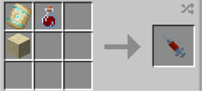

# Sand-Control

{ width=100 height=100 loading=lazy }

The **"Sand-Control"** is obtained via crafting the Sand-Infused Human DNA syringe and intaking it. This can be crafted by crafting with [Augmented Human DNA](../../items/material/augmented-human-dna.md), Dune Armor Trim and a Sand Block inside a crafting table.

{ width=282 height=127 loading=lazy }

**Stats**:

* Maximum Health: 36
* Maximum Healing / Second: N / A
* Armor Rating: 14
* Armor Toughness: N / A
* Base Attack Damage: 10
* Sprint Speed: 100%
* Flight Speed: 1.5

**Main Abilities**:

* **Slot 1 (Non-Crouch): "Sand Body - Transformation"** - Change your form to that of sand, hardening your skin and increasing your density.
* **Slot 2 (Non-Crouch): "Sand Arm - Blade"** - Shift your arm into a long Blade. This arm weapon variant will let you move the quickest, but deals the least amount of damage at +2.
* **Slot 2 (Non-Crouch): "Sand Arm - Fist"** - Shift your arm into a large Fist. This arm weapon variant deals more damage that the blade at +6, but will make you move slower (Movement is set to 0.8).
* **Slot 2 (Non-Crouch): "Sand Arm - Hammer"** - Shift your arm into a Hammer. This arm weapon variant deals the most damage at +6, but will make you move the slowest (Movement is set to 0.5).
* **Slot 2 (Crouch): "Change Arm Weapon"** - Toggle between the different arm weapons you available to use.
* **Slot 3 (Non-Crouch): "Density Control"** - By adjusting the density of your entire body, you can slip through the cracks of some blocks that are made of sand.
* **Slot 4 (Non-Crouch): "Size Control"** - By melding with sand or red sand in your mainhand, you can increase your size and strength at the cost of your movement speed. Crouch use this ability to get to normal size. Gained stats at maximum sizes are;
  * **Strength: +16**
  * **Armor: +16**

**Related Information**:

* When coming into contact with any water source, this power will have a physical appearance change and become much slower.
* While on fire, this power will have a physical appearance change into glass and be unable to move until no longer on fire.
* This power is _loosely_ based off of [William Baker, a.k.a Sandman](https://marvel.fandom.com/wiki/William_Baker_\(Earth-616\)).
