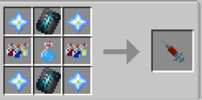

# Sentry

{ width="100" height="100" loading=lazy }

The **"Golden Sentry"** is obtained via using Golden Sentry DNA. This can be crafted with crafting x4 [Cosmic Particles](../../../items/cosmic-particle.md), [Super Soldier Serum](../../../items/super-soldier-serum.md), x2 [Assorted Chemicals](../../../items/assorted-chemicals.md) and x2 Silence Armor Trim Template inside a Crafting Table.

{ width=259 height=128 loading=lazy }

**Stats**:

* Maximum Health: 32
* Maximum Healing / Second: 2 HP / 3 Seconds
* Armor Rating: 14
* Armor Toughness: 6
* Base Attack Damage: 16
* Sprint Speed: 130%
* Flight Speed: 2.5

**Main Abilities**:

* **Slot 1 (Non-Crouch): "Thunder Clap"** - Using your strength to clap through the air, sending a shockwave out at your target and dealing Sound damage.
* **Slot 1 (Crouch): "Power Punch"** - Using your strength leap towards your target and deliver a powerful attack that scales in damage with your attack damage.
* **Slot 1 (Item in hand / Non-Crouch): "Molecularkinesis"** - allows the user to convert any iron or gold tool into another iron or gold tool. It can change ani iron or gold ingot, ore or raw metal into any tool as well. It can also transform a tool back into a single ingot or diamond.
* **Slot 1 (Item in hand / Crouch): "Molecularkinesis - Choose Shape"** - allows the user to decide the shape the material they are shaping will take.
* **Slot 2 (Non-Crouch): "Golden Light Teleportation"** - Teleport yourself up to 10 blocks in the direction you are looking in a flash of golden light. Any targets within 5 blocks of you will gain blindness for 3 seconds.
* **Slot 3 (Non-Crouch): "Photokinetic Shield"** - Use your Photokinetic energy to create a sphere-like construct around you to halt incoming damage for up to 10 seconds.
* **Slot 4 (Non-Crouch): "Photokinetic Beam"** - Generate a large amount of condensed Photokinetic energy in your hands to shoot it at your target for 12 damage, setting them on fire, but not smelting blocks.
* **Slot 5 (Non-Crouch): "Photokinetic Flash Strike"** - Explode a massive build up of energy to everything block of your target to devastate them with an immense amount of energy dealing 30 damage to everything within a 5 block radius around you. This ability has a 1 minute cooldown.

**Related Information**:

* This power **cannot use** any [Secondary Powers](../../secondary-powers/index.md) or any [Arc Reactor](../../../items/technology/arc-reactors/index.md) higher than the [Model I Reactor](../../../items/technology/arc-reactors/model-i.md) once the ability named, "**The Void**" is purchased.
* This power has the following _passives_;
  * **Night Vision**
  * **Fall Damage Immunity**
  * **Fire Damage Immunity**
  * **Lava Damage Immunity**
  * **Explosion Damage Immunity**
  * **Arrow Immunity**
  * **TACZ Bullet Immunity Compatibility**
* This power can breath in space using the Ad Astra Mod.
* This power is loosely based off of, [Robert Reynolds, a.k.a Sentry](https://marvel.fandom.com/wiki/Robert_Reynolds_\(Earth-616\)).
