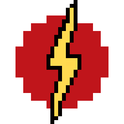
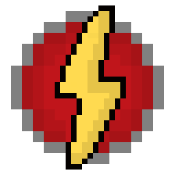
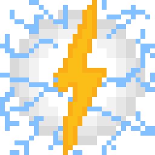
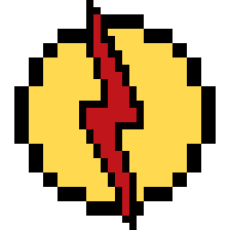
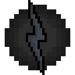
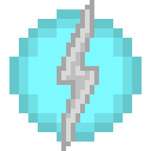

# Speedforce

{ width=86 height=86 loading=lazy }{ width=85 height=85 loading=lazy }{ width=90 height=90 loading=lazy }{ width=90 height=90 loading=lazy }{ width=97 height=97 loading=lazy }{ width="93" height="93" loading=lazy }{ width="90" height="90" loading=lazy }

This page lists the different, obtainable, Speedsters who have a connection to one of the different types of Speedforce. Each can be obtained through a weighted, random chance when being struck by lightning while having the required effect from intaking the assorted chemicals item(Except God of Speed variant).

- [Speedforce (God of Speed)](speedforce-god-of-speed.md)
- [Speedforce (Avatar)](speedforce-avatar.md)
- [Speedforce (Strength)](speedforce-strength.md)
- [Speedforce (Speed)](speedforce-speed.md)
- [Negative Speedforce (Avatar)](speedforce-negative-avatar.md)
- [Negative Speedforce (Leech)](speedforce-leech.md)
- [Tachyon Force](speedforce-tachyon.md)
