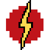

# Speedforce (Avatar)

{ width=100 height=100 loading=lazy }

The **"Speedforce (Avatar)"** is obtained via a random chance when using "Assorted Chemicals" and getting struck by lightning.

**Stats**:

* Maximum Health: 44
* Maximum Healing / Second: 4 HP / 2 Seconds
* Armor Rating: 3
* Armor Toughness: N/A
* Base Attack Damage: 3 (8 at max speed)
* Sprint Speed: 1750%

**Main Abilities**:

* **Slot 1 (Non-Crouch): "Speedforce Enable Speed"** - Press to activate your speed. When active, you can hold this button and scroll to increase/decrease your speed. Crouch when enabled to rapidly increase your speed
* **Slot 1 (Crouch): "Speedforce Disable Speed"** - Crouch for turning off your speed.
* **Slot 2 (Non-Crouch): "High Speed Punches"** - Punch as quick as you can at your target, this attack will scale to your damage output.
* **Slot 2 (Crouch): "High Speed Arm Rotation"** - This ability will allow you to rotate your arms rapidly when crouching to either knock targets back or slow your decent. Also this ability will put out flames.
* **Slot 3 (Non-Crouch): "Vibrational Phasing"** - When moving at at least 20% vibrate your molecules fast enough to phase through solid objects for up to 10 seconds. This ability has upgrades whic allows you to phase at least 20%/ 10% speed up to 10/20/30 seconds.
* **Slot 4 (Non-Crouch): "Throw Lightning"** - By moving at least 20% speed, you are fast enough to throw the lightning that normally trails behind you. This ability does 12 damage and applies shock II for 5 second. This ability is upgradable to usable at 10% speed and then at any speed.
* **Slot 5 (Non-Crouch): "Speedforce Dimensional Travel"** - Move fast enough the enter the Speedforce Dimesion to begin absorbing energy. Must be running and at a speed level of 100% or higher to enter, and must stay running to remain there. Running in this dimension for 5 minutes continuously will earn you 1 Speedforce Token.

**Related Information:**

* When you have enough tokens you can buy the last ability for transforming this power into the [God of Speed ](speedforce-god-of-speed.md)Variant.
* This power can run on water after unlocking the Water Running ability at minimum 30% Speed/ 20% Speed/ 10% Speed.
* This power can run on up walls or run back down after unlocking the Wall running ability. This ability can toggle on/off at power menu.
* You can change your Lightning trail with color slider in the power menu.
* This powers damage output will increase depending on your speed level.
