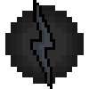

# Negative Speedforce (Leech)

{ width=100 height=100 loading=lazy }

The **"Speedforce (Leech)"** is obtained via a random chance when using "Assorted Chemicals" and getting struck by lightning.

**Stats**:

* Maximum Health: 44
* Maximum Healing / Second: 2 HP / 2 Seconds
* Armor Rating: 3
* Armor Toughness: N / A
* Base Attack Damage: 3
* Sprint Speed: 100% (1350% Movement Speed)
* Flight Speed: N / A

**Main Abilities**:

* **Slot 1 (Non-Crouch): "Speedforce Enable Speed"** - Press to activate your speed. When active, you can hold this button and scroll to increase/decrease your speed. Crouch when enabled to rapidly increase your speed
* **Slot 1 (Crouch): "Speedforce Disable Speed"** - Crouch for turning off your speed.
* **Slot 2 (Non-Crouch): "Vibrate Hand"** - Vibrate your mainhand to deal damage to anything you touch, this attack will scale to your damage output.
* **Slot 3 (Non-Crouch): "Vibrational Phasing"** - When moving at at least 20% vibrate your molecules fast enough to phase through solid objects for up to 10 seconds. This ability has an upgrade whic allows you to phase at least 20% speed up to 20 seconds and when phasing you will harm anything that you come into contact.
* **Slot 4 (Non-Crouch): "Channel Lightning"** - By moving at least 20% speed, you are fast enough to channel the lightning that normally trails behind you. This ability does 8 damage and applies shock II for 5 second. This ability is upgradable to usable at 10% speed and then at any speed.
* **Slot 5 (Non-Crouch): "Steal Speed"** - Steal the speed of target you are looking at within 2 blocks of you.
* **Slot 5 (Crouch): "Give Speed**" - You can give speed to other players for 5 minutes at the cost of 3 of your speed points.

**Related Information:**

* This power can run on water after unlocking the Water Running ability at minimum 30% Speed/ 20% Speed/ 10% Speed.
* This power can run on up walls or run back down after unlocking the Wall running ability. This ability can toggle on/off at power menu.
* You can change your Lightning trail with color slider in the power menu.
* This powers damage output will increase depending on your speed level.
* This power will match your eye color to your primary speed color when speed is active.
