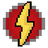

# Speedforce (Strength)

{ width=100 height=100 loading=lazy }

The **"Speedforce (Strength)"** is obtained via a random chance when using "Assorted Chemicals" and getting struck by lightning.

**Stats**:

* Maximum Health: 36
* Maximum Healing / Second: 2 HP / 2 Seconds
* Armor Rating: 6
* Armor Toughness: N / A
* Base Attack Damage: 8 (18 at Max Speed)
* Sprint Speed: 900%
* Flight Speed: N / A

**Main Abilities:**

* **Slot 1 (Non-Crouch): "Speedforce Enable Speed"** - Press to activate your speed. When active, you can hold this button and scroll to increase/decrease your speed. Crouch when enabled to rapidly increase your speed
* **Slot 1 (Crouch): "Speedforce Disable Speed"** - Crouch for turning off your speed.
* **Slot 2 (Non-Crouch): "High Speed Punches"** - Punch as quick as you can at your target, this attack will scale to your damage output.
* **Slot 3 (Non-Crouch): "Vibrational Phasing"** - When moving at at least 30% vibrate your molecules fast enough to phase through solid objects for up to 5 seconds. This ability has upgrades whic allows you to phase at least 20% speed up to 10 seconds. Final upgrade to this ability allows you to damage mobs you contact with while phasing
* **Slot 4 (Non-Crouch): "Lightning Blade"** - Solidify lightning into a living blade in your hand. You must have a empty mainhand to use this. This ability has upgrades which increase the damage of blade and applies shock effect on-hit.
* **Slot 5 (Non-Crouch): "Super Sonic Punch"** - Channel your kinetic energy into a Super Sonic Punch. Must be running and at a speed level of minimum 30% Speed/ 15% Speed/ 5% Speed

**Related Information:**

* This power can run on water after unlocking the Water Running ability at minimum 50% Speed/ 40% Speed/ 30% Speed.
* This power can run on up walls or run back down after unlocking the Wall running ability. This ability can toggle on/off at power menu.
* You can change your Lightning trail with color slider in the power menu.
* This powers damage output will increase depending on your speed level.
