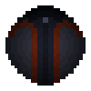

# Translucent

{ width="100" height="100" loading=lazy }

The **"Translucent"** is obtained through random chance by using the item "[**Compound V**](../../../items/compound-v.md)".

**Stats:**

* Maximum Health: 38
* Maximum Healing/Second: N / A
* Armor Rating: 16
* Armor Toughness: 6
* Base Attack Damage: 8
* Sprint Speed: 170%
* Flight Speed: N / A

**Main Abilities:**

* **Slot 1 (Non-Crouch): "Strength-Based Grab"** - With an empty main / off hand, use your strength to pick up an entity and hold them in front of you.
* **Slot 2 (Non-Crouch): "Carbon Skin Invisibility"** - Turn your skin into a carbon material to become invisible. Any **armor** or **toughness** upgrades you unlock will only be applied **while invisible**.

**Relevant information:**

* The invisibility is not true invisibility so your shadow and armor can still be seen.
* You can decrease / increase your Sprint Speed with the correct keybinds. Default settings are Down Arrow / Up Arrow. Crouch using will get your percentage to maximum or minimum.
* This power has the following _passives_ while Invisible;
  * **Fire Damage Immunity**
  * **Explosion Damage Immunity**
  * **Arrow Immunity**
  * **TACZ Bullet Immunity Compatibility**
* This power is based off of [Translucent](https://the-boys.fandom.com/wiki/Translucent).
