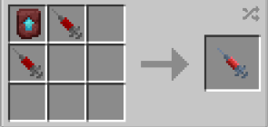

# Brute

{ width="100" height="100" loading=lazy }

The **"Viltrumite - Brute"** variant is obtained Viltrumite (Brute) DNA. This can crafted with crafting x2 Viltrumite DNA (Warrior) (This is different from Viltrumite Warrior Syringe, this warrior syringe needs to be crafted in a smithing template), and a Netherite Template inside a crafting table.

{ width=284 height=134 loading=lazy }

**Stats**:

* Maximum Health: 34
* Maximum Healing / Second: 1 HP / 2 Seconds
* Armor Rating: 18
* Armor Toughness: 10
* Base Attack Damage: 14
* Sprint Speed: 475%
* Flight Speed: 1.25

**Main Abilities**:

* **Slot 1 (Crouch): "Defensive Combat Abilities"** - Open the ability wheel to change what active ability you have for your first slot. Selected abilities are used with non-crouch. The Abilities for the first slots are:
  * **"Strength-based Grab"** - With an empty main / offhand, use your strength to pick up an entity and hold them in front of you. Right click while holding an entity to hit them with a powerful knockback punch
  * **"Block"** - Block incoming damage for a short while.
  * **"Skull Breaking Headbutt"** - Using your strength to smash your target with your head, dealing damage and disorienting them, temporarily. This ability scales with your damage output
* **Slot 2 (Non-Crouch): "Brutal smackdown"** - Raise your arm to strike your target with a brutal hit that deals heavy knockback. This ability scales with your damage output + a Strength III modifier.
* **Slot 3 (Non-Crouch): "Brutal Hand Stab"** - Grab a target right in front of you. While held, right-click to stab them through with your arm. This attack will deal initial damage then additional damage for 2 seconds. This attack will go through armor and deal true damage.

**Related Information**:

* This power **cannot use** any [Secondary Powers](../../secondary-powers/index.md).
* This power **cannot use** any [Arc Reactor](../../../items/technology/arc-reactors/index.md) higher than the [Model I Reactor](../../../items/technology/arc-reactors/model-i.md).
* **The older you are, the longer you can hold your breath when under water / in space (with Ad Astra mod).**
* This power will make your height taller.
* This power has a weakness to the **Sound Poisoning** status effect and **Scourge Virus**.
* You can decrease / increase your Sprint Speed and Flight Speed percentage with the correct keybinds. Default settings are Down Arrow / Up Arrow. Crouch using will get your percentage to maximum or minimum.
  * **When at 100% flight speed you will launch on the ground with creating an explosion around you** and will **destroy any blocks that will come in your way** while flying. For turning off the **destructive flight**, you just need to fly at not 100% flight speed.
* Max Age: **1000 days**
* This power will gain immunites by getting older
  * **Freezing Immunity** from age 21
  * **Lightning Immunity** from age 51
  * **Fire Immunity** from age 75
  * **Explosion Immunity** from age 101
    * You will have following passive immunites from start;
      * **Fall Damage Immunity**
      * **Arrow Immunity**
      * **TACZ Bullet Immunity Compatibility**
* This power gains various stats based on the amount of Minecraft days passed without dying (stats additions below are based on **Max Age**):
  * **Max Damage**: +25
  * **Max Armor**: +25
  * **Max Health:** +34
* This power is _loosely_ based off of [Viltrumite Conquest](https://imagecomics.fandom.com/wiki/Conquest).
