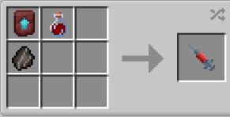

# Human Hybrid

{ width="100" height="100" loading=lazy }

The **"Viltrumite - Human-Hybrid"** is obtained Viltrumite (Human-Hybrid) DNA. This can crafted with crafting [Viltrumite Fossil](../../../items/artifacts/fossils/viltrumite-fossil.md) , [Augmented Human DNA](../../../items/material/augmented-human-dna.md) a Netherite Smithing Template inside a crafting table.

{ width=219 height=111 loading=lazy }

**Stats**:

* Maximum Health: 32
* Maximum Healing / Second: 2 HP / 2 Seconds
* Armor Rating: 14
* Armor Toughness: 10
* Base Attack Damage: 13
* Sprint Speed: 800%
* Flight Speed: 1.85

**Main Abilities**:

* **Slot 1 (Crouch): "Defensive Combat Abilities"** - Open the ability wheel to change what active ability you have for your first slot. Selected abilities are used with non-crouch. The Abilities for the first slots are:
  * **"Strength-based Grab"** - With an empty main / offhand, use your strength to pick up an entity and hold them in front of you.
  * **"Momentum Change"** - Use your Viltrumite ability to create your own momentum by moving yourself instantly in whatever direction you're looking.
  * **"Sonic Clap"** - Using your strength, clap your hands together to make a sonic boom that can apply Sound Poisoning to a target hit.
* **Slot 2 (Crouch): "Offensive Combat Abilities"** - Open the ability wheel to change what active ability you have for your second slot. Selected abilities are used with non-crouch. The Abilities for the second slots are:
  * **"High Speed Punch Barrage"** - Punch as quick as you can at your target. This ability will scale with your damage output + a Strength III modifier.
  * **"Knockback Kick"** - Kick the target close to you with a strong attack that sends them backwards.
  * **"High Speed Rotation"** - When not moving, spin in place, knocking back entities around you and doing small damage to them as you do. If used while fast flying, you will allow you to activate your Destructive Flight at any point above 50% flight speed.
* **Slot 3 (Non-Crouch): "Viltrumite Hybrid's Rage"** - Enter a state of rage for 30 seconds with an increase to your Strength +10 and Speed while your vision shakes. This ability has a long cooldown, and you will gain weakness and slowness for a bit after your rage ends.

**Related Information**:

* This power **cannot use** any [Secondary Powers](../../secondary-powers/index.md).
* This power **cannot use** any [Arc Reactor](../../../items/technology/arc-reactors/index.md) higher than the [Model I Reactor](../../../items/technology/arc-reactors/model-i.md).
* **The older you are, the longer you can hold your breath when under water / in space (with Ad Astra mod).**
* This power has a weakness to the **Sound Poisoning** status effect and **Scourge Virus**.
* You can decrease / increase your Sprint Speed and Flight Speed with the correct keybinds. Default settings are Down Arrow / Up Arrow. Crouch using will get your percentage to maximum or minimum.
  * **When at 100% flight speed you will launch on the ground with creating an explosion around you** and will **destroy any blocks that will come in your way** while flying. For turning off the **destructive flight**, you just need to fly at not 100% flight speed.
* Max Age: **500 days**
* This power will gain immunites by getting older
  * **Freezing Immunity** from age 21
  * **Lightning Immunity** from age 51
  * **Fire Immunity** from age 75
  * **Explosion Immunity** from age 101
    * You will have following passive immunites from start
      * **Fall Damage Immunity**
      * **Arrow Immunity**
      * **TACZ Bullet Immunity Compatibility**
* This power gains various stats based on the amount of Minecraft days passed without dying (stats additions below are based on Max Age):
  * **Max Damage**: + 12.5
  * **Max Armor**: +12.5
  * **Max Health:** +17.5
* This power is _loosely_ based off of [Mark Grayson, a.k.a Invincible](https://imagecomics.fandom.com/wiki/Invincible_\(Mark_Grayson\)).
