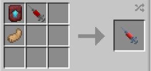

# Scout

{ width="100" height="100" loading=lazy }

The **"Viltrumite - Scout"** variant is obtained via using a Viltrumite (Scout) DNA. This can crafted with crafting Viltrumite DNA (Warrior) (This is different from Viltrumite Warrior Syringe, this warrior syringe needs to be crafted in a smithing template), Netherite Template and a Rabbit's Foot inside a crafting table.

{ width=248 height=116 loading=lazy }

**Stats**:

* Maximum Health: 36
* Maximum Healing / Second: 2 HP / 3 Seconds
* Armor Rating: 10
* Armor Toughness: 4
* Base Attack Damage: 9
* Sprint Speed: 1000%
* Flight Speed: 2.05

**Main Abilities**:

* **Slot 1 (Crouch): "Combat Abilities"** - Open the ability wheel to change what active ability you have for your first slot. Selected abilities are used with non-crouch. The Abilities for the first slots are:
  * **"Strength-based Grab"** - With an empty main / offhand, use your strength to pick up an entity and hold them in front of you.
  * **"Dodge Incoming Damage"** - While looking at an entity, quickly dodge backwards, avoiding incoming damage as you do so. For up to 1 second during the dodge, you will not take damage.
  * **"Dashing Punch"** - Leap in the direction you are looking, delivering a powerful punch along the way. Right-Click at any point during this ability's activation to instantly turn 180 degrees.
* **Slot 2 (Non-Crouch): "Super-Strength Uppercut"** - Punch your target, sending them straight up.
* **Slot 3 (Non-Crouch): "Swift Arm Swipe"** - Swipe your arm through the air to swiftly deal heavy damage that scales with your current output to entities in your immediate path. This ability scales with your damage output.

**Related Information**:

* This power **cannot use** any [Secondary Powers](../../secondary-powers/index.md).
* This power **cannot use** any [Arc Reactor](../../../items/technology/arc-reactors/index.md) higher than the [Model I Reactor](../../../items/technology/arc-reactors/model-i.md).
* **The older you are, the longer you can hold your breath when under water / in space (with Ad Astra mod).**
* This power has a weakness to the **Sound Poisoning** status effect and **Scourge Virus**.
* You can decrease / increase your Sprint Speed and Flight Speed with the correct keybinds. Default settings are Down Arrow / Up Arrow. Crouch using will get your percentage to maximum or minimum.
  * **When at 100% flight speed you will launch on the ground with creating an explosion around you** and will **destroy any blocks that will come in your way** while flying. For turning off the **destructive flight**, you just need to fly at not 100% flight speed.
* **This power has a natural dual wielding.**
* Max Age: **400 days**
* This power will gain immunites by getting older
  * **Freezing Immunity** from age 21
  * **Lightning Immunity** from age 51
  * **Fire Immunity** from age 75
  * **Explosion Immunity** from age 101
    * You will have following passive immunites from start
      * **Fall Damage Immunity**
      * **Arrow Immunity**
      * **TACZ Bullet Immunity Compatibility**
* This power gains various stats based on the amount of Minecraft days passed without dying (stats additions below are based on Max Age):
  * **Max Damage**: + 10
  * **Max Armor**: +10
  * **Max Health:** +14
* This power is _loosely_ based off of [Viltrumite Anissa](https://imagecomics.fandom.com/wiki/Anissa).
