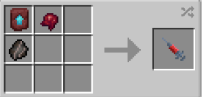

# Thraxan Hybrid

{ width="100" height="100" loading=lazy }

The **"Viltrumite - Thraxan-Hybrid"** is obtained Viltrumite (Thraxan-Hybrid) DNA. This can crafted with crafting [Viltrumite Fossil](../../../items/artifacts/fossils/viltrumite-fossil.md), Fermented Spider Eye and a Netherite Smithing Template inside a crafting table.

{ width=275 height=133 loading=lazy }

**Stats**:

* Maximum Health: 32
* Maximum Healing / Second: 2 HP / 2 Seconds
* Armor Rating: 12
* Armor Toughness: 4
* Base Attack Damage: 11
* Sprint Speed: 550%
* Flight Speed: 1.25

**Main Abilities**:

* **Slot 1 (Crouch): "Combat Abilities"** - Open the ability wheel to change what active ability you have for your first slot. Selected abilities are used with non-crouch. The Abilities for the first slots are:
  * **"Strength-Based Grab"** - With an empty main / offhand, use your strength to pick up an entity and hold them in front of you.
  * **"Powerhouse Kick"** - Kick the target close to you with a strong attack that sends them up into the air
  * **"Dash Strike"** - Dash in the direction you're looking, delivering a powerful strike that can knock them back on the way. This ability scales with your damage output.
* **Slot 2 (Non-Crouch): "Skull Crushing Headbutt"** - Using your strength to Smash your target with your head, dealing damage and disorienting yourself and them, temporarily. This ability scales with your current damage output.
* **Slot 3 (Non-Crouch): "Barrage Blitz"** - Attack your target with a flurry of attacks, then move around behind them to continue your attack. You will continue this pattern every few seconds. This ability scales with your damage output.
* **Slot 3 (Crouch) "Viltrumite Ground Slam"** - When on the ground, smash the ground at your feet, throwing nearby entities away from you and damaging those that are too close. Purchasing this will place it as the crouch-variant of your "Barrage Blitz" ability.

**Related Information**:

* This power **cannot use** any [Secondary Powers](../../secondary-powers/index.md).
* This power **cannot use** any [Arc Reactor](../../../items/technology/arc-reactors/index.md) higher than the [Model I Reactor](../../../items/technology/arc-reactors/model-i.md).
* **The older you are, the longer you can hold your breath when under water / in space (with Ad Astra mod).**
* This power has a weakness to the **Sound Poisoning** status effect and **Scourge Virus**.
* You can decrease / increase your Sprint Speed and Flight Speed with the correct keybinds. Default settings are Down Arrow / Up Arrow. Crouch using will get your percentage to maximum or minimum.
  * **When at 100% flight speed you will launch on the ground with creating an explosion around you** and will **destroy any blocks that will come in your way** while flying. For turning off the **destructive flight**, you just need to fly at not 100% flight speed.
* This power has a forced purple purple tint that will fade as you get older. This texture will gradually fade until (max age) you are back to using your default skin.
* This power has a unique aging system which will increase in the following intervals:
  * From Days 0-75, age up 3x per Minecraft Day
  * From Days 75-125, age up 2x per Minecraft Day
  * From days 125-300, age up 1x per Minecraft Day
* Max Age: **300 days**
* This power will gain immunites by getting older
  * **Freezing Immunity** from age 21
  * **Lightning Immunity** from age 51
  * **Fire Immunity** from age 75
  * **Explosion Immunity** from age 101
    * You will have following passive immunites from start
      * **Fall Damage Immunity**
      * **Arrow Immunity**
      * **TACZ Bullet Immunity Compatibility**
* This power gains various stats based on the amount of Minecraft days passed without dying (stats additions below are based on **Max Age)**:
  * **Max Damage**: + 7.5
  * **Max Armor**: +7.5
  * **Max Health:** +12
* This power is _loosely_ based off of [Oliver Grayson,a.k.a Kid Omni-Man](https://imagecomics.fandom.com/wiki/Oliver_Grayson_II).
