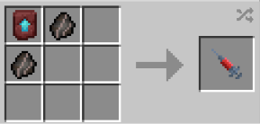

# Warrior

{ width="100" height="100" loading=lazy }

The **"Viltrumite - Warrior"** is obtained via using a Viltrumite (Warrior) DNA. This can crafted with crafting x2 [Viltrumite Fossil](../../../items/artifacts/fossils/viltrumite-fossil.md) and a Netherite Smithing Template inside a crafting table.

{ width=267 height=127 loading=lazy }

**Stats**:

* Maximum Health: 40
* Maximum Healing / Second: 2 HP / 2 Seconds
* Armor Rating: 16
* Armor Toughness: 8
* Base Attack Damage: 13
* Sprint Speed: 800%
* Flight Speed: 1.85

**Main Abilities**:

* **Slot 1 (Crouch): "Combat Abilities"** - Open the ability wheel to change what active ability you have for your first slot. Selected abilities are used with non-crouch. The Abilities for the first slots are:
  * **"Strength-based Grab"** - With an empty main / offhand, use your strength to pick up an entity and hold them in front of you.
  * **"Block"** - Block incoming damage for a short while.
  * **"Super Air Punch"** - Using your strength to punch through the air, with an empty mainhand, creating a powerful impact that can destroy blocks. This ability scales with your strength.
* **Slot 2 (Non-Crouch): "High Speed Punch Barrage"** - Punch as quick as you can at your target. This ability will scale with your damage output + a Strength III modifier.
* **Slot 3 (when in the air): "Super Powered Leaping Punch"** - Using your ability to create leverage anywhere, leap towards your target while not on the ground and deliver a powerful strike for heavy damage with a heavy knockback. This attack scales with your max damage output.
* **Slot 3 (Non-Crouch): "Super Ground Punch"** - Using your strength to punch the ground below you causing a non-destructive explosion on the ground at your feet. This will knock entities away and deal AOE damage base on how close they are to you.
* **Slot 3 (Crouch): "Explosive Leap"** - Crouch, then leap off the ground in the direction you are looking with enough force to explode the ground beneath your feet. This ability will cause a destructive explosion when used.
* **Slot 4 (Non-Crouch): "Swift Arm Swipe"** - Swipe your arm through the air to swiftly deal heavy damage that scales with your current output to entities in your immediate path. This ability scales with your damage output.

**Related Information**:

* This power **cannot use** any [Secondary Powers](../../secondary-powers/index.md).
* This power **cannot use** any [Arc Reactor](../../../items/technology/arc-reactors/index.md) higher than the [Model I Reactor](../../../items/technology/arc-reactors/model-i.md).
* **The older you are, the longer you can hold your breath when under water / in space (with Ad Astra mod).**
* This power has a weakness to the **Sound Poisoning** status effect and **Scourge Virus**.
* You can decrease / increase your Sprint Speed and Flight Speed with the correct keybinds. Default settings are Down Arrow / Up Arrow. Crouch using will get your percentage to maximum or minimum.
  * **When at 100% flight speed you will launch on the ground with creating an explosion around you** and will **destroy any blocks that will come in your way** while flying. For turning off the **destructive flight**, you just need to fly at not 100% flight speed.
* Max Age: **700 days**
* This power will gain immunites by getting older
  * **Freezing Immunity** from age 21
  * **Lightning Immunity** from age 51
  * **Fire Immunity** from age 75
  * **Explosion Immunity** from age 101
    * You will have following passive immunites from start
      * **Fall Damage Immunity**
      * **Arrow Immunity**
      * **TACZ Bullet Immunity Compatibility**
* This power gains various stats based on the amount of Minecraft days passed without dying (stats additions below are based on **Max Age**):
  * **Max Damage**: + 17.5
  * **Max Armor**: +17.5
  * **Max Health:** +24
* This power is _loosely_ based off of [Nolan Grayson, a.k.a Omni-Man](https://imagecomics.fandom.com/wiki/Nolan_Grayson) and generic Viltrumite Officer.
