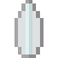

# Cosmic

{ width="100" height="100" loading=lazy }

The **"Power Cosmic"** is obtained via Right-Clicking a Cosmic Silver, an item that has a rare chance of appearing in End City chests.

**Stats**:

* Maximum Health: +8
* Maximum Healing / Second: 2 HP / 2 Seconds
* Armor Rating: +10
* Armor Toughness: +2
* Base Attack Damage: +8
* Sprint Speed: +50%
* Flight Speed: +1.25

**Main Abilities**:

* **Slot 1 (Non-Crouch): "Cosmic Awareness"** - Channel the power of the cosmos to sense the life-force of nearby entities up to 30 blocks for 10 seconds with a 30 second cooldown.
* **Slot 2 (Non-Crouch): "Cosmic Telekinesis"** - Using your Cosmic Telekinesis to lift an entity within 5 blocks of you and hold them in front of you.
* **Slot 2 (Crouch): "Short Range Teleportation"** - Using your connestion to the Cosmic forces, teleport yourself up to 30 blocks in the direction you are looking.
* **Slot 3 (Non-Crouch): "Cosmic Blast"** - Channel your Cosmic powers into a powerful blast dealing 10 damage per hit.
* **Slot 3 (Crouch): "Mini Black Hole"** - By condensing the Gravity in your hands, fire off a small black hole which deals an initial 15 damage and causes destruction when it makes contact.
* **Slot 4 (Crouch): "Cosmic Dampening"** - Open the ability wheel to change what active ability you have for your fourth slot. Selected abilities are used with non-crouch. The Abilities for the fourth slots are:
  * **"Cosmic Dampening - Technology EMP"** - Channel the power of the cosmos to cause Tech on the person you are looking at in a 5 block range to malfunction for 10 seconds.
  * **"Cosmic Dampening - Speed"** - Channel the power of the cosmos to cause Speed on the person you are looking at in a 5 block range to malfunction for 10 seconds.
  * **"Cosmic Dampening - Red Sun"** - Channel the power of the cosmos to cause Kryptonian DNA on the person you are looking at in a 5 block range to be dampened for 10 seconds.
  * **"Cosmic Dampening - Metaphysical"** - Channel the power of the cosmos to cause Cosmic / Magic users you are looking at in a 5 block range to be dampened for 10 seconds.
  * **"Cosmic Dampening - Genetic"** - Channel the power of the cosmos to cause Genetic-based powers on the person you are looking at in a 5 block range to be dampened for 10 seconds.

**Related Information**:

* This power can breath in space using the Ad Astra Mod.
* When you fly with this power you will have a surfing animations.
* This power forces your skin to silver color.
