# Scarabs

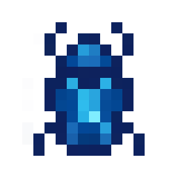{ width="56" height="56" loading=lazy }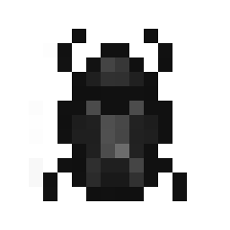{ width="59" height="59" loading=lazy }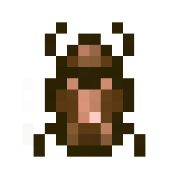{ width="59" height="59" loading=lazy }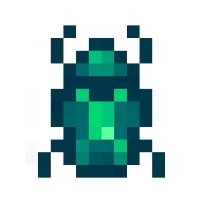{ width="61" height="61" loading=lazy }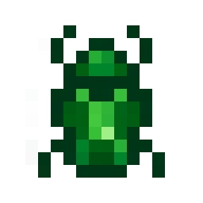{ width="59" height="59" loading=lazy }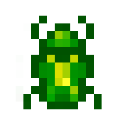{ width="60" height="60" loading=lazy }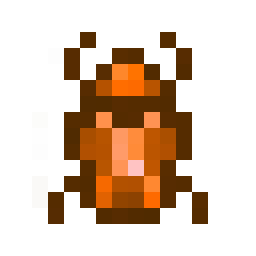{ width="60" height="60" loading=lazy }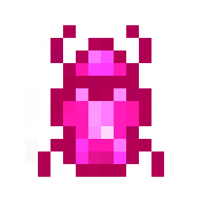{ width="60" height="60" loading=lazy }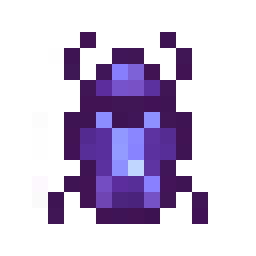{ width="59" height="59" loading=lazy }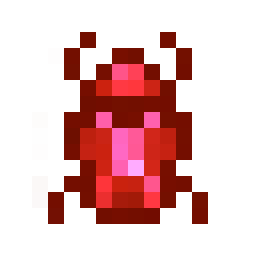{ width="58" height="58" loading=lazy }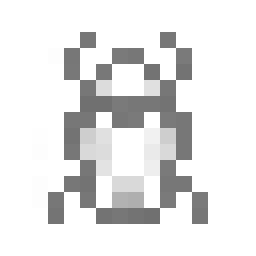{ width="57" height="57" loading=lazy }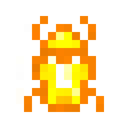{ width="56" height="56" loading=lazy }

The **"Scarab"** is obtained via first crafting an[ Unaugmented Scarab Base](../../items/artifacts/unaugmented-scarab-base.md) by using a Scarab Compass from PantheonSent and one Titanium Circuit with 2 Diamond circuits. Once you have the Unaugmented Scarab Base you then can craft a number of colored working scarabs using Dye and Augmented Human D.N.A. Placing your colored Scarab in a crafting grid can revert it back to an [Unaugmented Scarab Base](../../items/artifacts/unaugmented-scarab-base.md) to be re-dyed later. You can equip the scarab into your **Curios:Back** slot.

**Stats**:

* Maximum Health: +8
* Maximum Healing / Second: N / A
* Armor Rating: +12
* Armor Toughness: +2
* Base Attack Damage: +4
* Sprint Speed: 150%
* Flight Speed: 0.75

**Main Abilities**:

* **Slot 1 (Non-Crouch Not Transformed): "Suit Up"** - This allows you to enable / disable the Scarab suit.
* **Slot 1 (Non-Crouch While Transformed): "Scarab Tool Selection"** - This ability will open a wheel and give you ability to turn your hands into various tools. This tools requires an empty mainhand and offhand to use.
  * **"Scarab Blades" -** Creates blades out of your arms to deal extra damage.
  * **"Scarab Pickaxe" -** Creates a pickaxe to be able to mine up to iron level. You can upgrade your pickaxe to be able to mine up to diamond level and tripling the speed.
  * **"Scarab Sonic-Blasters" -** Creates blasters out of your arms to fire off high frequency sound waves. This ability applies **Sound Poisoning**.
* **Slot 2 (Crouch): "Scarab Energy Selection"** - This ability will open a wheel and give you ability to use your turn your energy to various things:
  * **"Scarab Energy Wave" -** Create a wave of energy around you which can damage all hit by it within 3x3x3 radius, and cause other technology to malfunction temporarily.
  * **"Scarab Energy Shield" -** Expand your energy to a translucent shield around you to protect yourself from incoming damage.
  * **"Scarab Energy Beams" -** Fire of beams of energy from each of your pincers at your target
* **Slot 3 (Non-Crouch): "Scarab Mode Changer"** - This ability will open a wheel and give you ability to transform your scarab to 3 different modes:
  * **"Scarab Strength Mode" -** Reconfigure your scarab into a Strength form, granting an increase to your **strength by +6, armor by +8 and your toughness by +4 at the cost of your speed(Slowness 4).** You will not be able to fly, use your 2nd ability bar slot abilities or your blasters while in Strength Mode.
    * **Slot 4 (Non-Crouch Strength Mode): "Explosive Leap" -** Use your brute strength to leap to high places while creating a explosion behind you.
    * **Slot 5 (Non-Crouch Strength Mode): "Grab and Throw" -** Grab an entity for up to 5 seconds (full recharge is the same) and launching them in the direction you are looking at.
  * **"Scarab Speed Mode" -** Reconfigure your scarab into a Speed form and gain speed based abilities. You will not be able to fly or use your 2nd ability bar slot abilities while in Speed Mode.
    * **Slot 4 (Non-Crouch Speed Mode): "Enable Speed" -** Turn on / off your super speed. This gives +1000% speed.
    * **Slot 5 (Non-Crouch Speed Mode): "Speed Punches"** - Punch as quick as you can at your target, this attack will scale to your damage output.
  * **"Scarab Marine Mode" -** Reconfigure your scarab into a Marine form, granting underwater breath, space breathing, and two water based abilities. You will not be able to use your 2nd ability bar slot abilities while in Marine Mode.
    * **Slot 4 (Non-Crouch Marine Mode): "Water Absorbtion" -** Absorb the water you looking at.
    * **Slot 5 (Non-Crouch Marine Mode): "Water Expulsion" -** Put out the fire around you.

**Related Information**:

* For removing the scarab you need to buy the ability in the middle of the power menu.
* Changing the color of your scarab will not reset your power progress.
* This power has **Night Vision** which will activate under light level 10, when the suit is enabled.
* When you transform while wearing armor your armor will be stored inside the scarab.
* After buying the skill you can utilize your bond with the scarab, allowing you to call upon Khaji Da's wisdom and aid. Say **"Khaji"** in the chat to enable the AI features.
  * **Health Display:** Your scarab will notify you about information regarding your Health Levels.
  * **Adrenaline Based-Healing:** Your scarab's passive ability to turn your saturation levels into health when you get too low, as long as the Scarab's AI is active.
  * **Highlight Entities:** Say **"tag"** into the chat after enabling your AI to display nearby entities.
  * **Scan Target:** Say **"scan"** into the chat after enabling your AI to scan targeted entities current powers.
* This power has multiple different accessory options to allow for in-depth customization of the user's scarab suit.
  * The different accessories can be customized as Helmet, Chestplate, Leggings and Boots.

Following suit customization is for the full combo of suits;

> **Default Suit:**

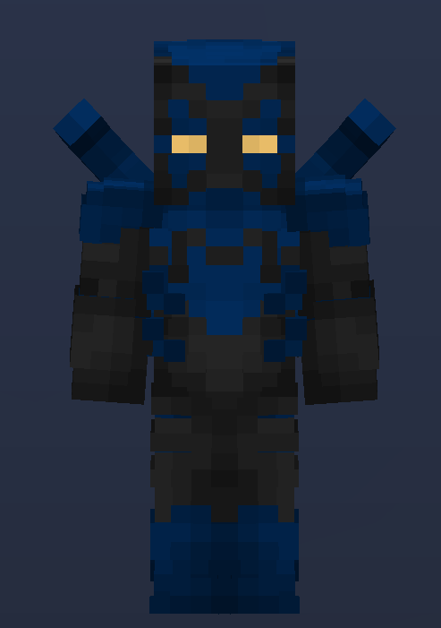{ width="296" height="421" loading=lazy }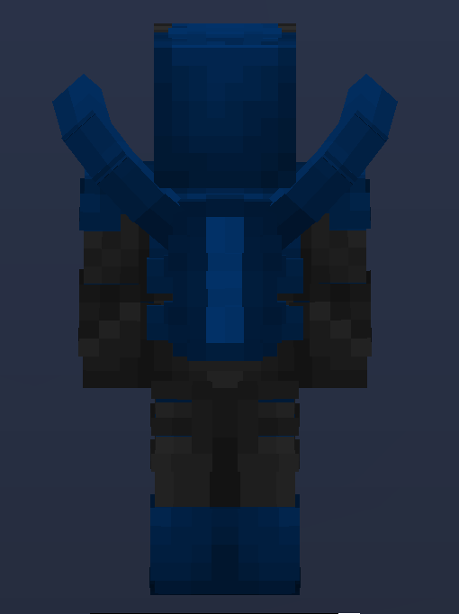{ width="315" height="422" loading=lazy }

> **DCEU SUIT:**

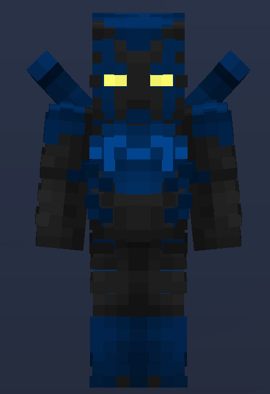{ width="278" height="404" loading=lazy }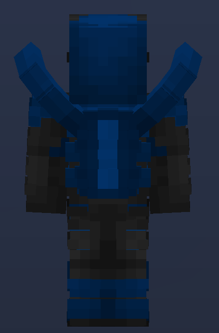{ width="267" height="405" loading=lazy }

> **GAME SHOW DANGER SUIT:**

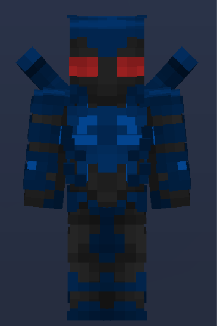{ width="274" height="411" loading=lazy }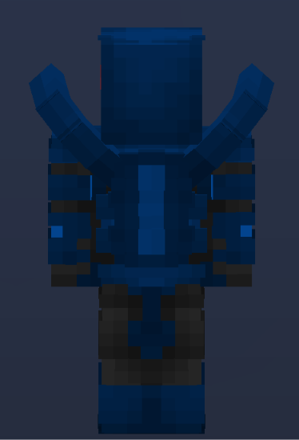{ width="280" height="411" loading=lazy }

> **INFINITE CRISIS SUIT:**

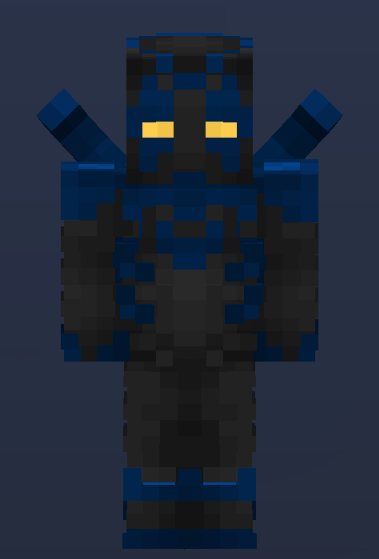{ width="285" height="420" loading=lazy }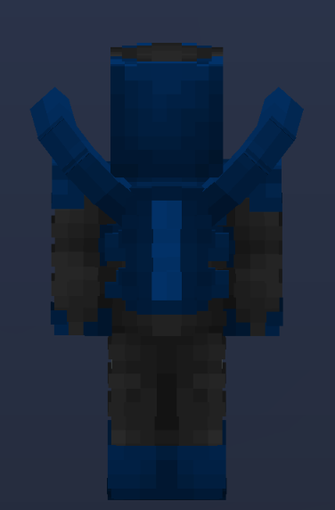{ width="276" height="419" loading=lazy }

> **LEGADO SUIT:**

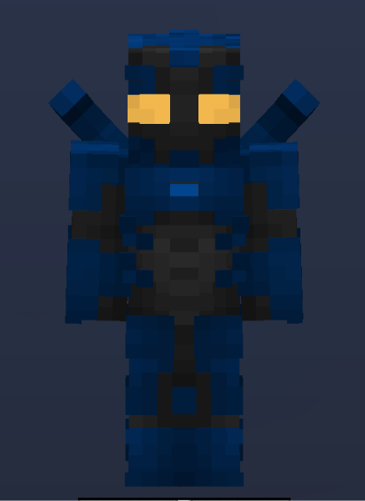{ width="309" height="425" loading=lazy }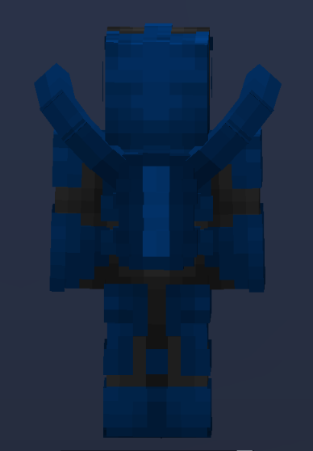{ width="295" height="424" loading=lazy }
