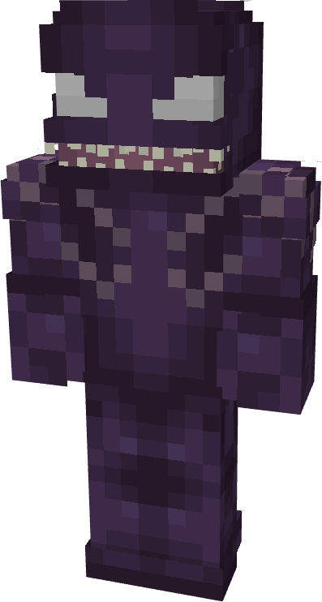
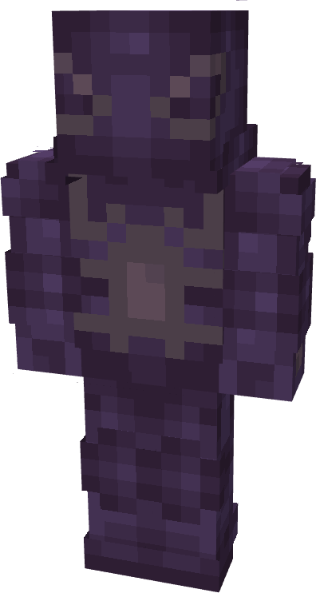
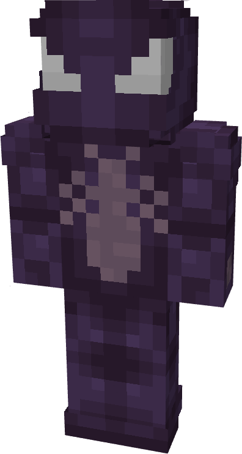
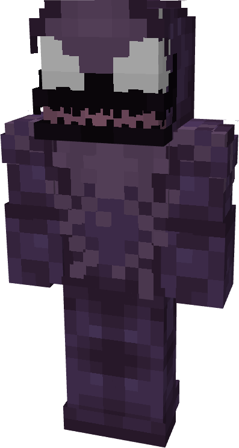
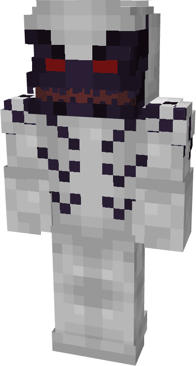
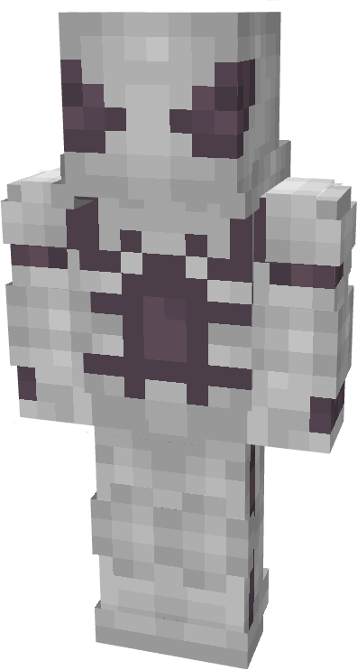
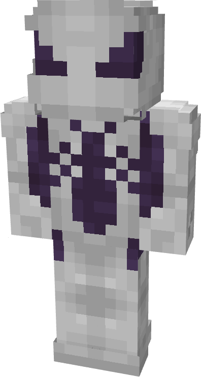
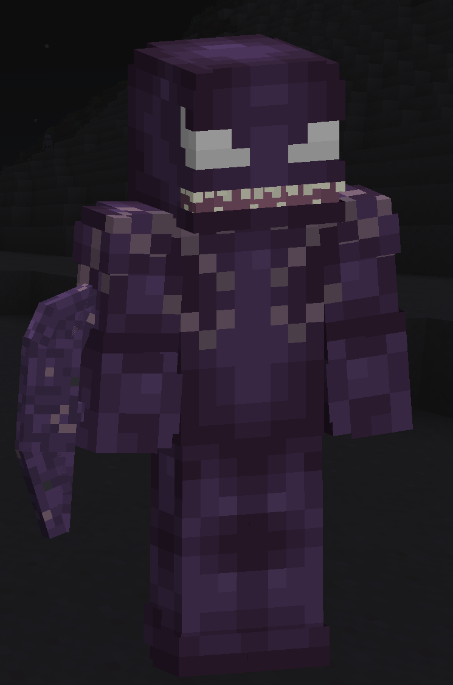

# Agony

| { width="72" height="134" loading=lazy } | { width="72" height="134" loading=lazy } | { width="72" height="134" loading=lazy } | { width="72" height="134" loading=lazy } |
|-------------------------------------------------------------------------------------------|-------------------------------------------------------------------------------------------|-------------------------------------------------------------------------------------------|-------------------------------------------------------------------------------------------|
| Base | Agent | Spider | Special |
| { width="72" height="134" loading=lazy } | { width="72" height="134" loading=lazy } | { width="72" height="134" loading=lazy } | N/A |

The “_Agony_” Symbiote is one of the random Symbiotes that can be obtained as a secondary power.

{ width=208 height=314 loading=lazy }

“Agony”’s arm weapon.

This Symbiote has the unique ability:

- (Non-Couch) **Agony Acid Shot**: Shoot a ball of acid at your target dealing 2 damage initially, and giving poison 5 for 5 seconds if an entity if hit, or nausea 10 for 10 seconds in a 3x3x3 radius if a block is hit. This ability has a 3 second cooldown.

Related Information:

- N/A
