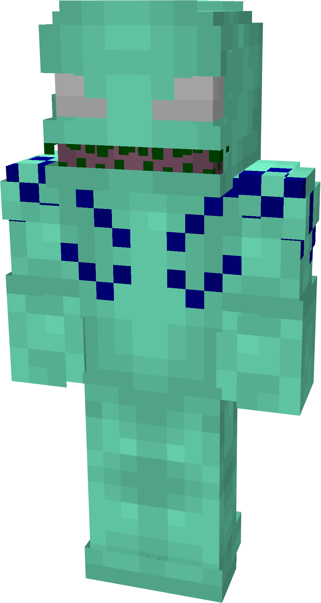
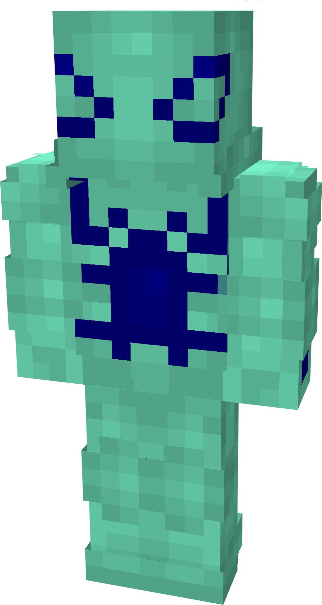
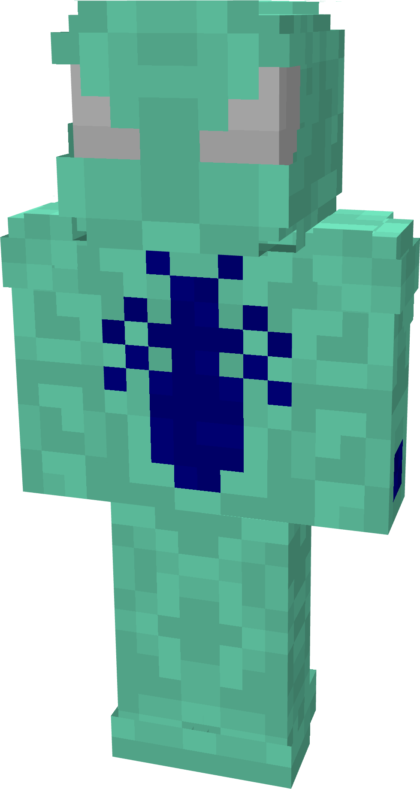
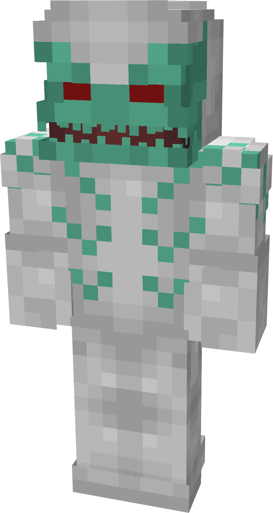
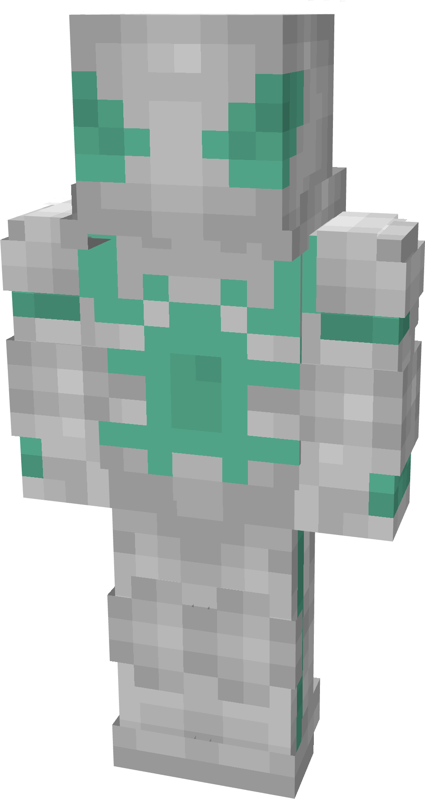
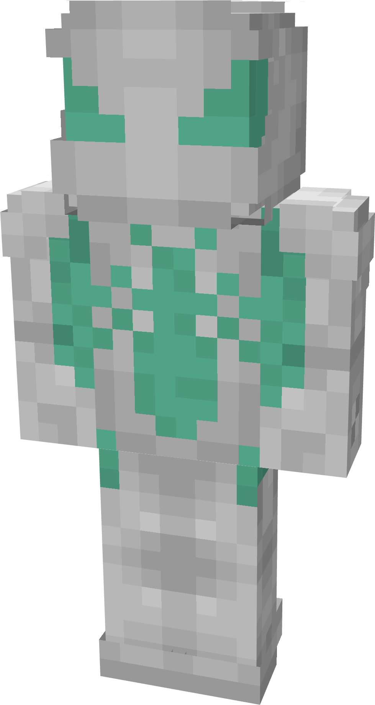

# Aquamarine

| { width="119" height="223" loading=lazy } | { width="119" height="223" loading=lazy } | { width="118" height="221" loading=lazy } | N/A |
|--------------------------------------------------------------------------------------------|--------------------------------------------------------------------------------------------|--------------------------------------------------------------------------------------------|-----|
| Base | Agent | Spider | Special |
| { width="118" height="220" loading=lazy } | { width="118" height="221" loading=lazy } | { width="117" height="220" loading=lazy } |  |

The “_Aquamarine_” Symbiote is one of the random Symbiotes that can be obtained as a secondary power.

_Arm Weapon Image_

Aquamarine’s arm weapon.

This Symbiote has the unique ability:

- (Non-Couch) **Aquamarine Aquatic Mode**: This ability can be activated indefinitely and will grow fins to increase swim speed by +2, as well as block-break speed by +3 while under water.

Related Information:

- This symbiote has Natural water breathing
- If used with the [Atlantean - Sea Changed ](../../../main-powers/atlanteans/index.md)variant, when transformed, this symbiote can allow that power to breath on land
