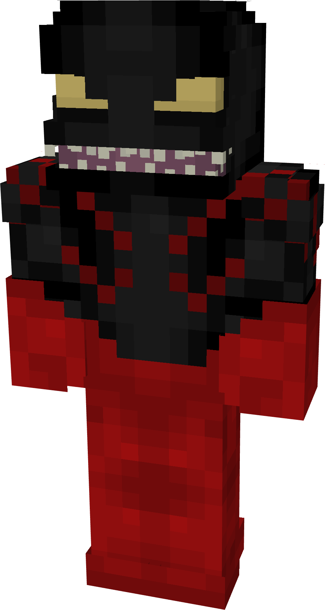
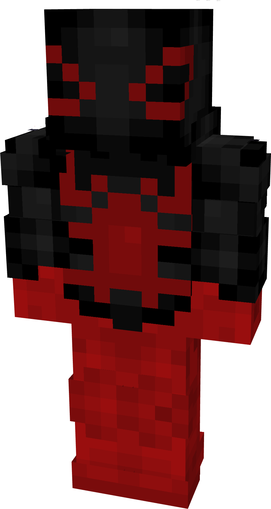
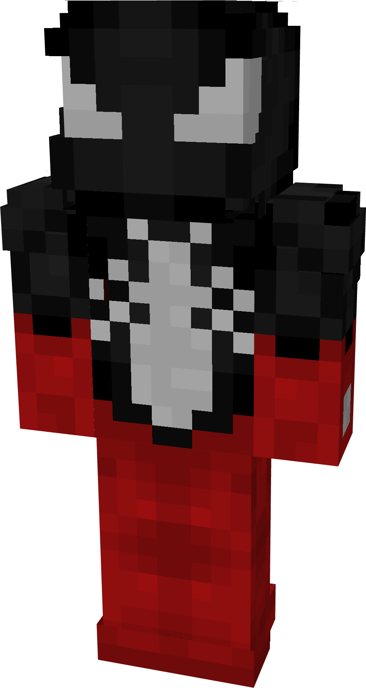
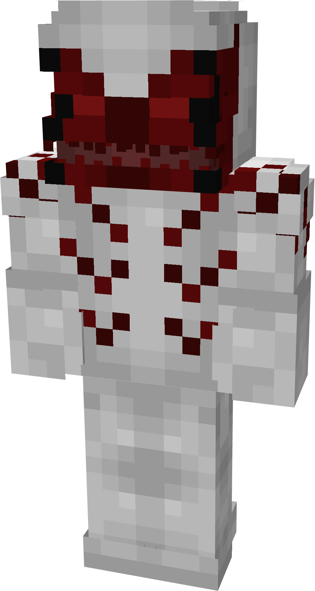
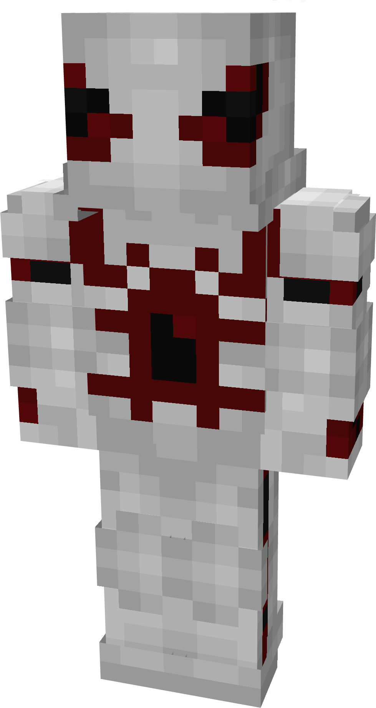
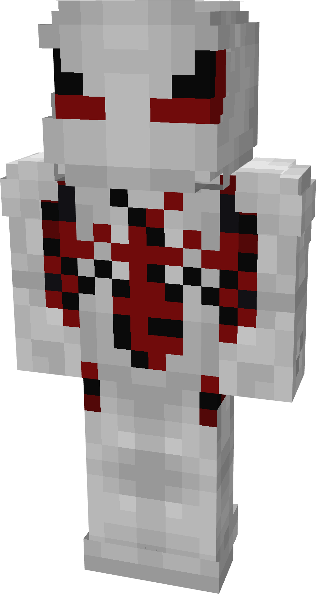

# Authority

| {  loading=lazy } | {  loading=lazy } | {  loading=lazy } | N/A |
|------------------------------------------------------------------|------------------------------------------------------------------|------------------------------------------------------------------|-----|
| Base | Agent | Spider | Special |
| {  loading=lazy } | {  loading=lazy } | {  loading=lazy } | N/A |

The “<em>Authority</em>” Symbiote is one of the random Symbiotes that can be obtained as a secondary power.

_Arm Weapon Image_ “Symbiote’s Name”’s arm weapon.

This Symbiote has the unique ability:

- (Non-Couch) Cosmic Blast: Fire off a beam that deals 6 damage per hit to your target.
