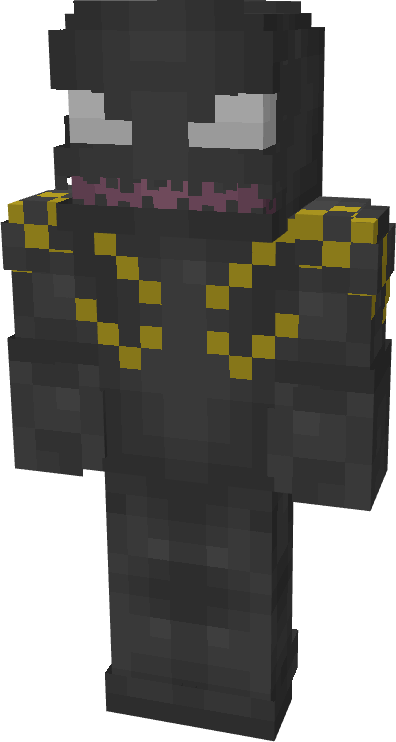
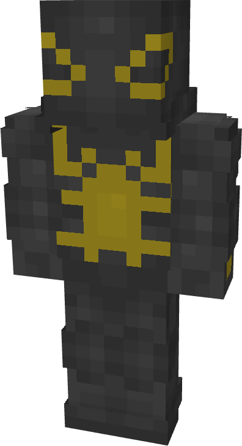
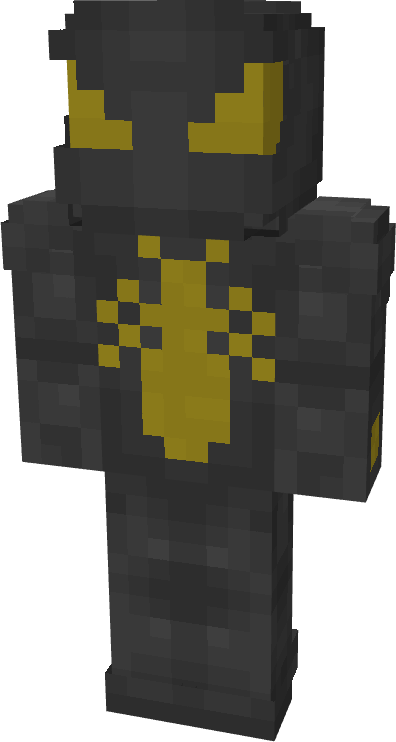
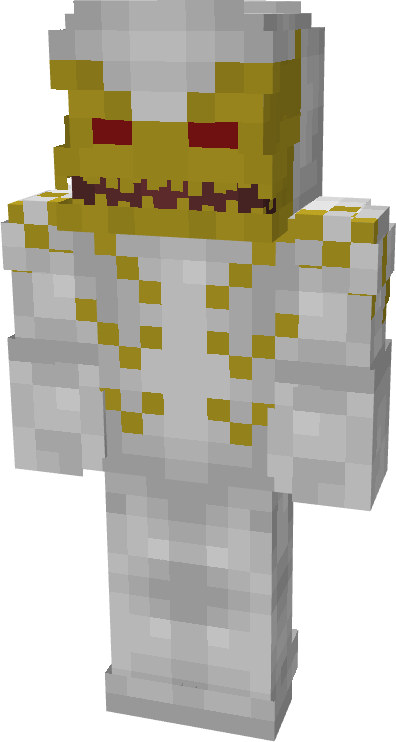
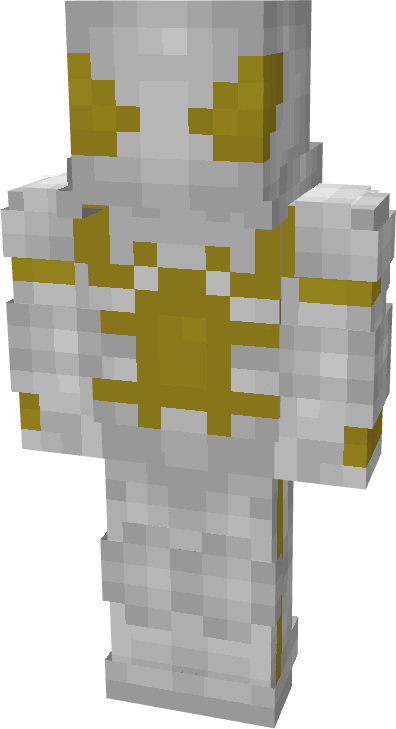
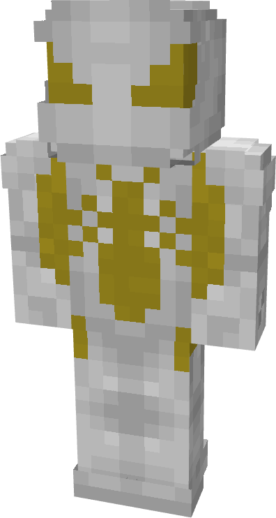

# Blackout

| { width=72 height=134 loading=lazy } | { width=73 height=134 loading=lazy } | { width=73 height=136 loading=lazy } | N/A |
|---------------------------------------------------------------------------------------|---------------------------------------------------------------------------------------|---------------------------------------------------------------------------------------|-----|
| Base | Agent | Spider | Special |
| { width=72 height=134 loading=lazy } | { width=73 height=133 loading=lazy } | { width=73 height=135 loading=lazy } | N/A |

The “<em>Blackout</em>” Symbiote is one of the random Symbiotes that can be obtained as a secondary power.

_Arm Weapon Image_ “Symbiote’s Name”’s arm weapon.

This Symbiote has the unique ability:

- (Non-Couch) Infiltration: Become invisible for up 20 seconds and gain a Speed II effect while invisible.
