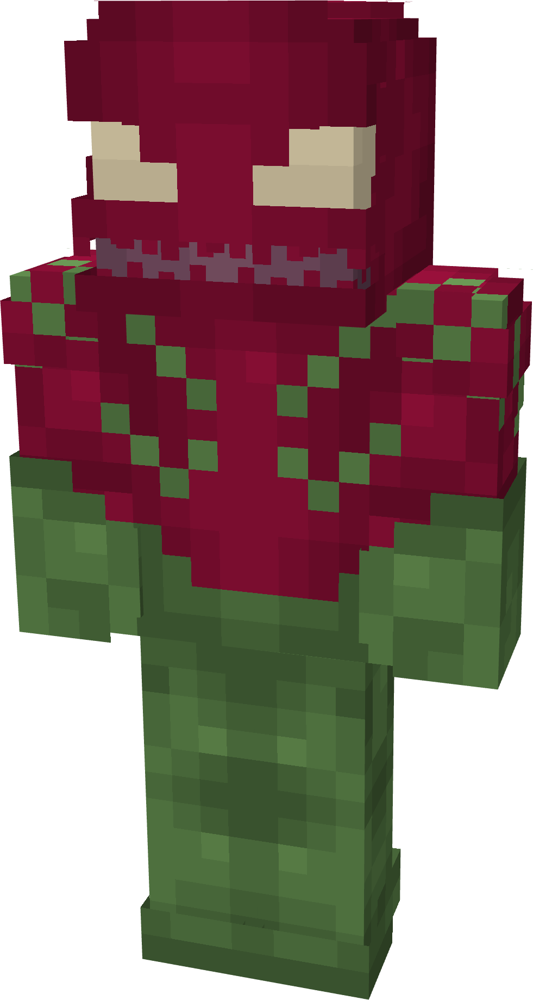
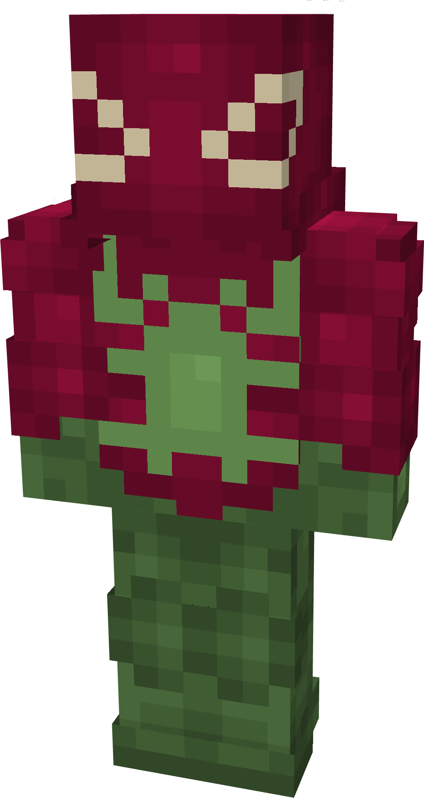
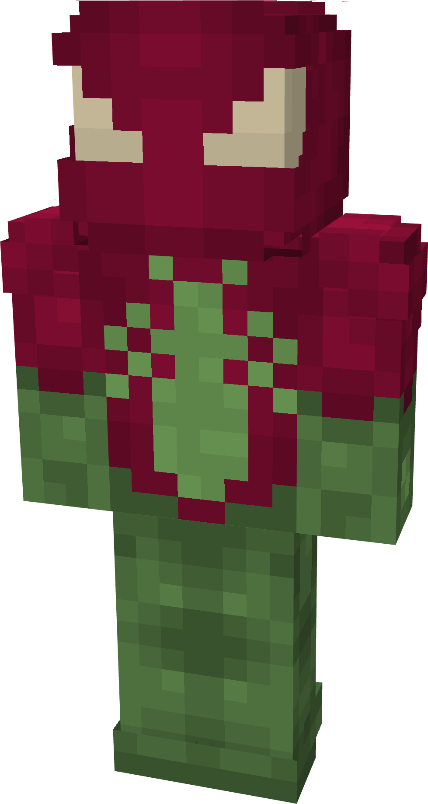
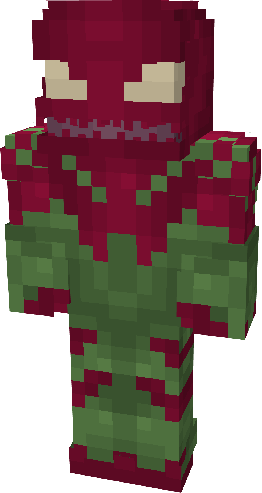
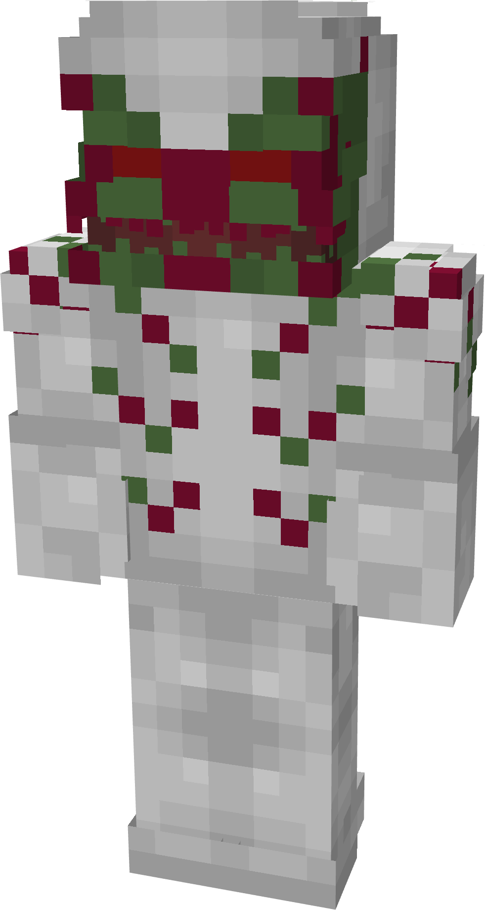
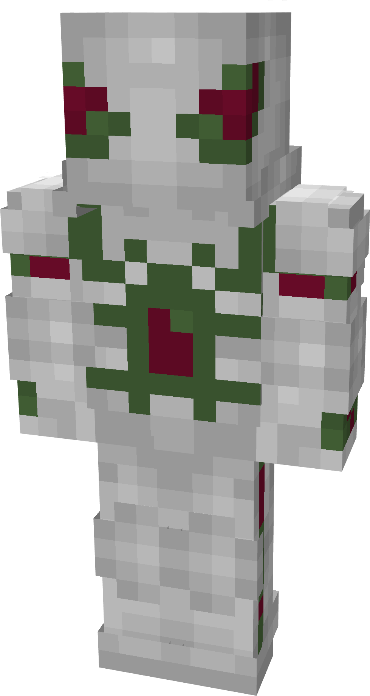
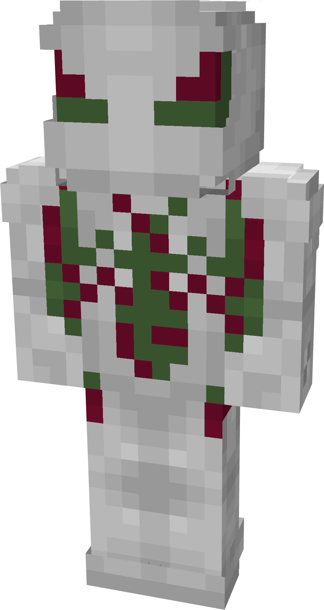
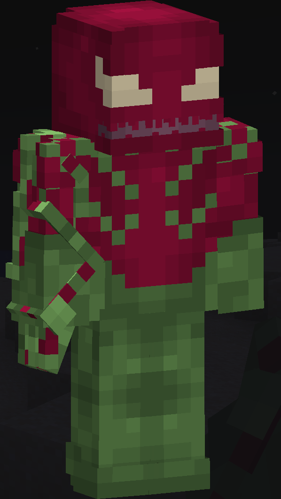

# Bloom

| { width="102" height="191" loading=lazy } | { width="102" height="191" loading=lazy } | { width="102" height="191" loading=lazy } | { width="102" height="190" loading=lazy } |
|--------------------------------------------------------------------------------------------|--------------------------------------------------------------------------------------------|--------------------------------------------------------------------------------------------|--------------------------------------------------------------------------------------------|
| Base | Agent | Spider | Special |
| { width="101" height="189" loading=lazy } | { width="101" height="189" loading=lazy } | { width="101" height="189" loading=lazy } | N/A |

The Bloom Symbiote is one of the random Symbiotes that can be obtained as a secondary power.

{ width=270 height=478 loading=lazy }

Bloom’s arm weapon.

This Symbiote has the unique ability:

- (Non-Couch) **Bloom Spores**: Create a field of spores in a 15x15x15 block radius around the user, granting glowing and slowness for 25 seconds to anything within this range. This ability has a 30 second cooldown.
