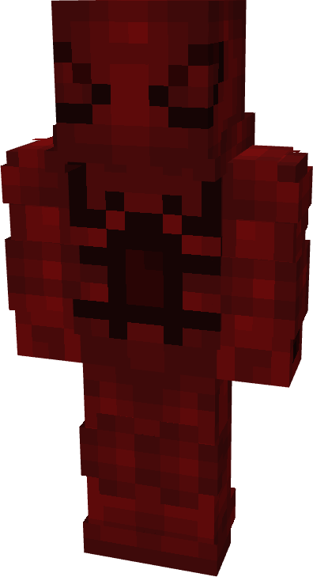
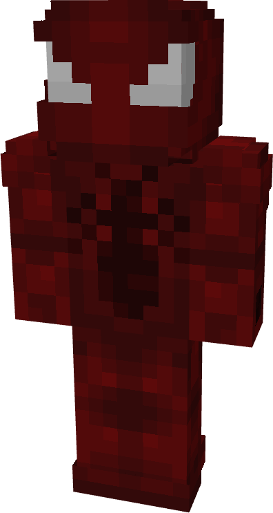
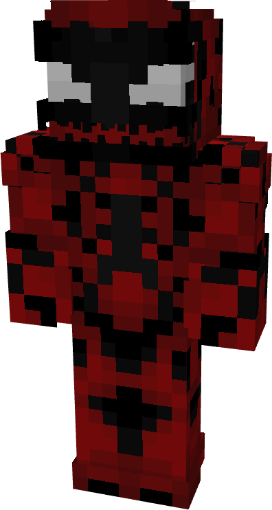
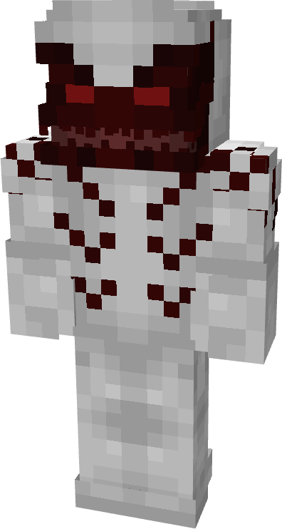
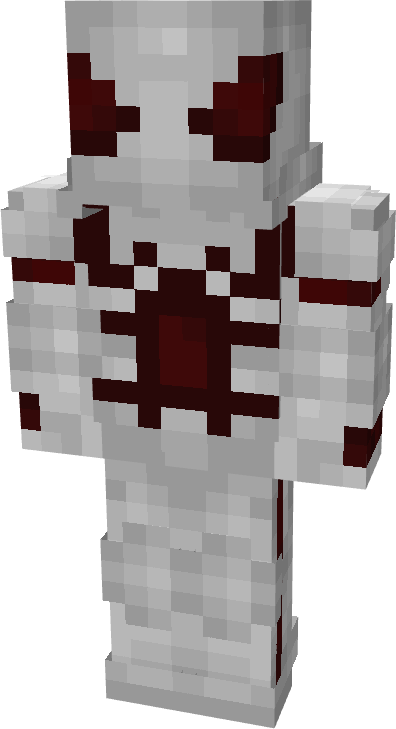

# Carnage

| { width="72" height="134" loading=lazy } | { width="73" height="134" loading=lazy } | { width="72" height="134" loading=lazy } | { width="74" height="138" loading=lazy } |
|-------------------------------------------------------------------------------------------|-------------------------------------------------------------------------------------------|-------------------------------------------------------------------------------------------|-------------------------------------------------------------------------------------------|
| Base | Agent | Spider | Special |
| { width="72" height="134" loading=lazy } | { width="73" height="133" loading=lazy } | { width="72" height="134" loading=lazy } | N/A |

The “_Carnage_” Symbiote is one of the random Symbiotes that can be obtained as a secondary power.

{ width=160 height=288 loading=lazy }

“Carnage”’s arm weapon.

This Symbiote has the unique ability:

- (Non-Crouch) **Carnage Rage Mode**: Grow by 1.5 and transform into a combat-oriented rage mode for up to 30 seconds at a time. While transformed, you gain +6 to your attack damage.

Related Information:

- N/A
