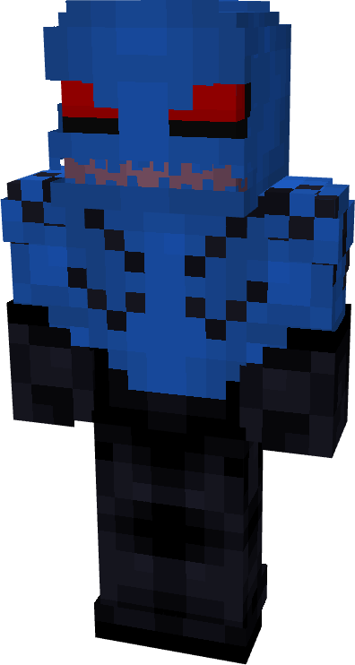
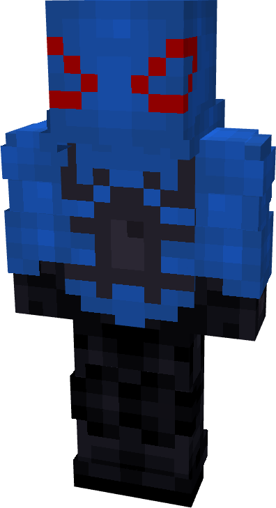
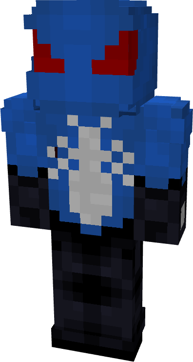
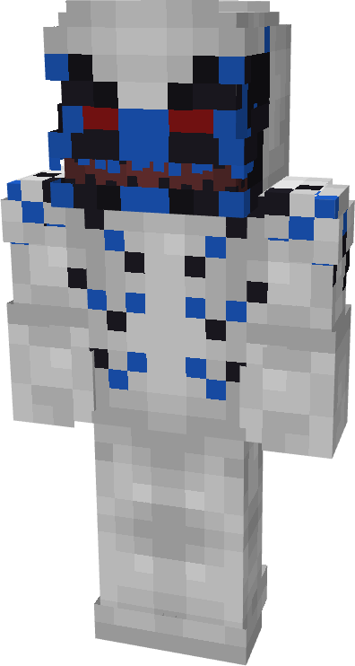
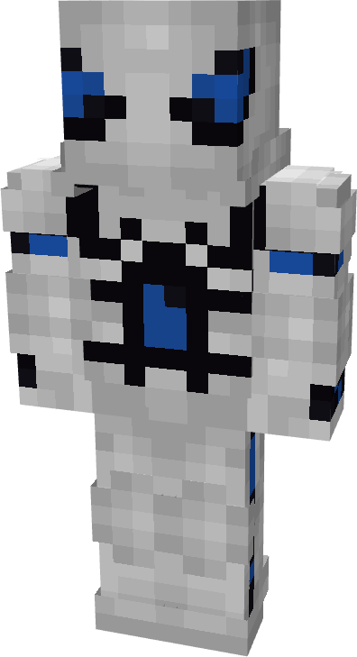
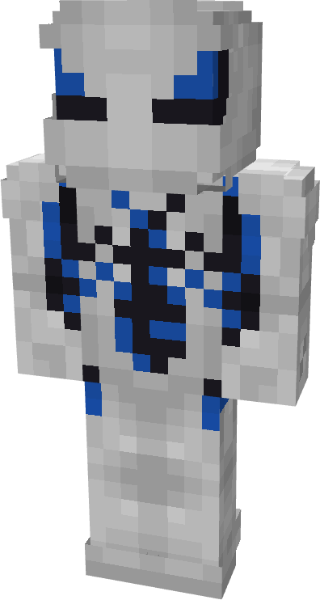
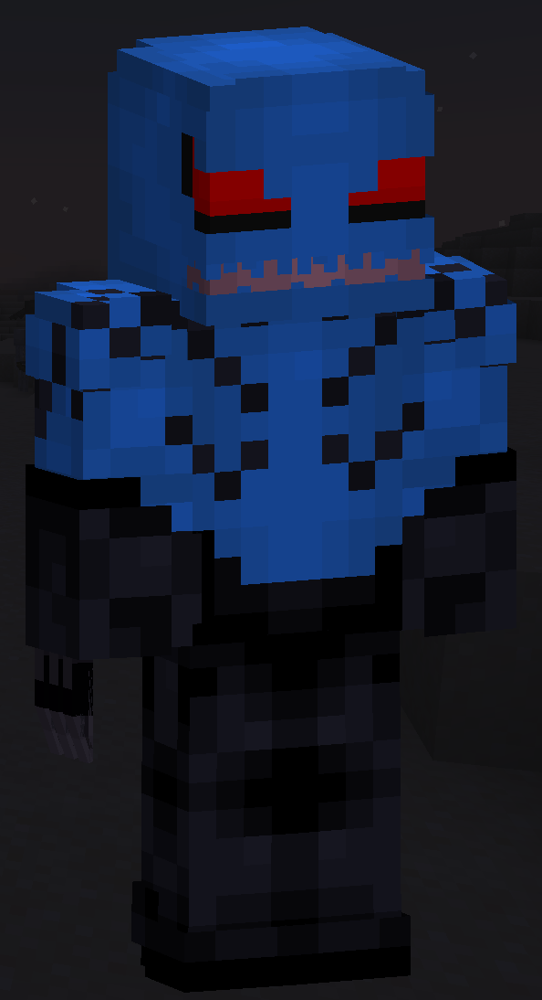

# Curse

| { width="72" height="134" loading=lazy } | { width="73" height="134" loading=lazy } | { width="73" height="136" loading=lazy } | N/A |
|-------------------------------------------------------------------------------------------|-------------------------------------------------------------------------------------------|-------------------------------------------------------------------------------------------|-----|
| Base | Agent | Spider | Special |
| { width="72" height="134" loading=lazy } | { width="73" height="133" loading=lazy } | { width="73" height="135" loading=lazy } | N/A |

The “_Curse_” Symbiote is one of the random Symbiotes that can be obtained as a secondary power.

{ width=208 height=382 loading=lazy }

Curse’s arm weapon.

This Symbiote has the unique ability:

- (Non-Crouch) **Increase Size:** This ability lets the player grow up in size multiple times. The larger they are, the higher the increase to their strength is, but the slower they move.
- (Crouch) **Decrease Size**: This ability lets the player shrink down in size multiple times. The smaller they are, the higher the decrease to their strength is, but the faster they move.

Related Information:

- N/A
