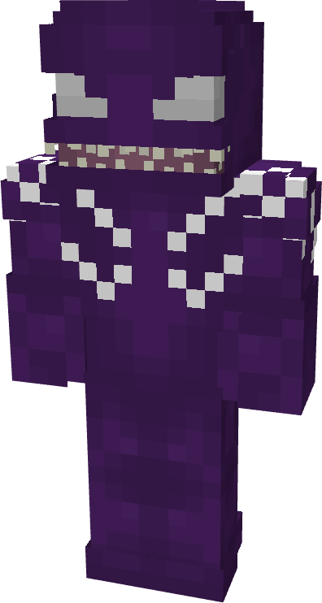
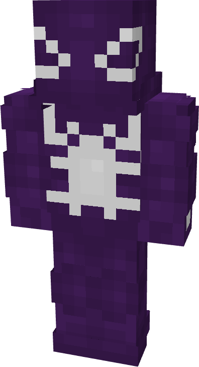
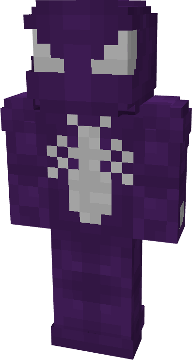
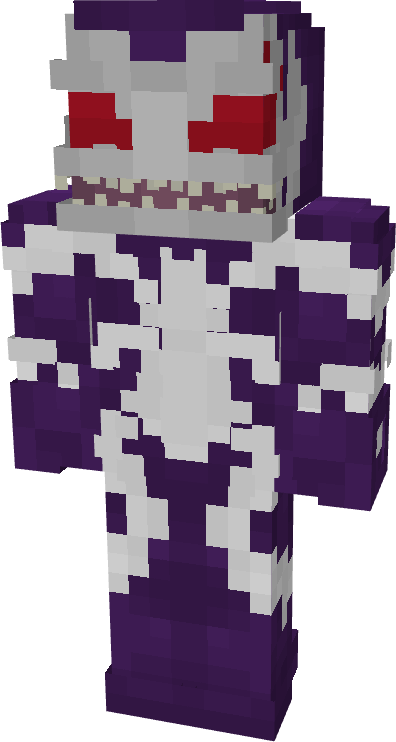
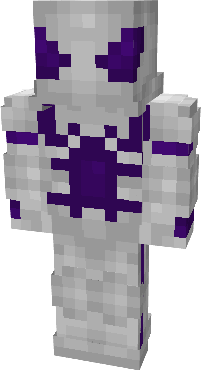
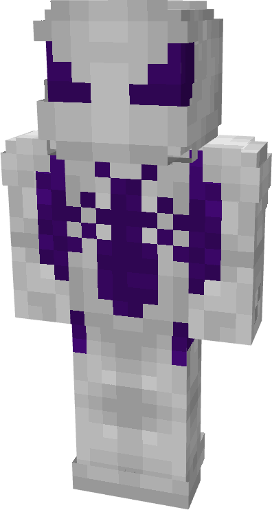

# Death Angel

| { width=72 height=134 loading=lazy } | { width=73 height=134 loading=lazy } | { width=73 height=135 loading=lazy } | { width=73 height=136 loading=lazy } |
|---------------------------------------------------------------------------------------|---------------------------------------------------------------------------------------|---------------------------------------------------------------------------------------|---------------------------------------------------------------------------------------|
| Base | Agent | Spider | Special |
| { width=72 height=133 loading=lazy } | { width=73 height=133 loading=lazy } | { width=73 height=135 loading=lazy } | N/A |

The “Death Angel” Symbiote is one of the random Symbiotes that can be obtained as a secondary power.

_Arm Weapon Image_ “Symbiote’s Name”’s arm weapon.

This Symbiote has the unique ability:

- (Non-Couch) Death Angel Rage Mode: Grow in form for up to 1 minute, gaining an increase to your punch damage (+8) while transforme.
