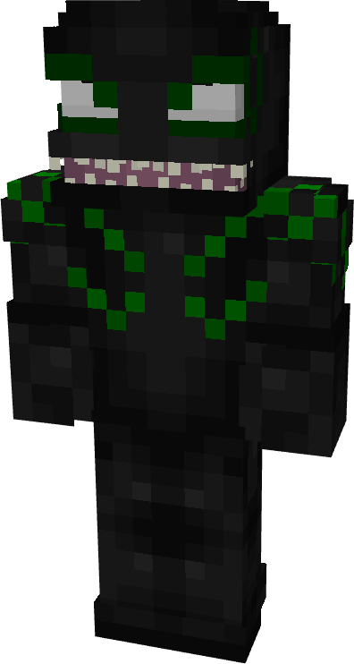
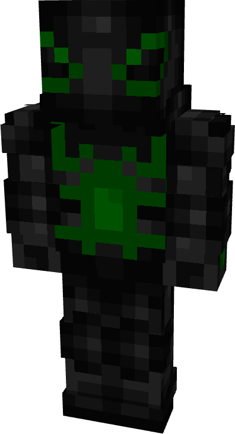
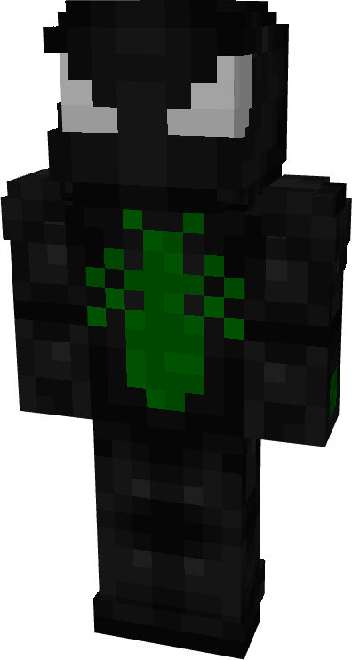
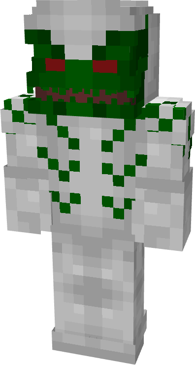
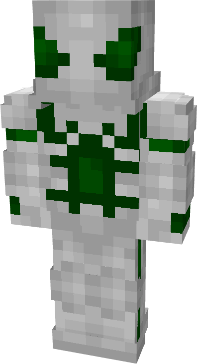
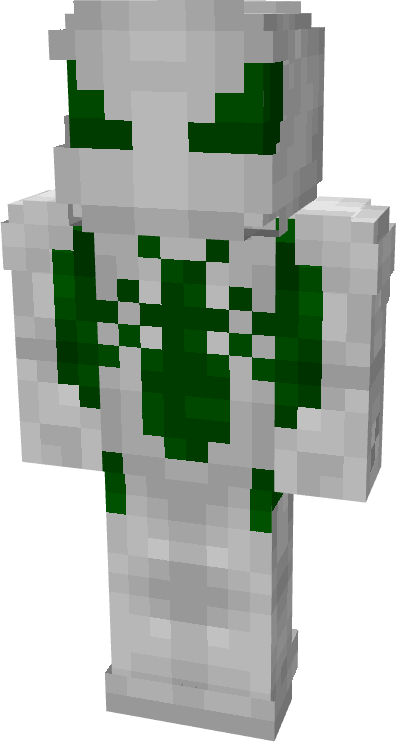
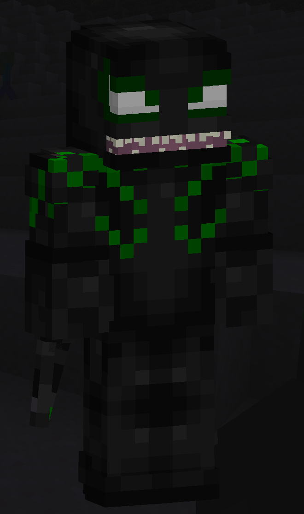

# Fang

| { width="72" height="134" loading=lazy } | { width="73" height="134" loading=lazy } | { width="73" height="136" loading=lazy } | N/A |
|-------------------------------------------------------------------------------------------|-------------------------------------------------------------------------------------------|-------------------------------------------------------------------------------------------|-----|
| Base | Agent | Spider | Special |
| { width="72" height="134" loading=lazy } | { width="73" height="134" loading=lazy } | { width="73" height="136" loading=lazy } | N/A |

The “_Fang_” Symbiote is one of the random Symbiotes that can be obtained as a secondary power.

{ width="210" height="353" loading=lazy }

Fang’s arm weapon.

This Symbiote has the unique ability:

* (Non-Crouch, Non-Gun Mode) Fang Gun Mode - Enable: Enable the use of your right arm entering Gun Mode.
* (Non-Crouch, Gun Mode) Fire: Fire off your gun arm to deal 10 damage on hit with a 3 second cooldown.
* (Crouch, Gun Mode) Fang Gun Mode - Disable: Disable the use of your right arm entering Gun Mode.

Related Information:

- N/A
