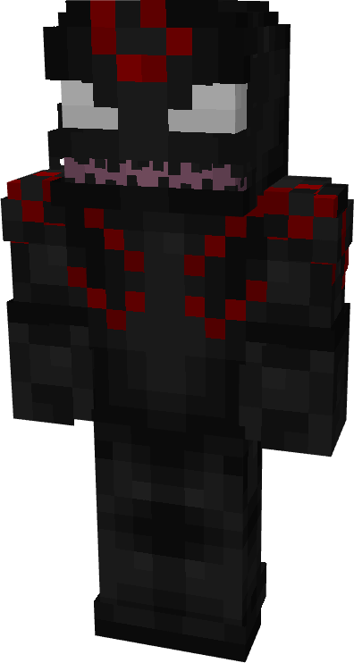
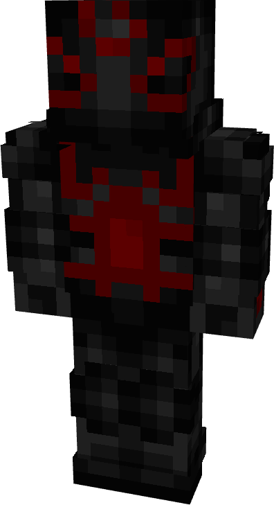
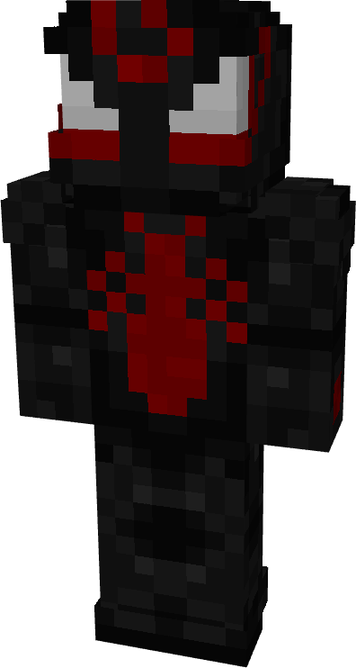
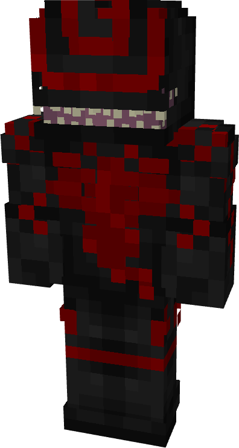
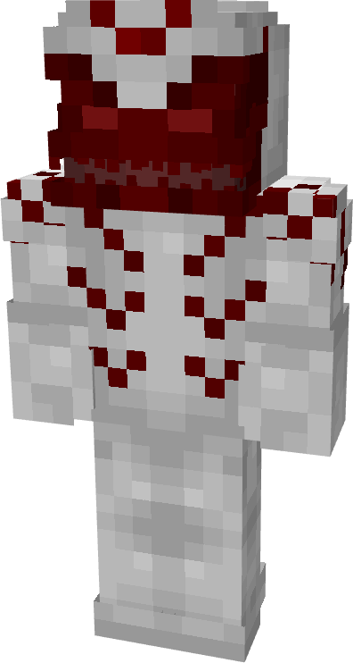
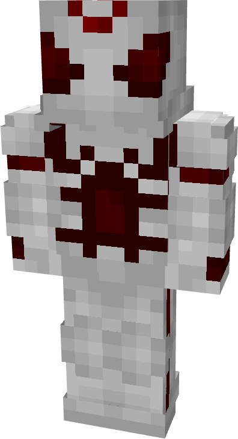
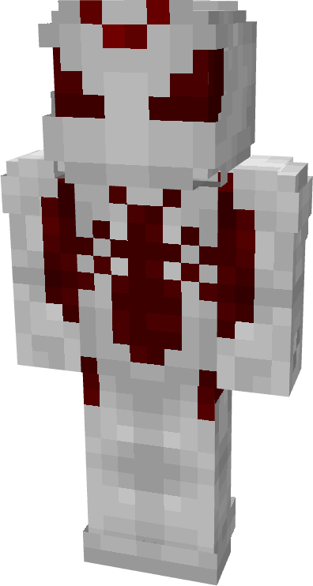
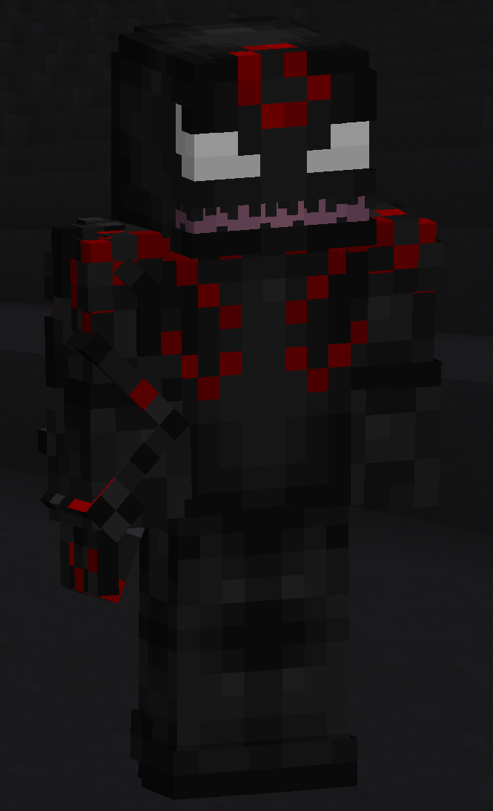

# Grendel

| { width="72" height="134" loading=lazy } | { width="73" height="134" loading=lazy } | { width="73" height="136" loading=lazy } | { width="72" height="134" loading=lazy } |
|-------------------------------------------------------------------------------------------|-------------------------------------------------------------------------------------------|-------------------------------------------------------------------------------------------|-------------------------------------------------------------------------------------------|
| Base | Agent | Spider | Special |
| { width="72" height="134" loading=lazy } | { width="73" height="134" loading=lazy } | { width="73" height="136" loading=lazy } | N/A |

The “_Grendel_” Symbiote is one of the random Symbiotes that can be obtained as a secondary power.

{ width=205 height=336 loading=lazy }

Grendel’s arm weapon.

This Symbiote has the unique ability:

- (Non-Crouch) **Draconic Breath**: Launch a powerful stream of flames from your mouth which can smelt blocks, an set fire to blocks and entities. This attack deals a base of 4 damage per hit, and can be held for a max of 10 seconds at a time.

Related Information:

- N/A
