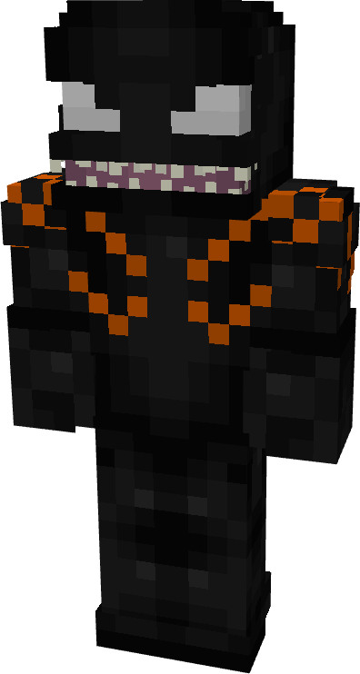
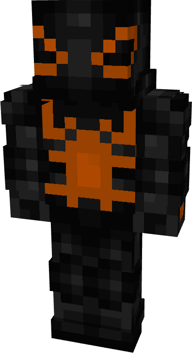
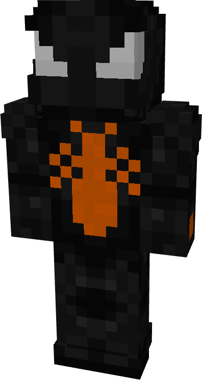
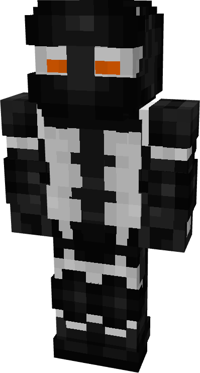
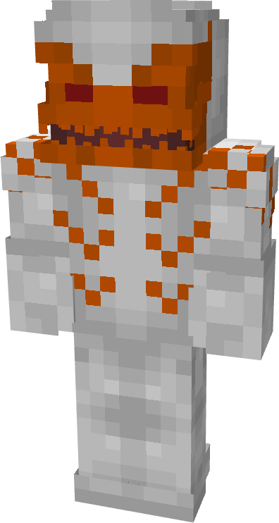
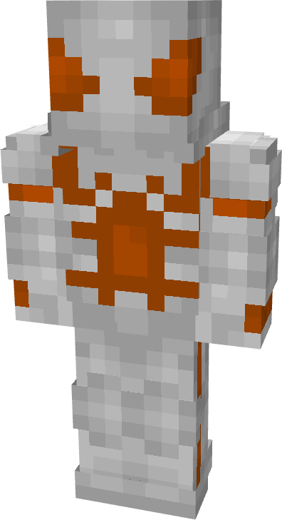
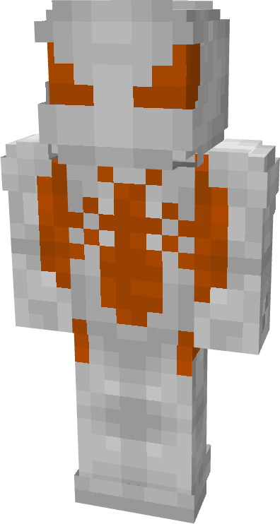
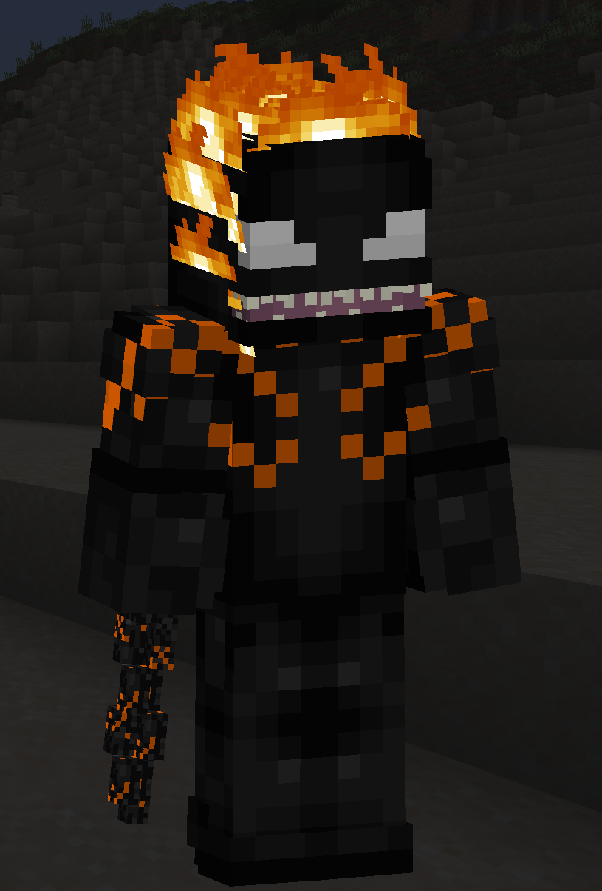

# Host Rider

| { width="72" height="134" loading=lazy } | { width="73" height="133" loading=lazy } | { width="73" height="136" loading=lazy } | { width="73" height="135" loading=lazy } |
|-------------------------------------------------------------------------------------------|-------------------------------------------------------------------------------------------|-------------------------------------------------------------------------------------------|-------------------------------------------------------------------------------------------|
| Base | Agent | Spider | Special |
| { width="72" height="134" loading=lazy } | { width="73" height="133" loading=lazy } | { width="73" height="136" loading=lazy } | N/A |

The “_Host Rider_” Symbiote is one of the random Symbiotes that can be obtained as a secondary power.

{ width="207" height="305" loading=lazy }

Host Rider’s arm weapon.

This Symbiote has the unique ability:

- (Non-Crouch) **Penance Kiss**: Damage the target you are looking at within 10 blocks by 3 damage per second, and grant them slowness for 5 seconds.

Related Information:

- This Symbiote is immune to all forms of fire damage.
  * This also means it won't retract when you are exposed to fire.
