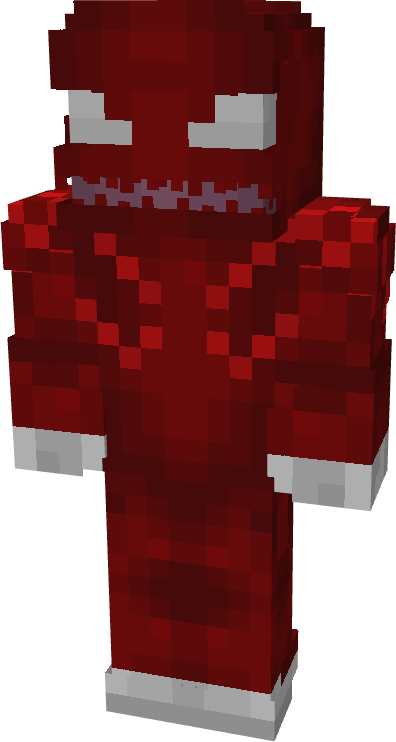
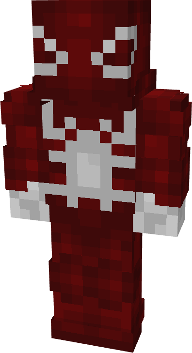
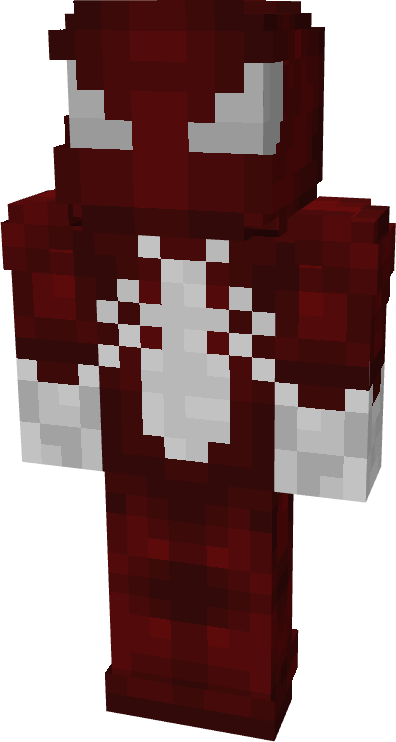
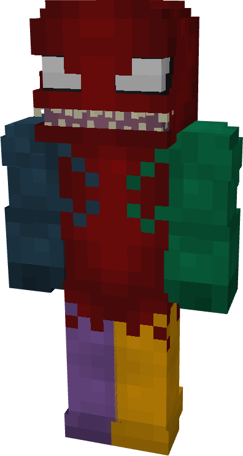
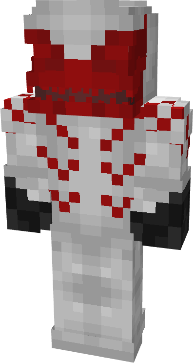
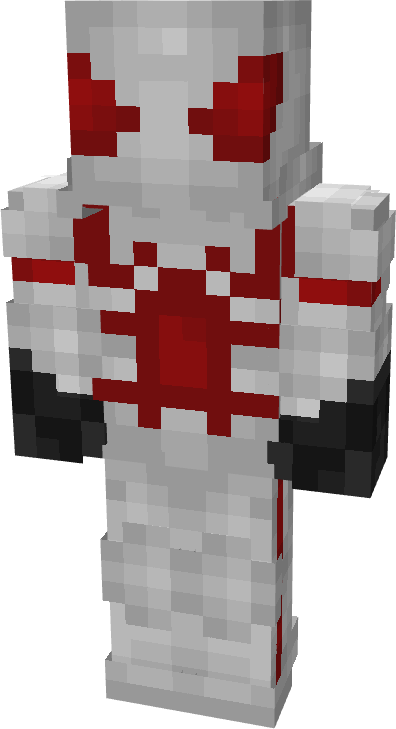
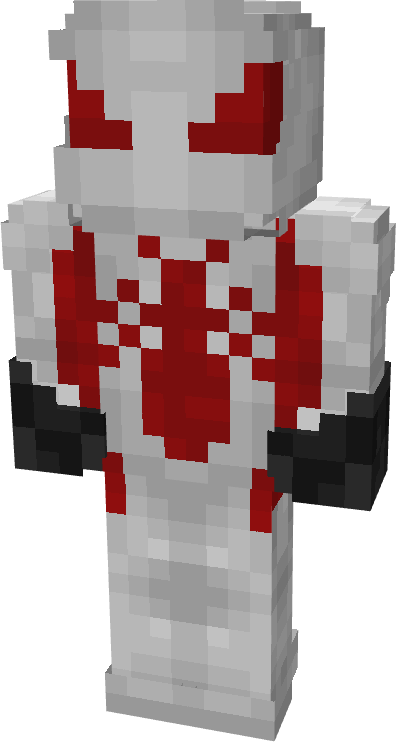
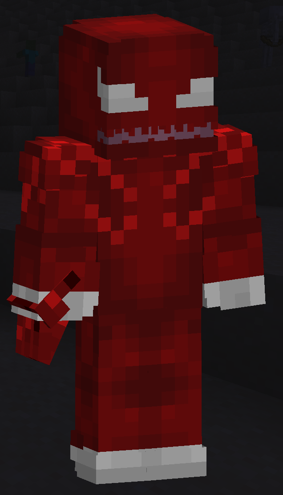

# Hybrid

| { width="71" height="132" loading=lazy } | { width="74" height="136" loading=lazy } | { width="73" height="136" loading=lazy } | { width="73" height="136" loading=lazy } |
|-------------------------------------------------------------------------------------------|-------------------------------------------------------------------------------------------|-------------------------------------------------------------------------------------------|-------------------------------------------------------------------------------------------|
| Base | Agent | Spider | Special |
| { width="71" height="132" loading=lazy } | { width="74" height="135" loading=lazy } | { width="73" height="136" loading=lazy } | N/A |

The “_Hybrid_” Symbiote is one of the random Symbiotes that can be obtained as a secondary power.

{ width=208 height=363 loading=lazy }

Hybrid’s arm weapon.

This Symbiote has the unique ability:

- (Non-Crouch) Symbiote Tendrils: Create an even larger version of your symbiote tendrils to damage everything in a 3x3x3 radius for 10 damage per tick. This ability has a 3 second cooldown.

Related Information:

- N/A
