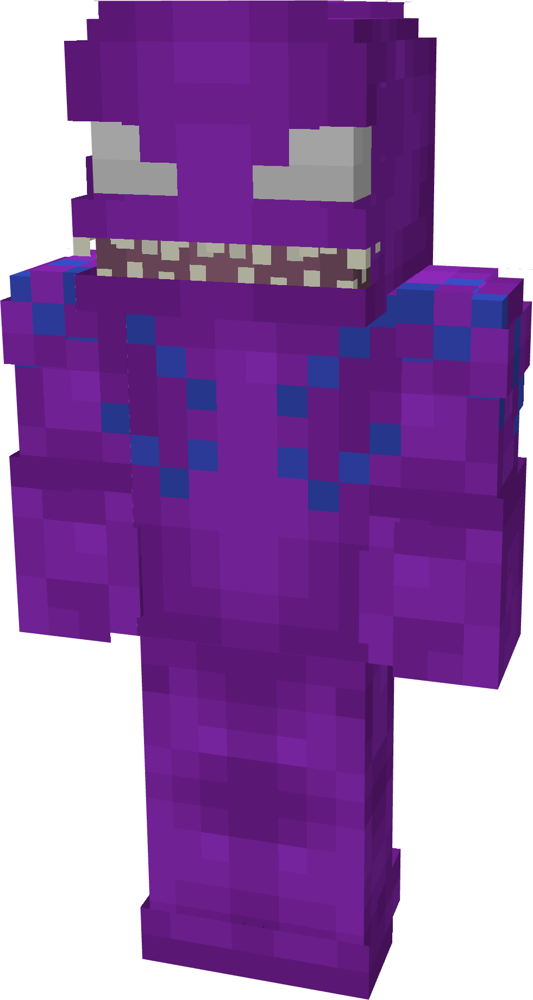
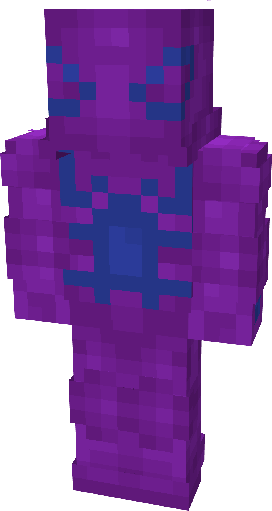
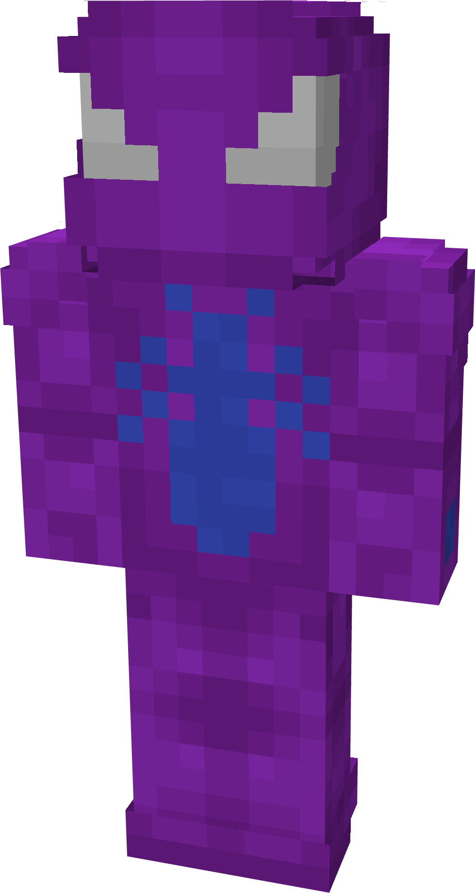
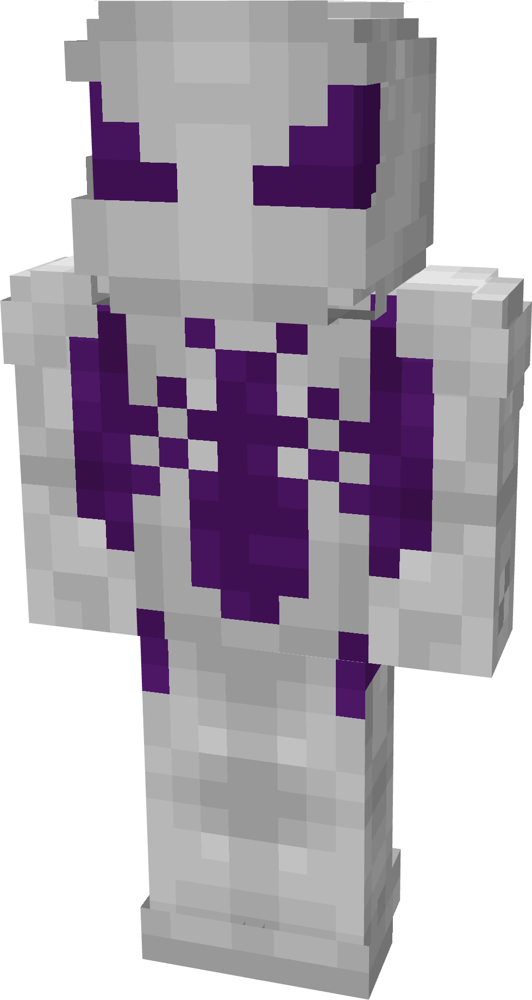
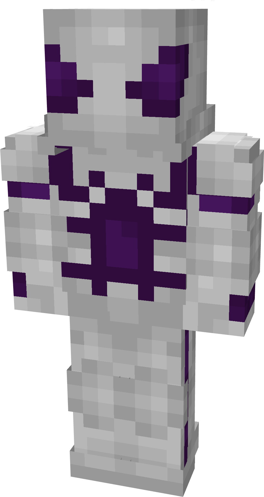
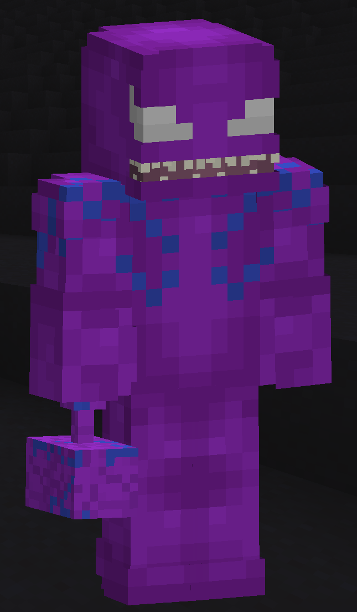

# Inumis

| { width="105" height="197" loading=lazy } | { width="105" height="196" loading=lazy } | { width="105" height="196" loading=lazy } | N/A |
|--------------------------------------------------------------------------------------------|--------------------------------------------------------------------------------------------|--------------------------------------------------------------------------------------------|-----|
| Base | Agent | Spider | Special |
| { width="105" height="197" loading=lazy } | { width="105" height="196" loading=lazy } | { width="106" height="199" loading=lazy } | N/A |

The “_Inumis_” Symbiote is one of the random Symbiotes that can be obtained as a secondary power.

{ width=267 height=456 loading=lazy }

 

Inumis’s arm weapon.

This Symbiote has the unique ability:

- (Non-Crouch) Inumis Phasing: Allows the user to phase horizontally through blocks, becoming immune to all forms of damage at the cost of having the weakness effect. This ability can be toggled on for a max of 10 seconds at a time.

Related Information:

- N/A
