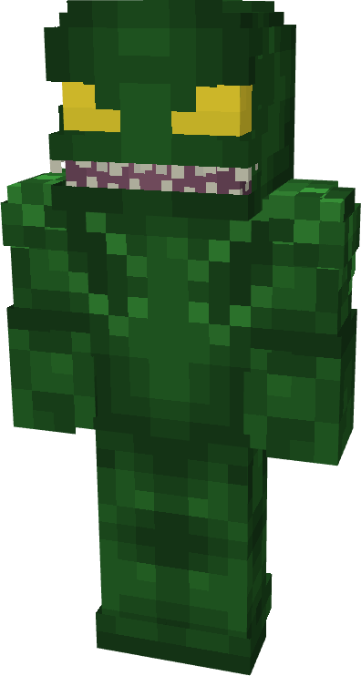
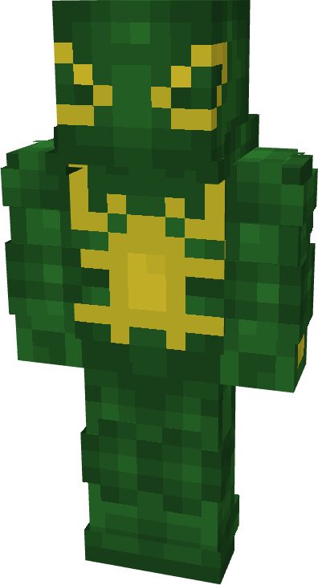
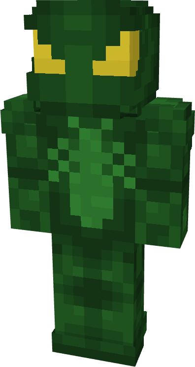
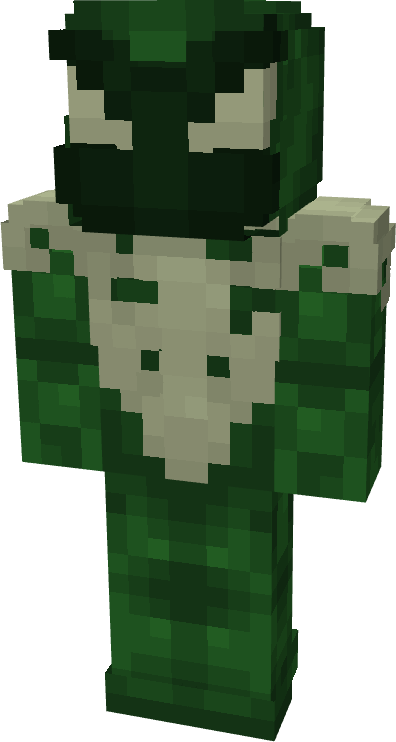
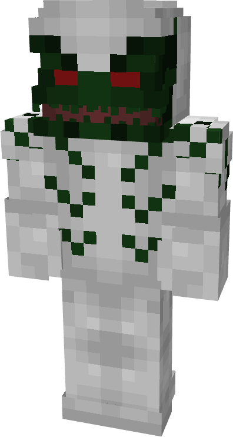
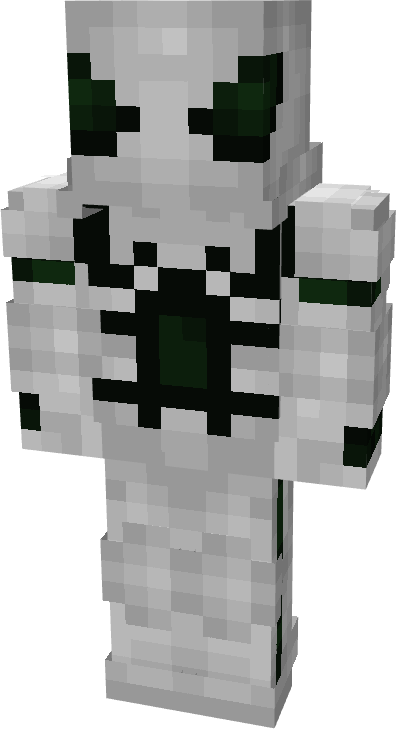
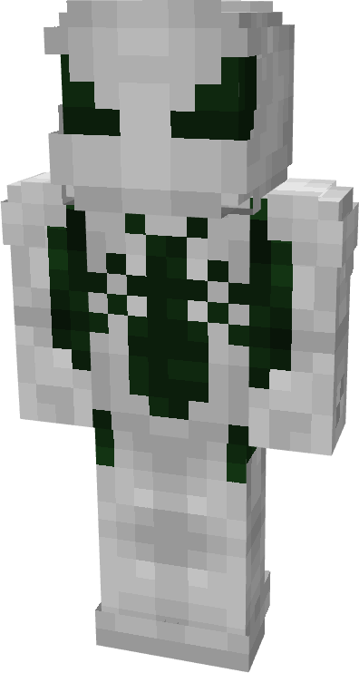
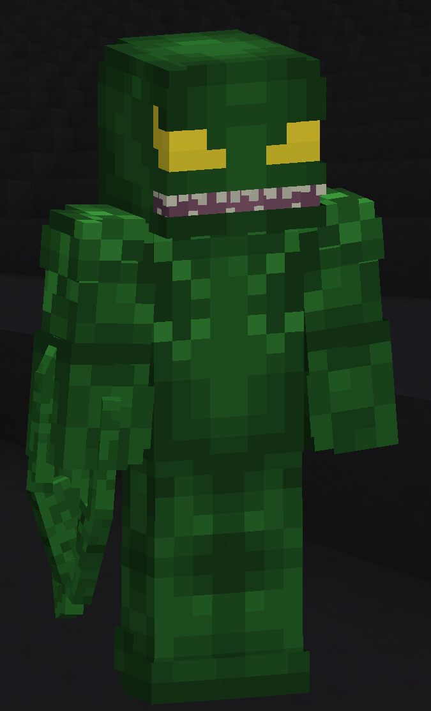

# Lasher

| { width="72" height="134" loading=lazy } | { width="73" height="134" loading=lazy } | { width="73" height="136" loading=lazy } | { width="73" height="136" loading=lazy } |
|-------------------------------------------------------------------------------------------|-------------------------------------------------------------------------------------------|-------------------------------------------------------------------------------------------|-------------------------------------------------------------------------------------------|
| Base | Agent | Spider | Special |
| { width="72" height="134" loading=lazy } | { width="73" height="134" loading=lazy } | { width="73" height="136" loading=lazy } | N/A |

The “_Lasher_” Symbiote is one of the random Symbiotes that can be obtained as a secondary power.

{ width=141 height=231 loading=lazy }

Lasher’s arm weapon.

This Symbiote has the unique ability:

- (Non-Couch) **Lasher Remote Symbiosis**: Summon a tamed War Dog for up to 30 seconds.
- (Couch) **Lasher Remove Symbiosis**: Remove a summoned War Dog within 10 blocks of you.

Related Information:

- N/A
