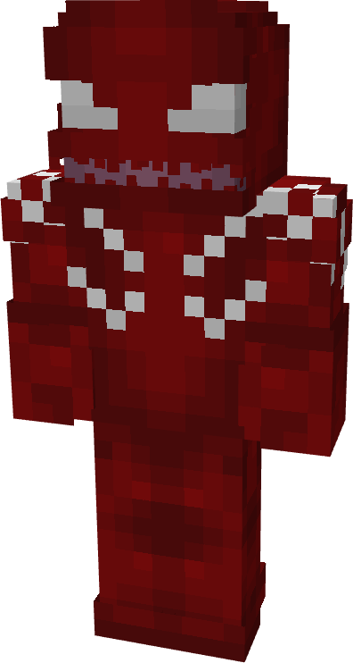
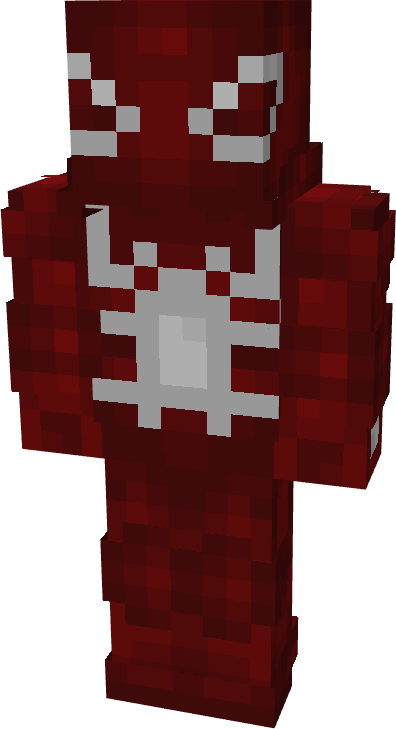
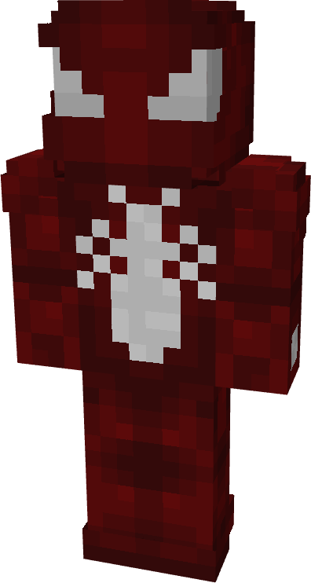
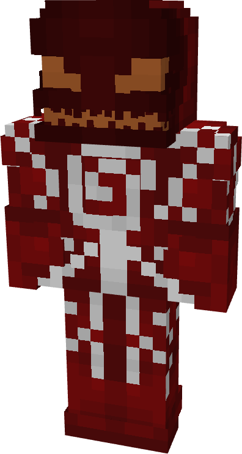
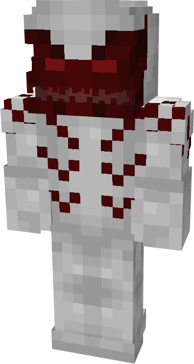
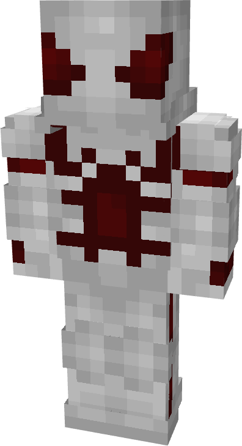
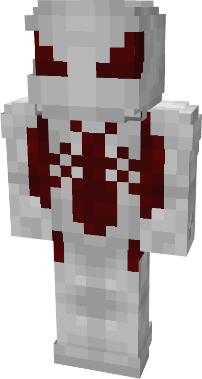
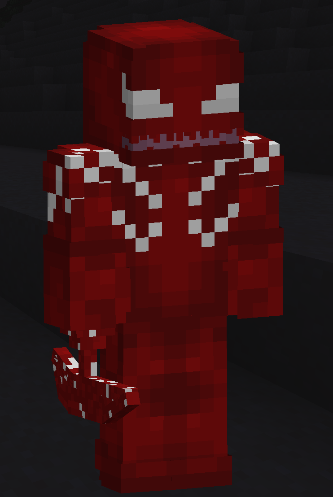

# Misery

| { width="72" height="134" loading=lazy } | { width="73" height="133" loading=lazy } | { width="73" height="136" loading=lazy } | { width="73" height="136" loading=lazy } |
|-------------------------------------------------------------------------------------------|-------------------------------------------------------------------------------------------|-------------------------------------------------------------------------------------------|-------------------------------------------------------------------------------------------|
| Base | Agent | Spider | Special |
| { width="72" height="134" loading=lazy } | { width="73" height="133" loading=lazy } | { width="73" height="136" loading=lazy } | N/A |

The “_Misery_” Symbiote is one of the random Symbiotes that can be obtained as a secondary power.

{ width=208 height=310 loading=lazy }

Misery’s arm weapon.

This Symbiote has the unique ability:

- (Non-Crouch) Body Cleansing: Grant the regeneration effect for everything within a 5 block radius of the user for 10 seconds (including the user). This ability has a 30 second cooldown

Related Information:

- Other information related to this specific Symbiote
