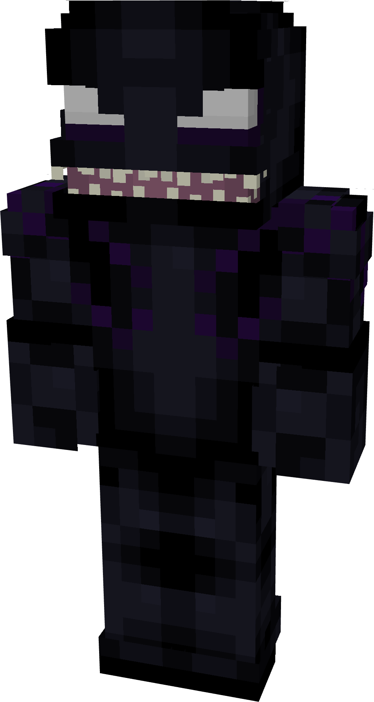
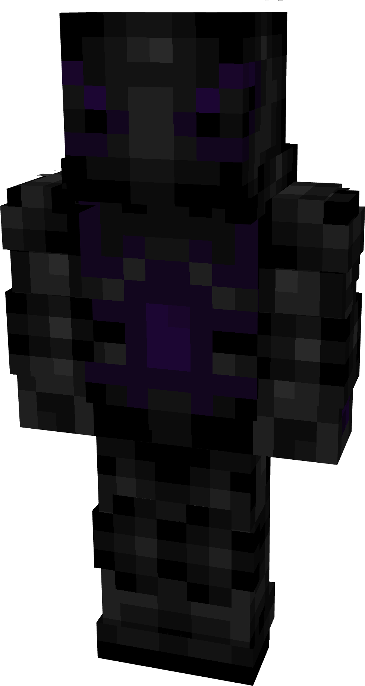
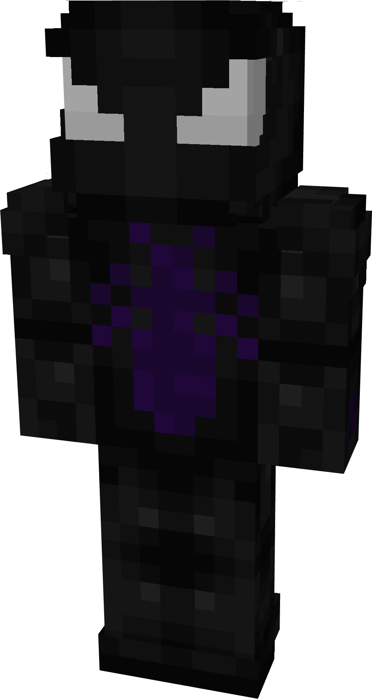
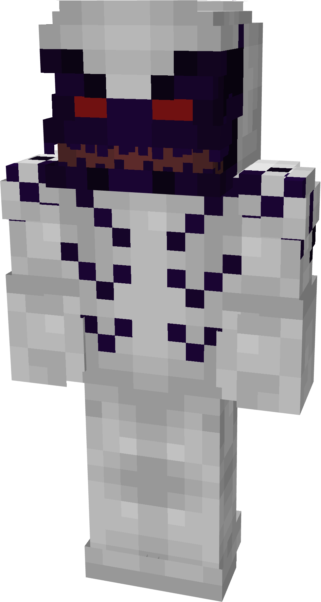
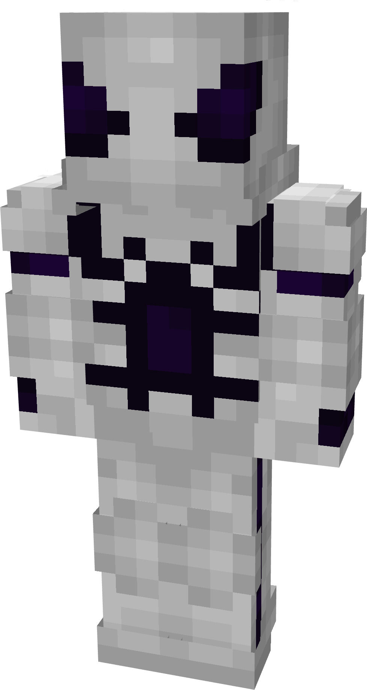
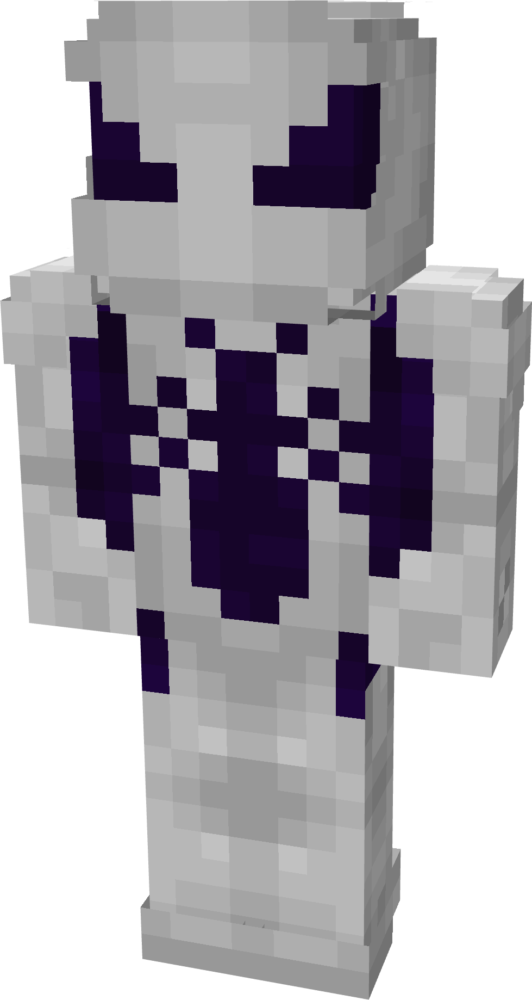
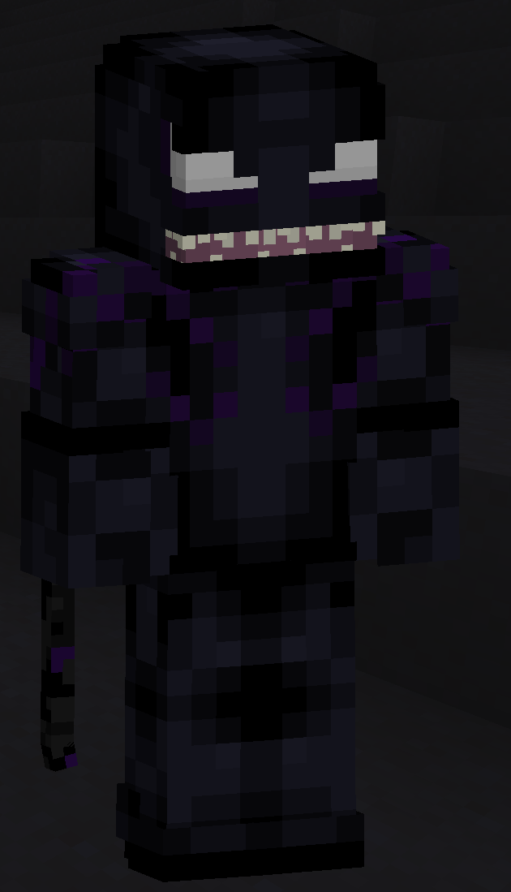

# Montechiari

| { width="110" height="206" loading=lazy } | { width="109" height="204" loading=lazy } | { width="109" height="204" loading=lazy } | N/A |
|--------------------------------------------------------------------------------------------|--------------------------------------------------------------------------------------------|--------------------------------------------------------------------------------------------|-----|
| Base | Agent | Spider | Special |
| { width="110" height="206" loading=lazy } | { width="109" height="204" loading=lazy } | { width="109" height="204" loading=lazy } | N/A |

The “_Montechiari_” Symbiote is one of the random Symbiotes that can be obtained as a secondary power.

{ width=284 height=495 loading=lazy }

Montechiari’s arm weapon.

This Symbiote has the unique ability:

- (Non-Crouch) **Montechiari Lightning Throw**: Launch a stream of purple lightning from your hand which can deal 3 damage per hit and have a max range of 10 blocks.

Related Information:

- N/A
