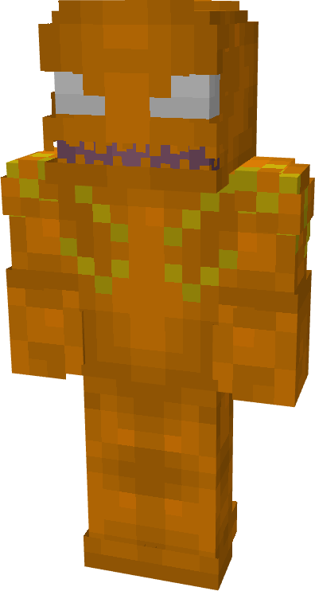
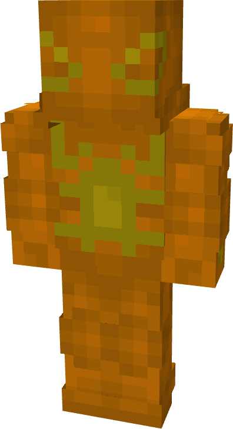
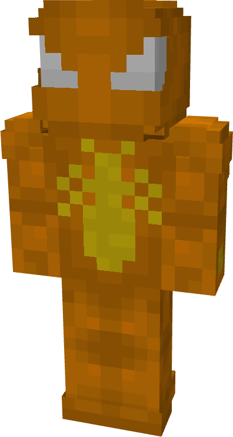
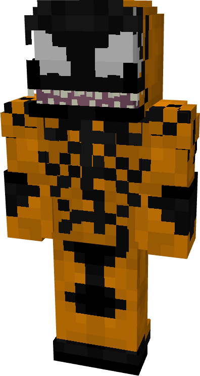
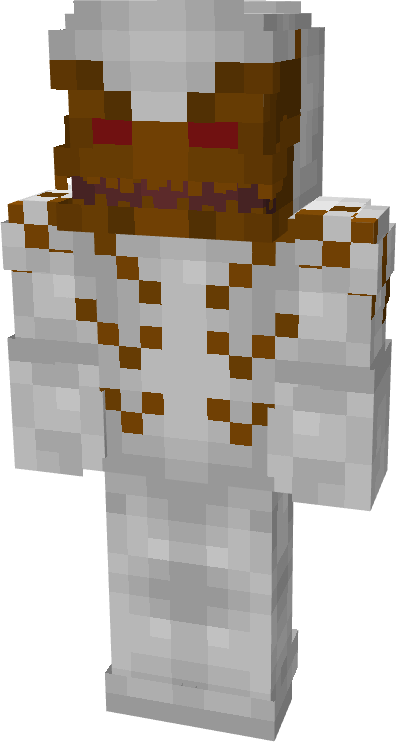
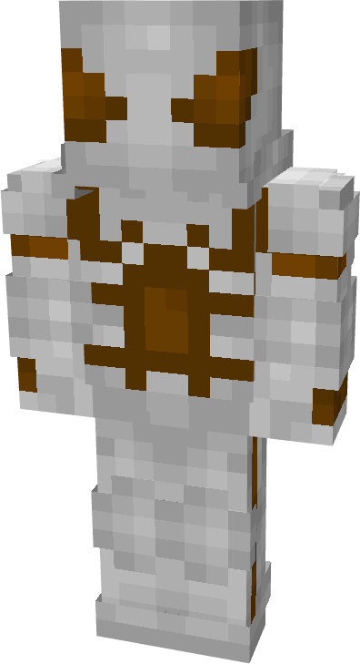
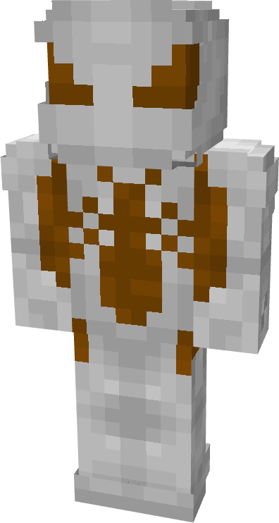
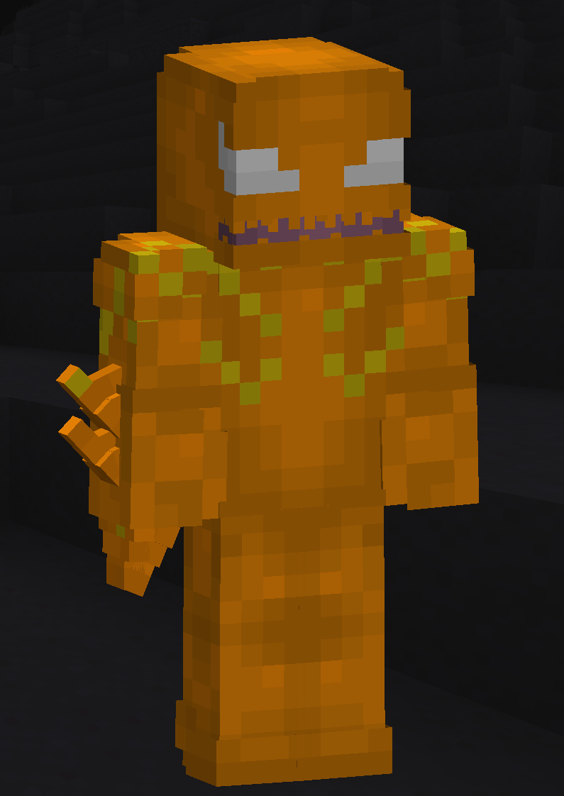

# Phage

| { width="72" height="134" loading=lazy } | { width="73" height="134" loading=lazy } | { width="73" height="136" loading=lazy } | { width="73" height="135" loading=lazy } |
|-------------------------------------------------------------------------------------------|-------------------------------------------------------------------------------------------|-------------------------------------------------------------------------------------------|-------------------------------------------------------------------------------------------|
| Base | Agent | Spider | Special |
| { width="72" height="134" loading=lazy } | { width="73" height="133" loading=lazy } | { width="73" height="136" loading=lazy } | N/A |

The “_Phage_” Symbiote is one of the random Symbiotes that can be obtained as a secondary power.

{ width=146 height=205 loading=lazy }

Phage’s arm weapon.

This Symbiote has the unique ability:

- (Non-Crouch) **Phage Blade Mode**: Grow blades on yourself to increase your unarmed damage by +4. You also gain a +0.25 to your movement speed, and a level 1 passive knockback

Related Information:

- N/A
