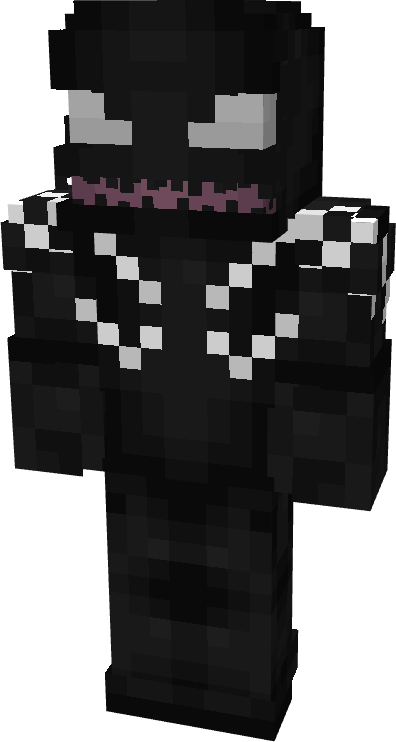
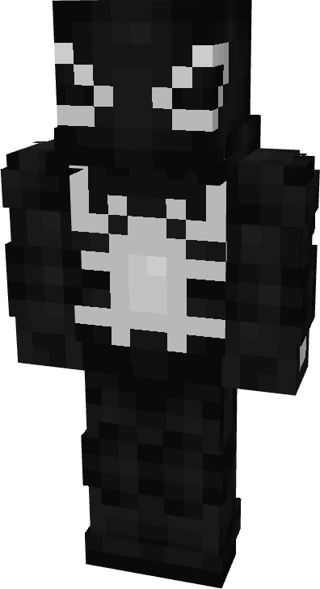
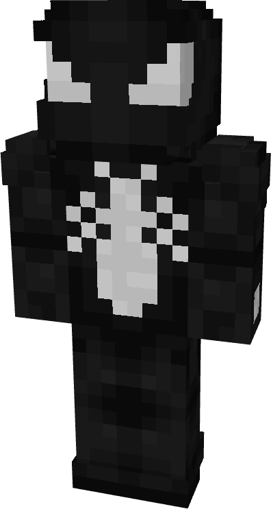
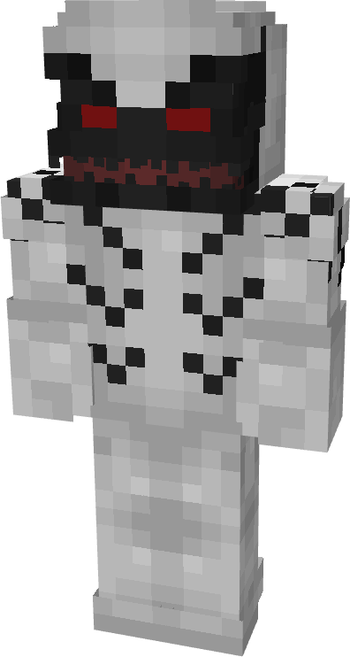
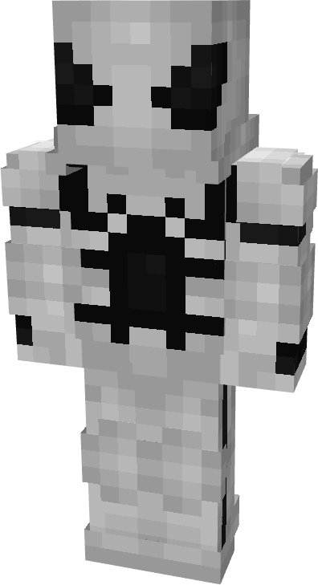
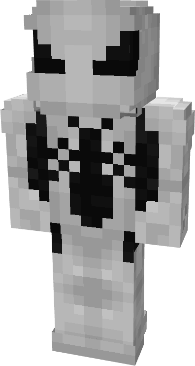

# Reaper

| { width="72" height="134" loading=lazy } | { width="73" height="133" loading=lazy } | { width="73" height="136" loading=lazy } | N/A |
|-------------------------------------------------------------------------------------------|-------------------------------------------------------------------------------------------|-------------------------------------------------------------------------------------------|-----|
| Base | Agent | Spider | Special |
| { width="72" height="134" loading=lazy } | { width="73" height="133" loading=lazy } | { width="73" height="136" loading=lazy } | N/A |

The “<em>Reaper</em>” Symbiote is one of the random Symbiotes that can be obtained as a secondary power.

_Arm Weapon Image_ “Symbiote’s Name”’s arm weapon.

This Symbiote has the unique ability:

- (Non-Couch) Body Cleansing: Heal yourself and all entitles within 5 blocks for 10 seconds.
