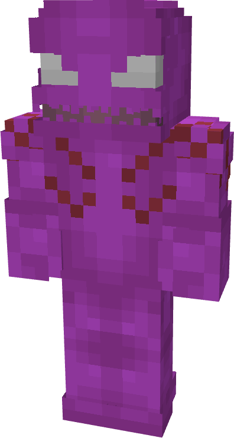
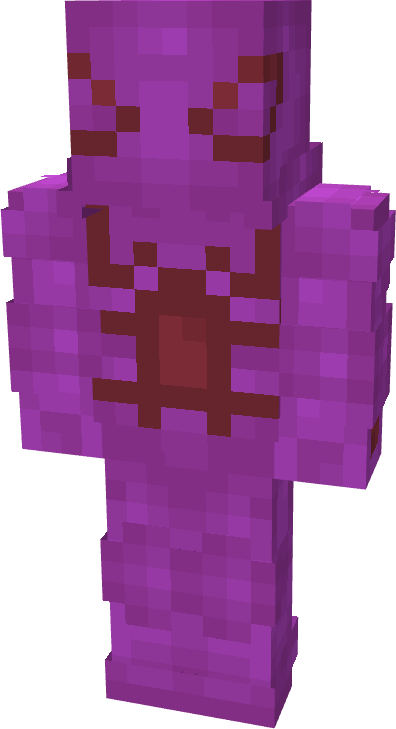
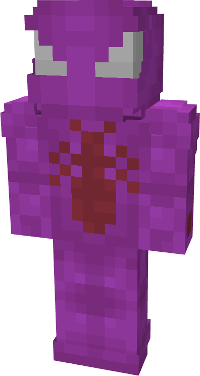
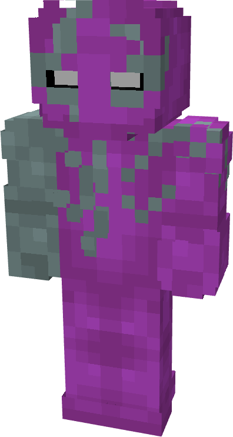
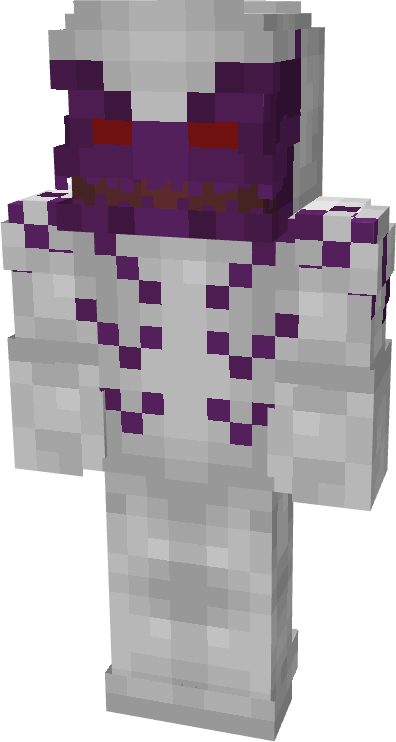
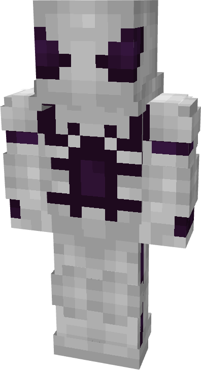
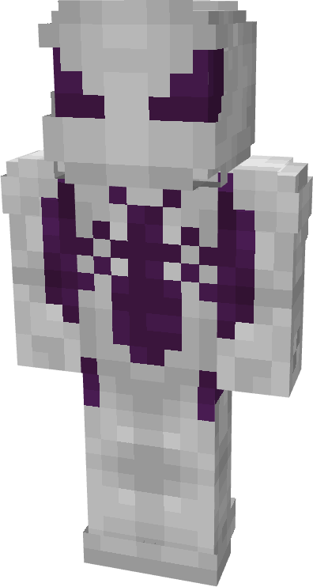
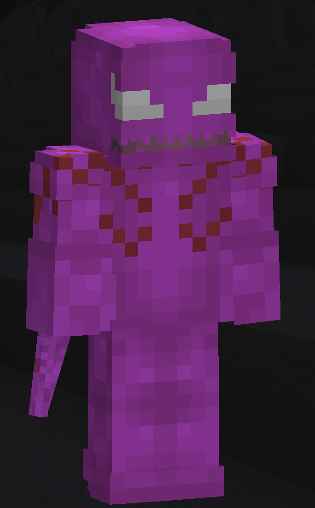

# Scorn

| { width="72" height="134" loading=lazy } | { width="73" height="134" loading=lazy } | { width="73" height="136" loading=lazy } | { width="73" height="136" loading=lazy } |
|-------------------------------------------------------------------------------------------|-------------------------------------------------------------------------------------------|-------------------------------------------------------------------------------------------|-------------------------------------------------------------------------------------------|
| Base | Agent | Spider | Special |
| { width="72" height="134" loading=lazy } | { width="73" height="133" loading=lazy } | { width="73" height="136" loading=lazy } | N/A |

The “_Scorn_” Symbiote is one of the random Symbiotes that can be obtained as a secondary power.

{ width=208 height=335 loading=lazy }

Scorn’s arm weapon.

This Symbiote has the unique ability:

- (Non-Crouch, Non-Gun Mode) Scorn Gun Mode - Enable: Enable the use of your right arm entering Gun Mode.
- (Non-Crouch, Gun Mode) Fire: Fire off your gun arm to deal 10 damage on hit with a 3 second cooldown.
- (Crouch, Gun Mode) Scorn Gun Mode - Disable: Disable the use of your right arm entering Gun Mode.

Related Information:

- N/A
