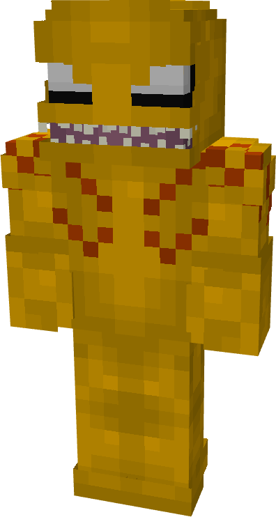
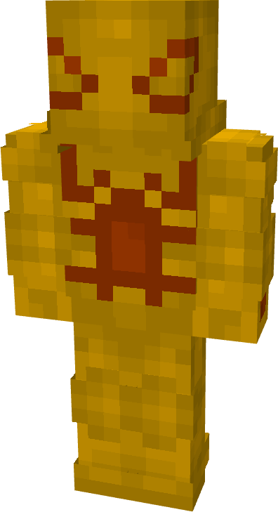
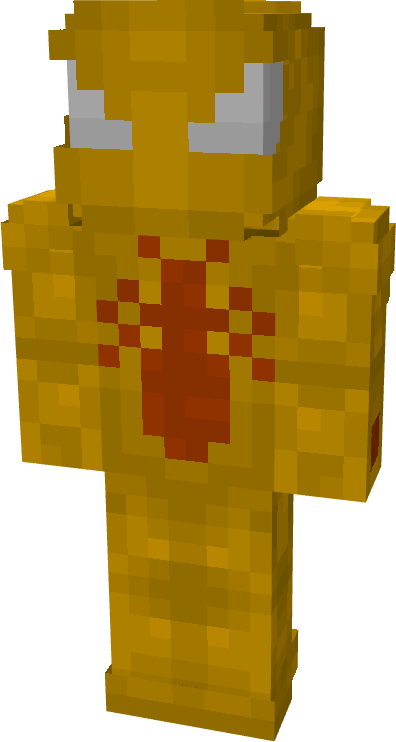
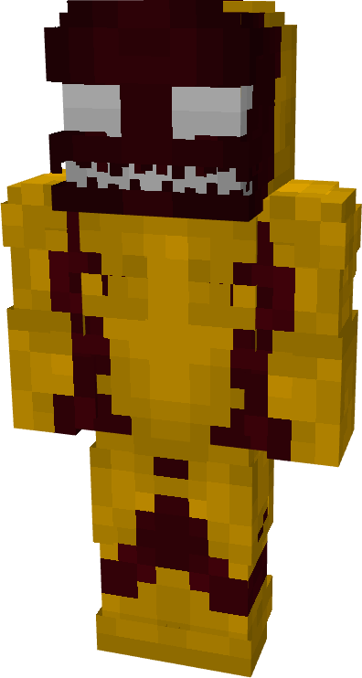
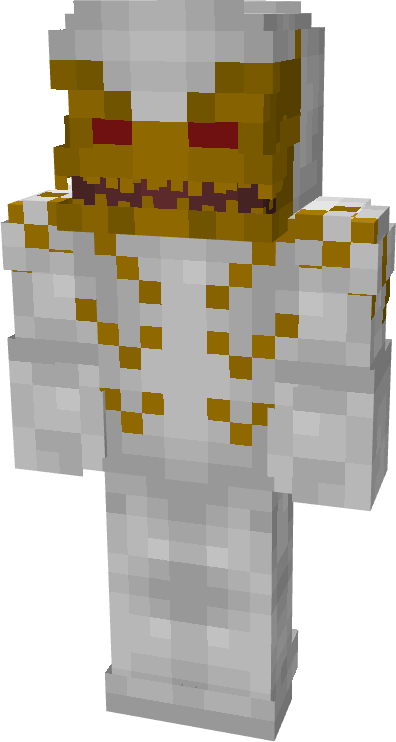
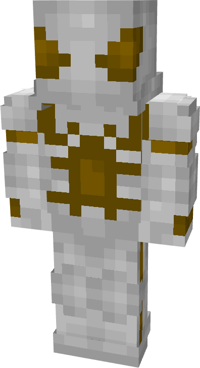
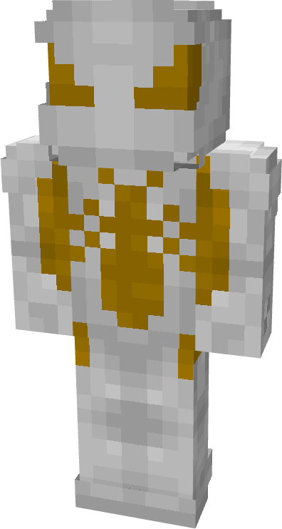
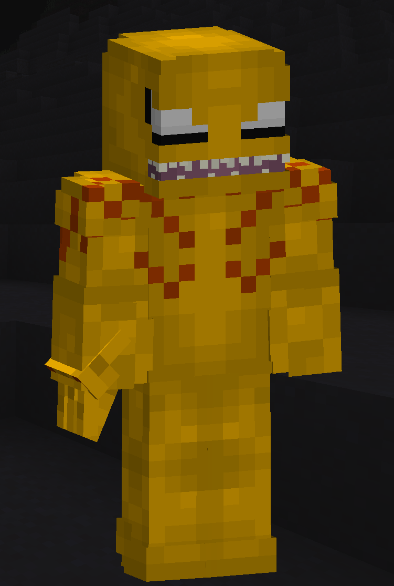

# Scream

| { width="72" height="134" loading=lazy } | { width="73" height="134" loading=lazy } | { width="73" height="136" loading=lazy } | { width="73" height="136" loading=lazy } |
|-------------------------------------------------------------------------------------------|-------------------------------------------------------------------------------------------|-------------------------------------------------------------------------------------------|-------------------------------------------------------------------------------------------|
| Base | Agent | Spider | Special |
| { width="72" height="134" loading=lazy } | { width="73" height="133" loading=lazy } | { width="73" height="136" loading=lazy } | N/A |

The “_Scream_” Symbiote is one of the random Symbiotes that can be obtained as a secondary power.

{ width=208 height=308 loading=lazy }

Scream’s arm weapon.

This Symbiote has the unique ability:

- (Non-Couch) **Scream Shriek**: Let out a powerful screech that deals 1 damage on contact, but can also grant Sound Poisoning to anyone in the line of fire. Using this attack can be held for 1 second at a time with a 2 second cooldown.

Related Information:

- This Symbiote is immune to any / all sound poisoning.
