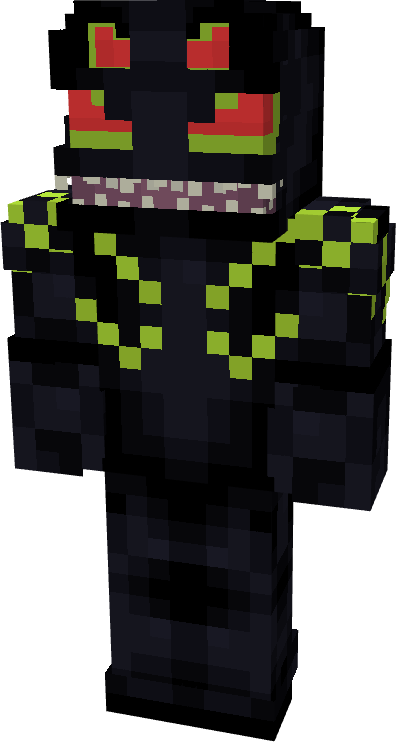
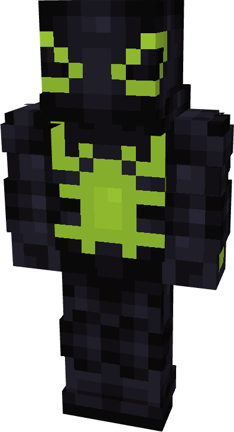
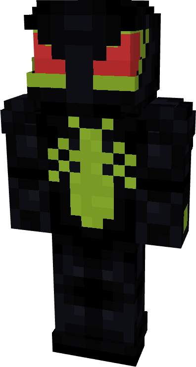
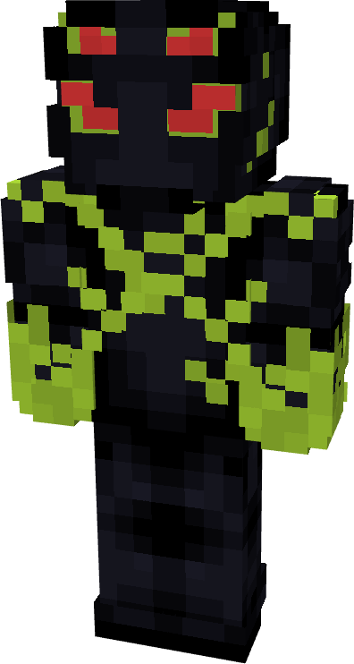
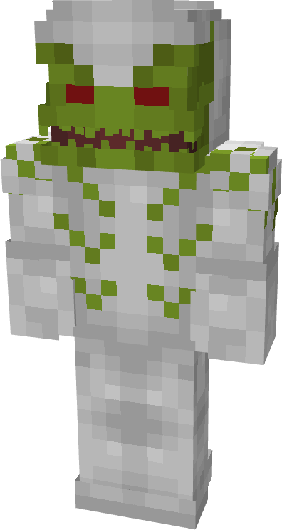
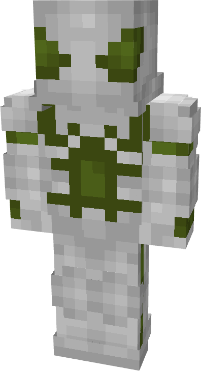
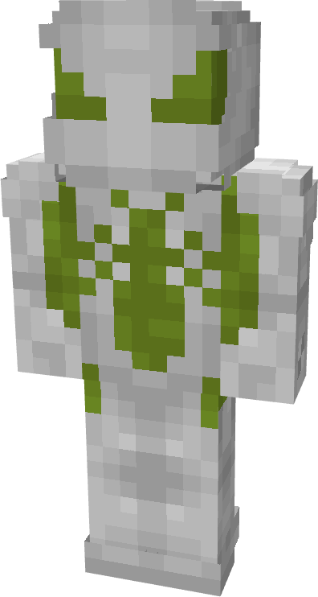
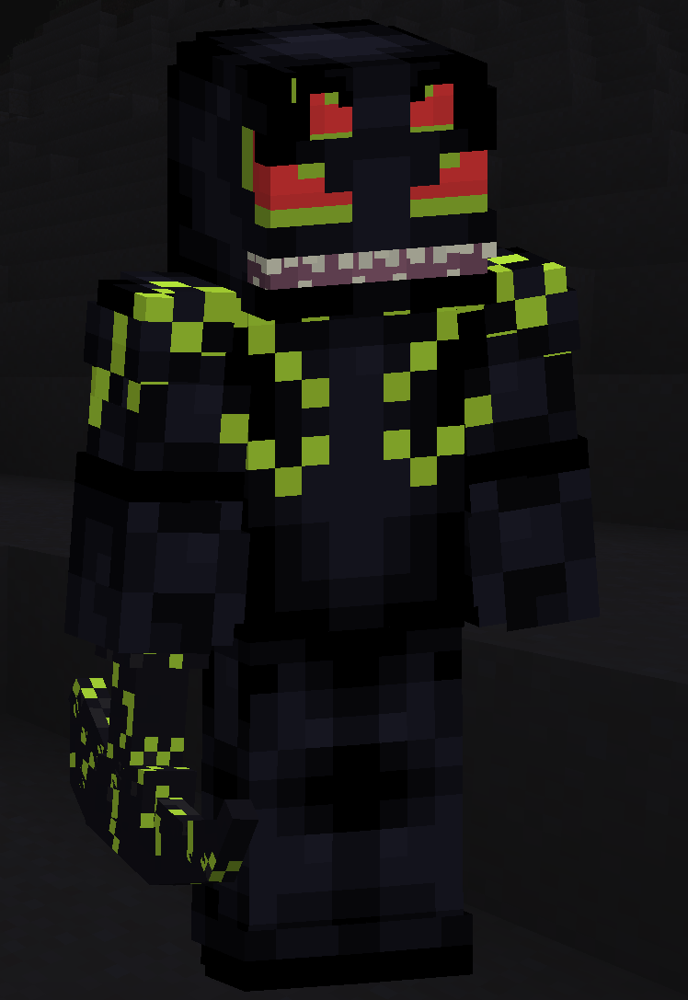

# Sleeper

| { width="72" height="134" loading=lazy } | { width="73" height="133" loading=lazy } | { width="73" height="136" loading=lazy } | { width="73" height="135" loading=lazy } |
|-------------------------------------------------------------------------------------------|-------------------------------------------------------------------------------------------|-------------------------------------------------------------------------------------------|-------------------------------------------------------------------------------------------|
| Base | Agent | Spider | Special |
| { width="72" height="134" loading=lazy } | { width="73" height="134" loading=lazy } | { width="73" height="136" loading=lazy } | N/A |

The “_Sleeper_” Symbiote is one of the random Symbiotes that can be obtained as a secondary power.

{ width=213 height=309 loading=lazy }

Sleeper’s arm weapon.

This Symbiote has the unique ability:

* (Non-Couch) **Sleeper Remote Symbiosis**: Summon a tamed War Cat for up to 30 seconds.
* (Couch) **Lasher Sleeper Symbiosis**: Remove a summoned War Cat within 10 blocks of you.

lated Information:

- N/A
