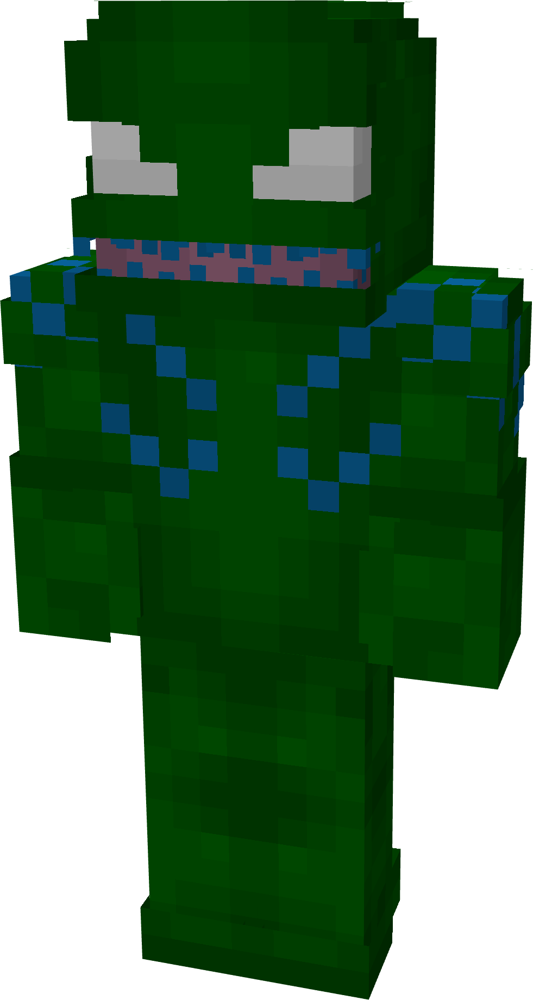
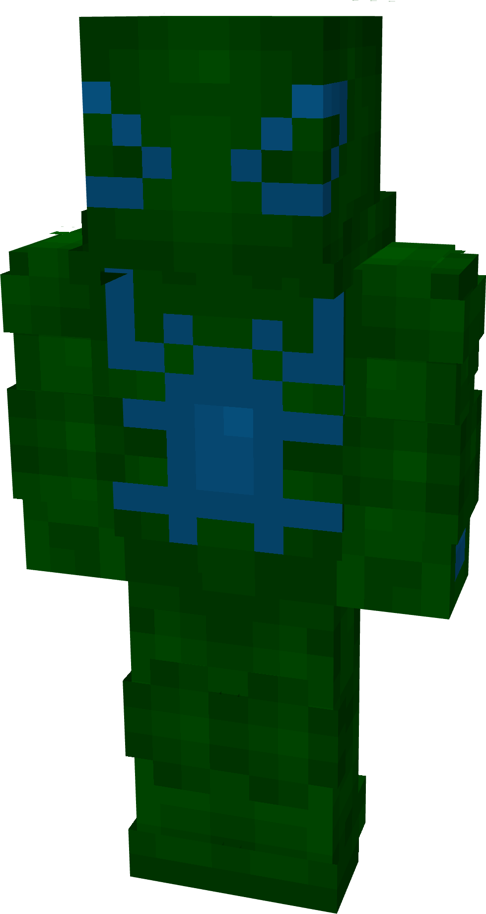
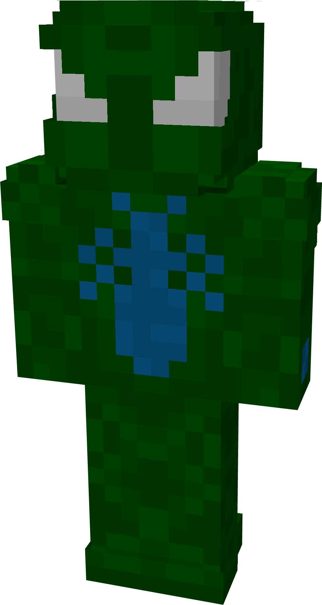
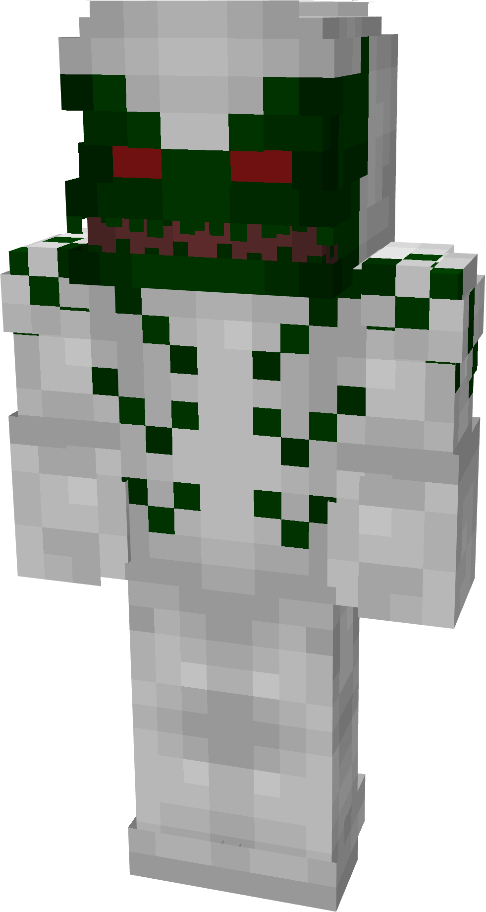
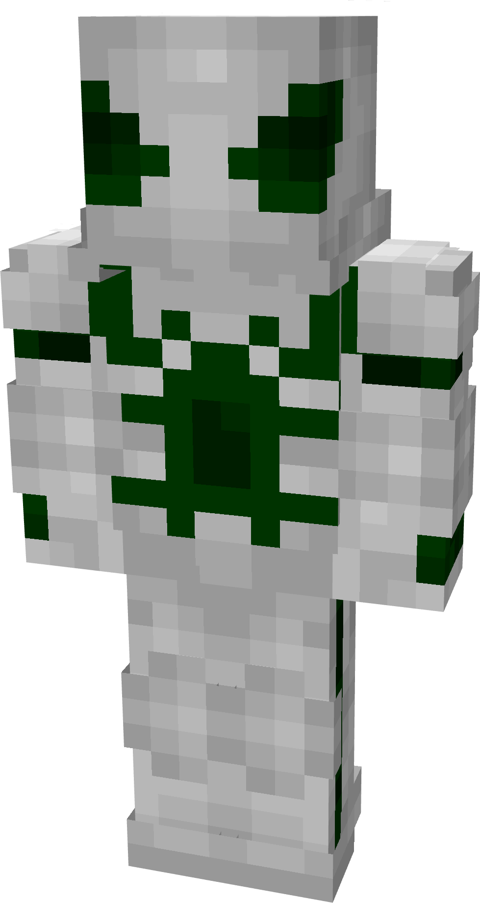
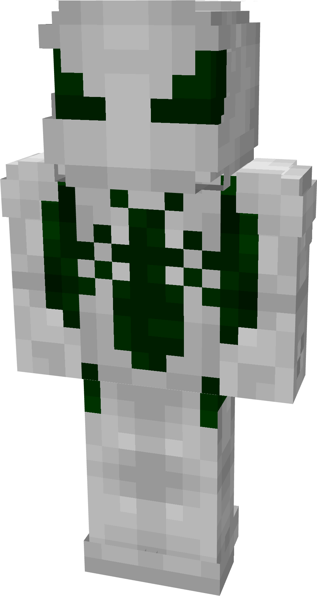

# Sprain

| { width=123 height=230 loading=lazy } | { width=122 height=229 loading=lazy } | { width=123 height=231 loading=lazy } | N/A |
|----------------------------------------------------------------------------------------|----------------------------------------------------------------------------------------|----------------------------------------------------------------------------------------|-----|
| Base | Agent | Spider | Special |
| { width=123 height=230 loading=lazy } | { width=123 height=231 loading=lazy } | { width=123 height=230 loading=lazy } | N/A |

The “<em>Sprain</em>” Symbiote is one of the random Symbiotes that can be obtained as a secondary power.

_Arm Weapon Image_ “Symbiote’s Name”’s arm weapon.

This Symbiote has the unique ability:

- (Non-Couch) Sprain Rage Mode: Grow in size for up to 30 seconds and gain +6 to your attack damage.
