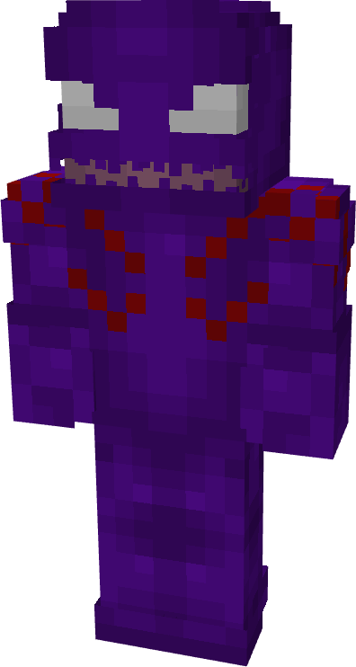
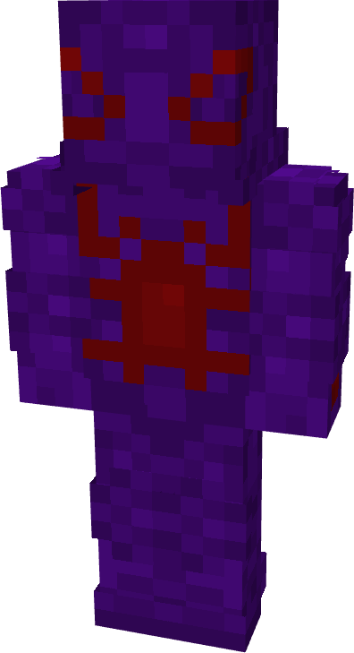
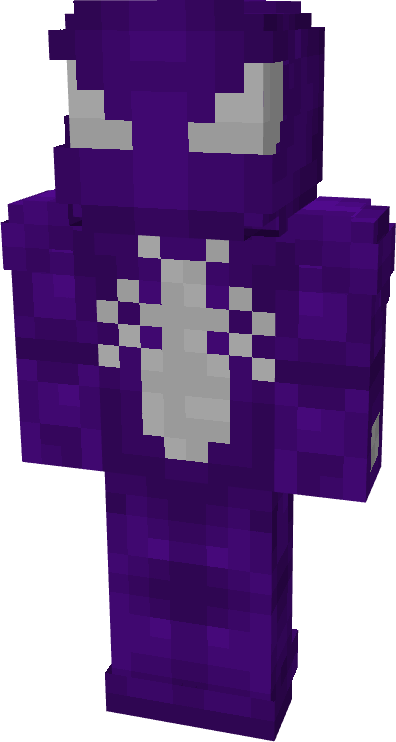
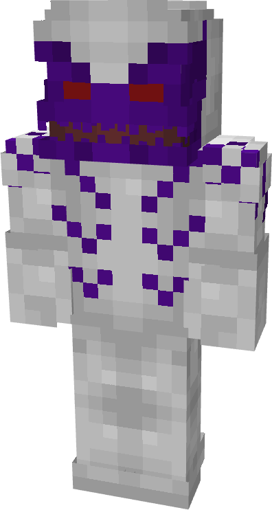
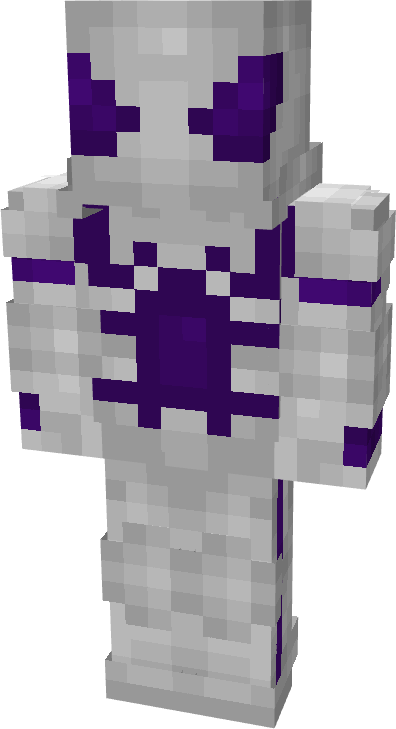
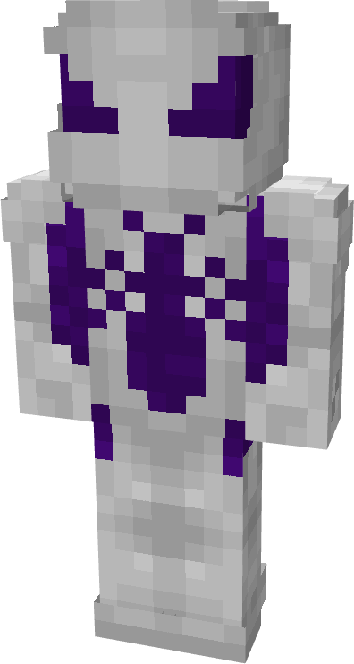

# Strain

| { width=72 height=134 loading=lazy } | { width=73 height=133 loading=lazy } | { width=73 height=135 loading=lazy } | N/A |
|---------------------------------------------------------------------------------------|---------------------------------------------------------------------------------------|---------------------------------------------------------------------------------------|-----|
| Base | Agent | Spider | Special |
| { width=72 height=134 loading=lazy } | { width=73 height=134 loading=lazy } | { width=73 height=136 loading=lazy } | N/A |

The “Strain” Symbiote is one of the random Symbiotes that can be obtained as a secondary power.

_Arm Weapon Image_ “Symbiote’s Name”’s arm weapon.

This Symbiote has the unique ability:

- (Non-Couch) Strain Blade Mode: Grow in size and grow blades on the arms to gain a +6 to punch damage while transformed for up to 1 minute.
