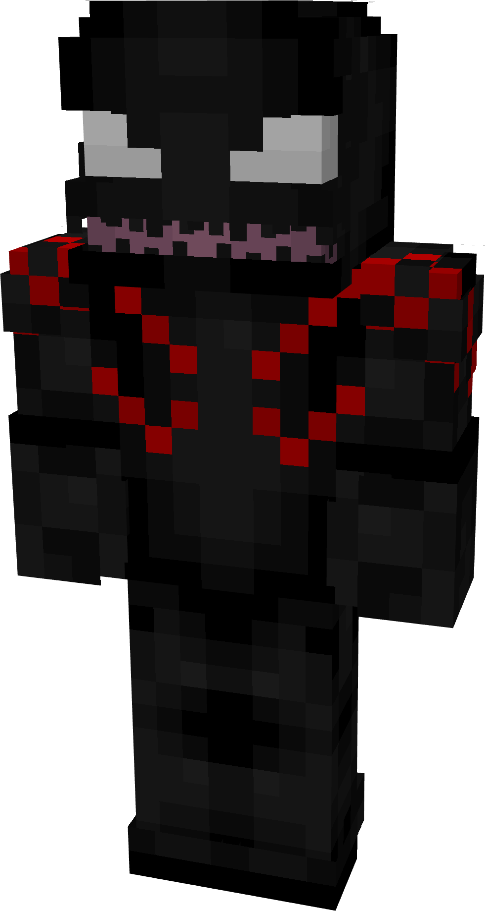
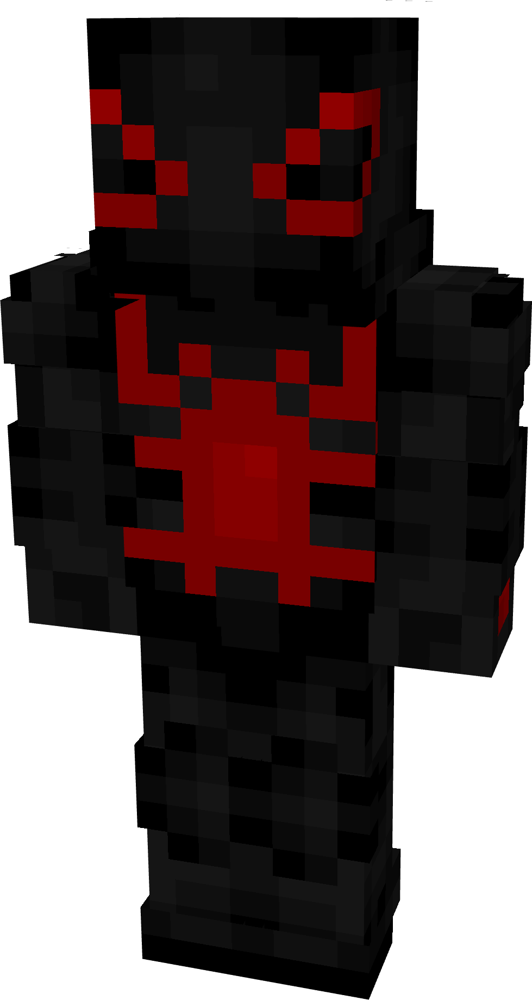
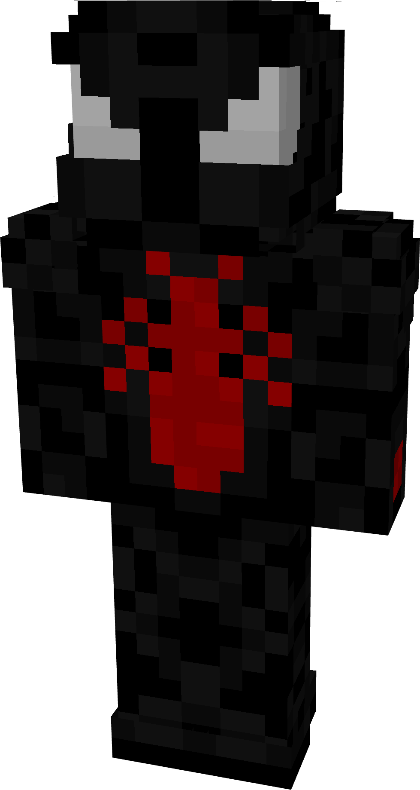
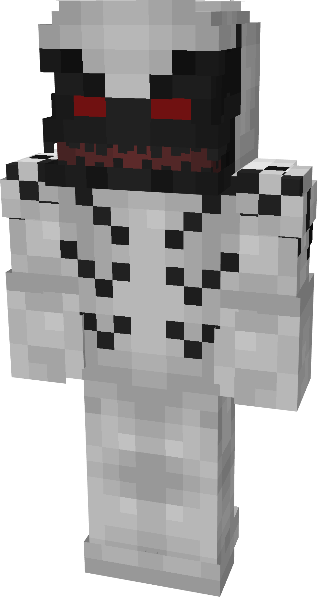
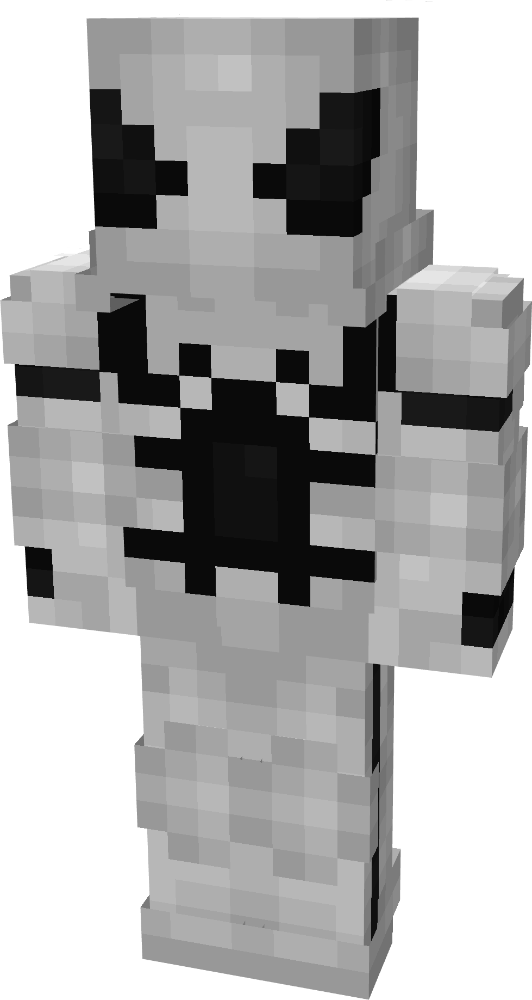
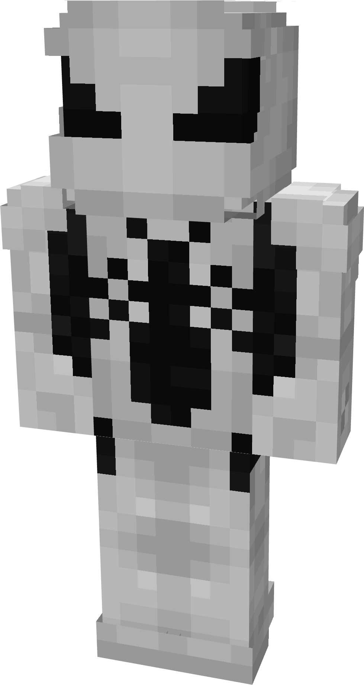

# Tempest

| { width=139 height=260 loading=lazy } | { width=138 height=259 loading=lazy } | { width=139 height=260 loading=lazy } | N/A |
|----------------------------------------------------------------------------------------|----------------------------------------------------------------------------------------|----------------------------------------------------------------------------------------|-----|
| Base | Agent | Spider | Special |
| { width=138 height=259 loading=lazy } | { width=138 height=259 loading=lazy } | { width=138 height=259 loading=lazy } | N/A |

The “<em>Tempest</em>” Symbiote is one of the random Symbiotes that can be obtained as a secondary power.

_Arm Weapon Image_ “Symbiote’s Name”’s arm weapon.

This Symbiote has the unique ability:

- (Non-Couch) Tempest Beams: Fire beams from your eyes that deal4 damage per hit.
