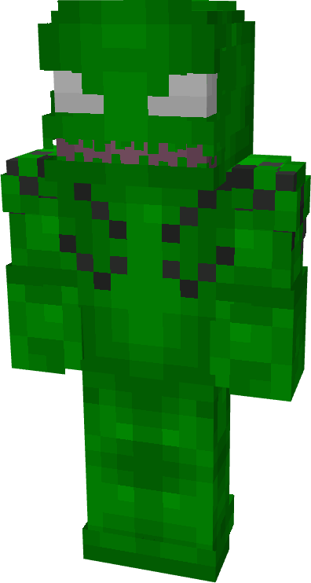
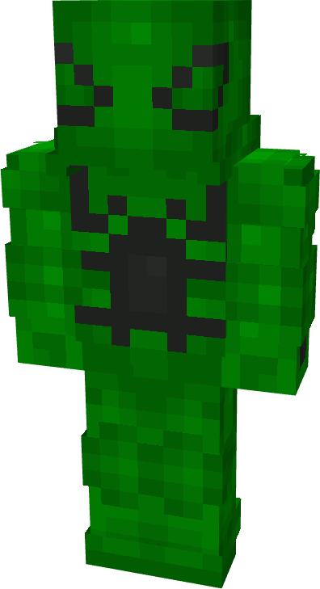
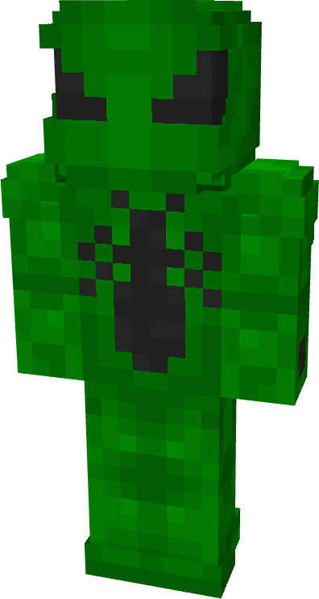
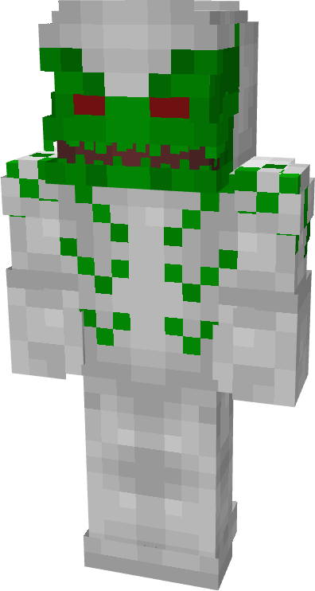
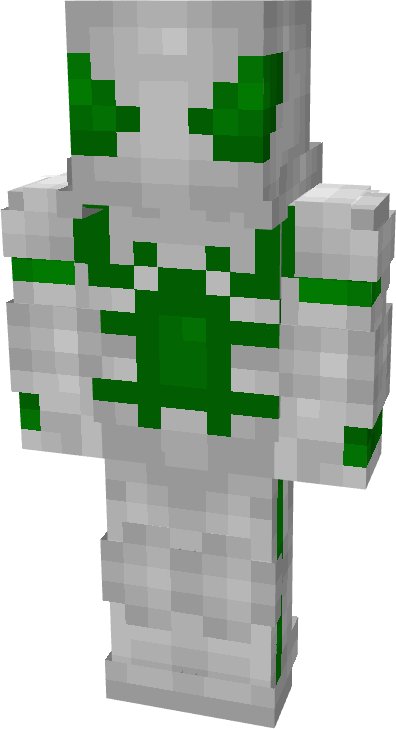
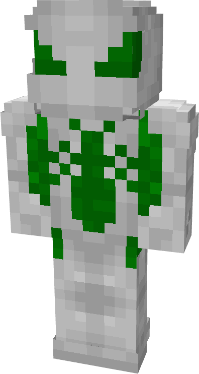

# Thorn

| { width=72 height=134 loading=lazy } | { width=73 height=134 loading=lazy } | { width=73 height=136 loading=lazy } | N/A |
|---------------------------------------------------------------------------------------|---------------------------------------------------------------------------------------|---------------------------------------------------------------------------------------|-----|
| Base | Agent | Spider | Special |
| { width=72 height=134 loading=lazy } | { width=73 height=133 loading=lazy } | { width=73 height=135 loading=lazy } | N/A |

The “<em>Thorn</em>” Symbiote is one of the random Symbiotes that can be obtained as a secondary power.

_Arm Weapon Image_ “Symbiote’s Name”’s arm weapon.

This Symbiote has the unique ability:

- (Non-Couch) Thorn Rage Mode: Increase your punch damage by +6 for up to 30 seconds.
- 
