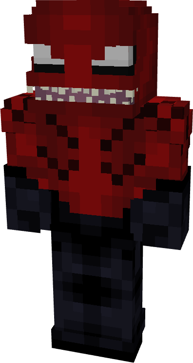
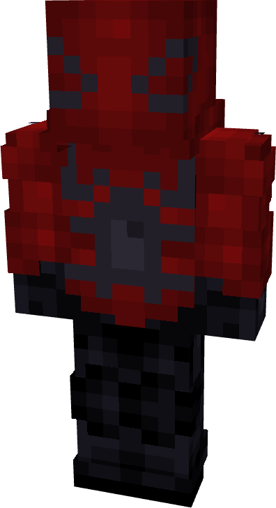
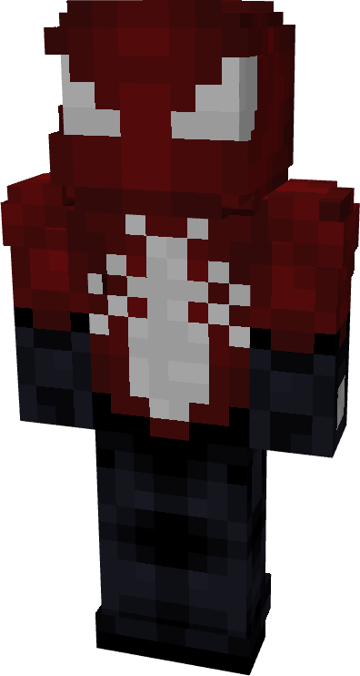
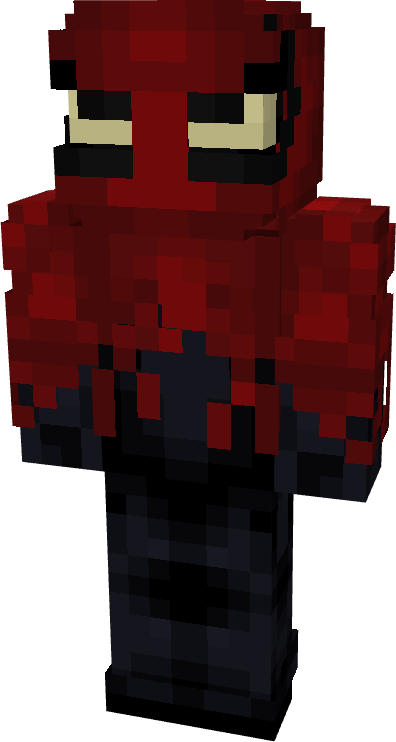
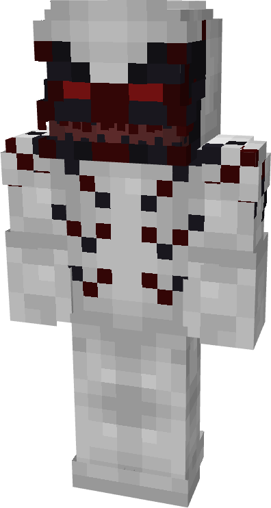
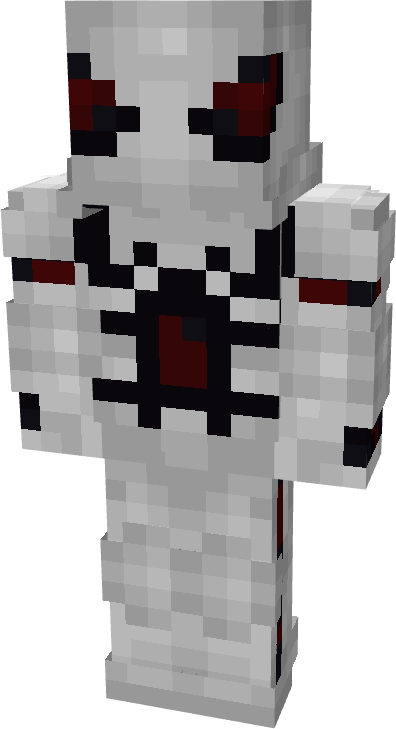
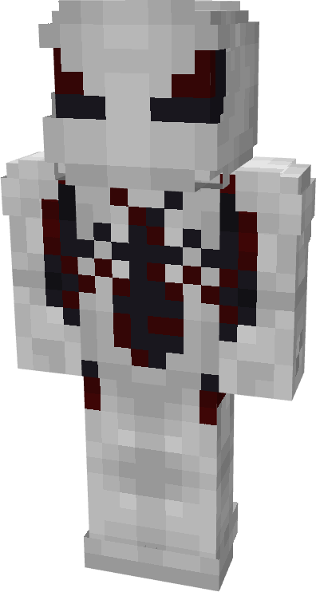
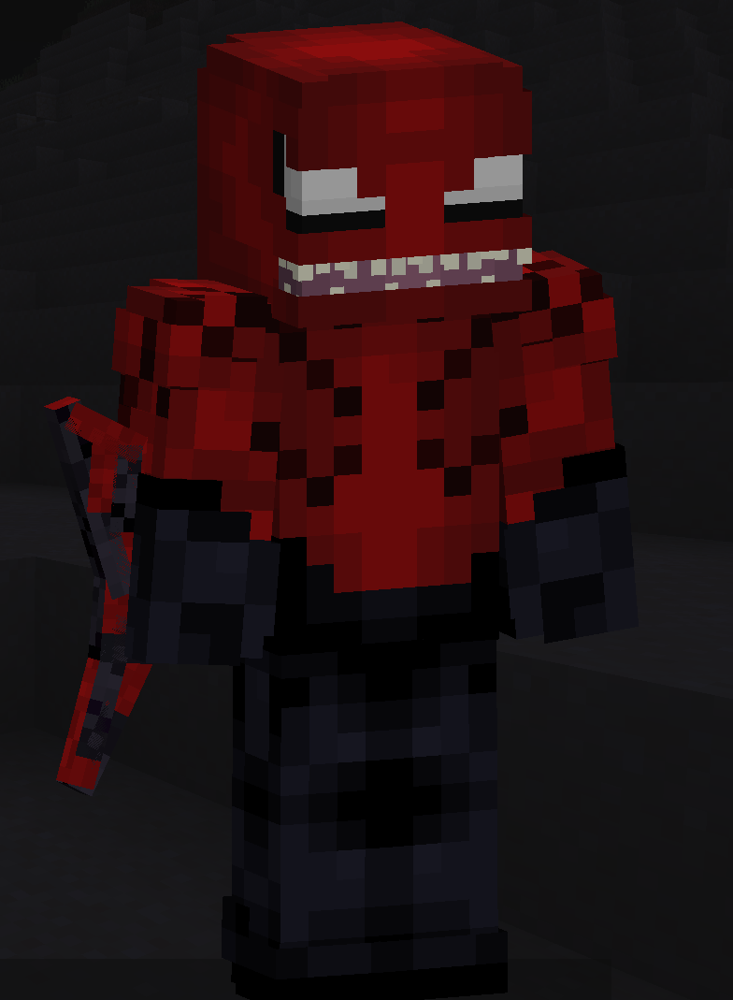

# Toxin

| { width="72" height="134" loading=lazy } | { width="73" height="134" loading=lazy } | { width="73" height="136" loading=lazy } | { width="73" height="136" loading=lazy } |
|-------------------------------------------------------------------------------------------|-------------------------------------------------------------------------------------------|-------------------------------------------------------------------------------------------|-------------------------------------------------------------------------------------------|
| Base | Agent | Spider | Special |
| { width="73" height="136" loading=lazy } | { width="73" height="134" loading=lazy } | { width="73" height="136" loading=lazy } | N/A |

The “_Toxin_” Symbiote is one of the random Symbiotes that can be obtained as a secondary power.

{ width=211 height=287 loading=lazy }

Toxin’s arm weapon.

This Symbiote has the unique ability:

- (Non-Crouch) **Toxin Monstrous Form**: For up to 30 seconds at a time, change your form into a monster-like form, increasing your size and gaining+6 to your unarmed damage at the cost of gaining slowness 2.

Related Information:

- N/A
