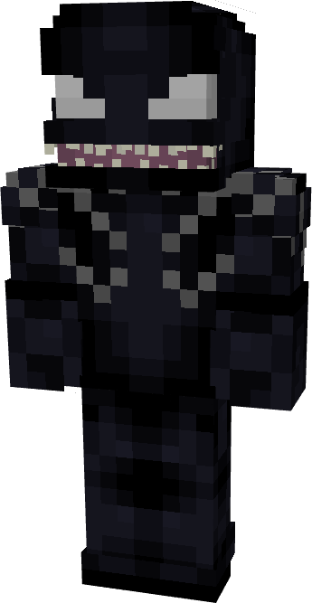
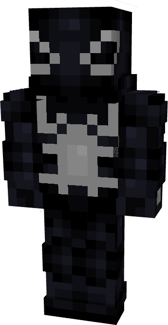
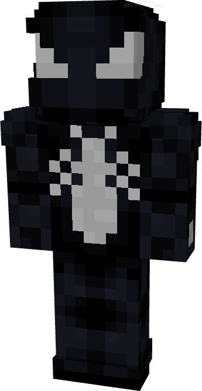
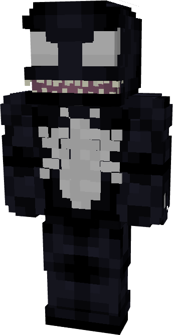
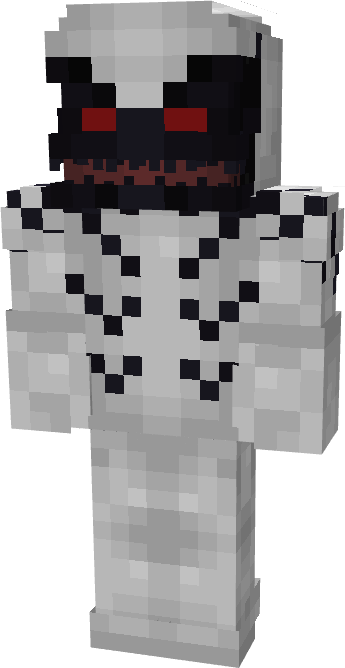
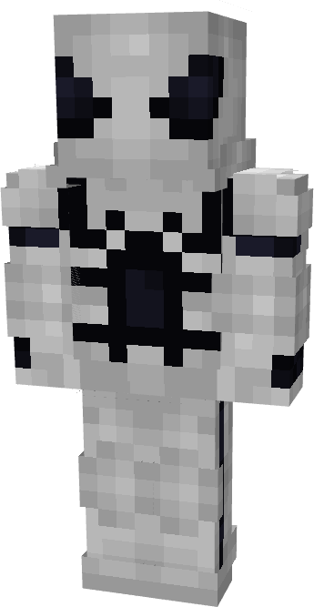
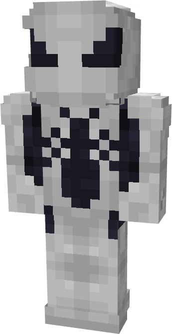
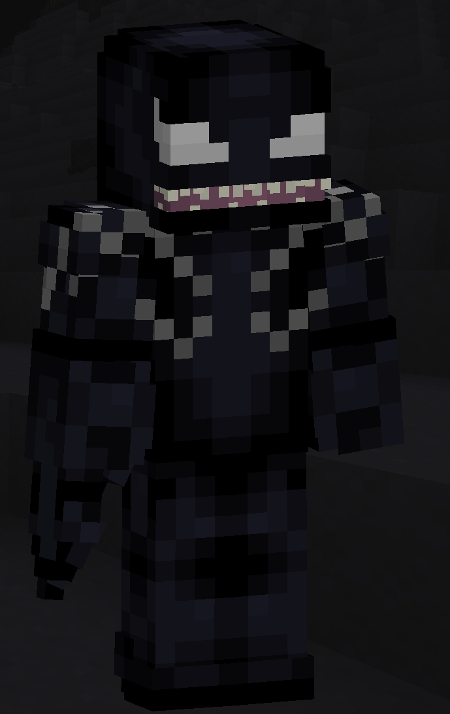

# Venom

| { width="110" height="212" loading=lazy } | { width="110" height="212" loading=lazy } | { width="110" height="212" loading=lazy } | { width="110" height="212" loading=lazy } |
|----------------------------------------------------------------------------------------|--------------------------------------------------------------------------------------------|--------------------------------------------------------------------------------------------|--------------------------------------------------------------------------------------------|
| **Base** | **Agent** | **Spider** | **Special** |
| { width="95" height="183" loading=lazy } | { width="96" height="185" loading=lazy } | { width="95" height="183" loading=lazy } | N/A |

The “_Venom_” Symbiote is one of the random Symbiotes that can be obtained as a secondary power.

{ width="183" height="289" loading=lazy }

Venom’s arm weapon.

This Symbiote has the unique ability:

- (Non-Crouch) **Venomous Leap**: Leap in the direction you are looking to deal 2 damage and give 10 seconds of poison IV to any target you leap into. This ability has a cooldown of 5 seconds.

Related Information:

- N/A
