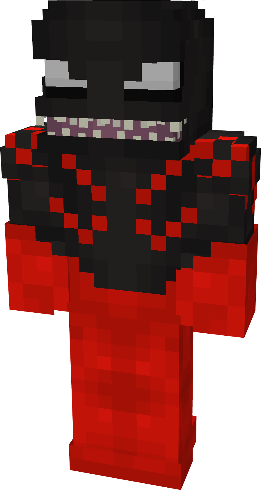
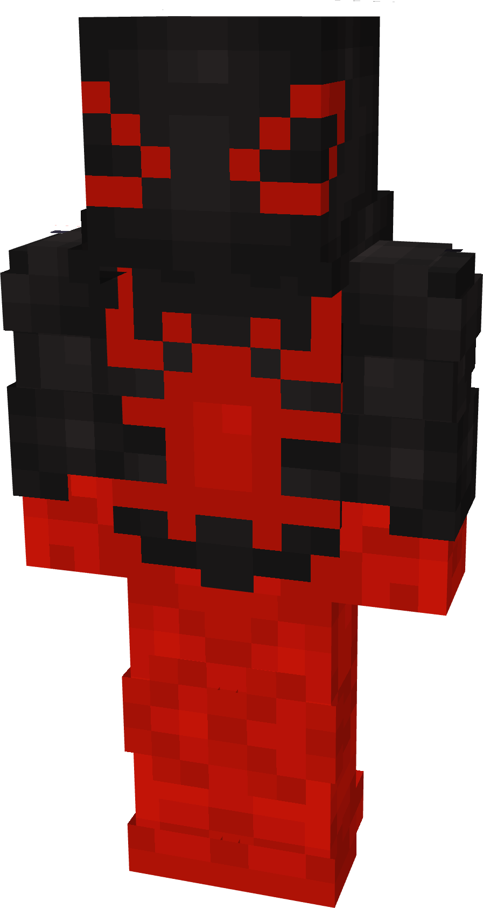
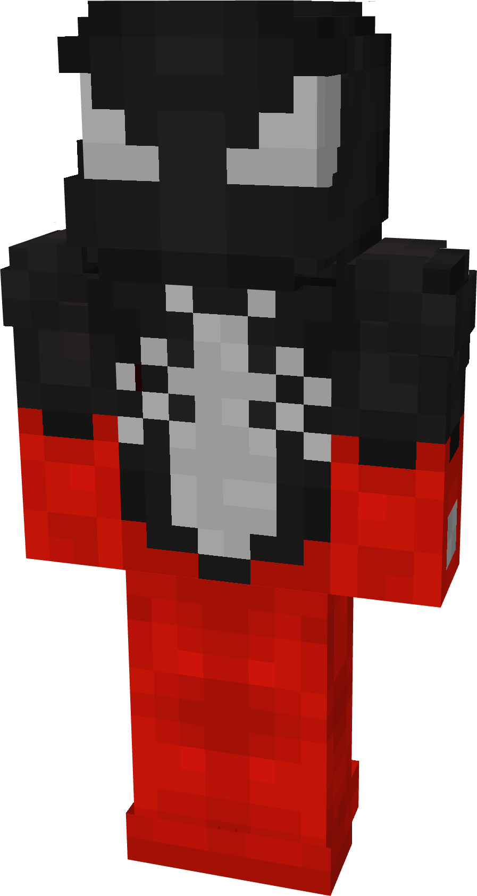
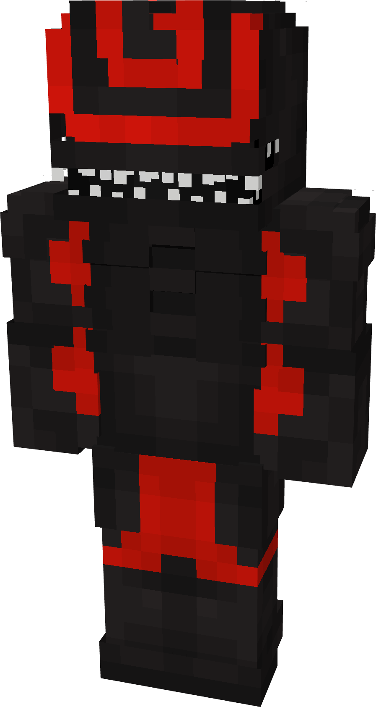
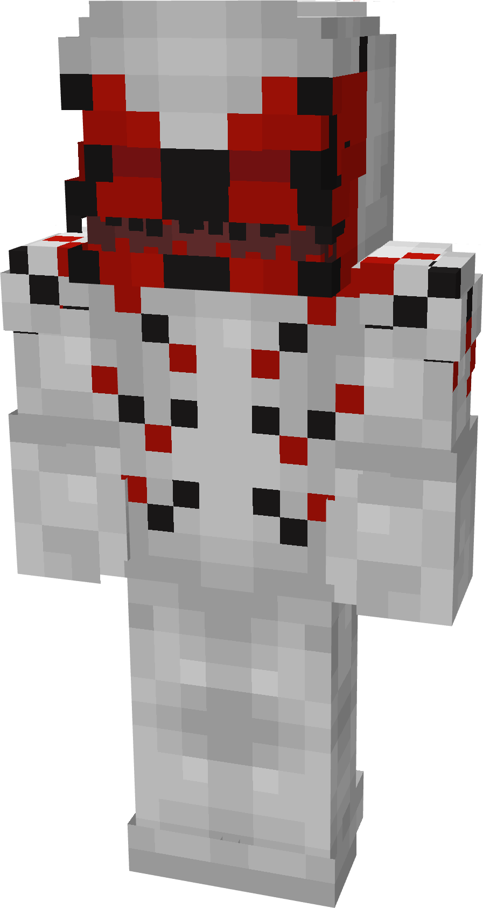
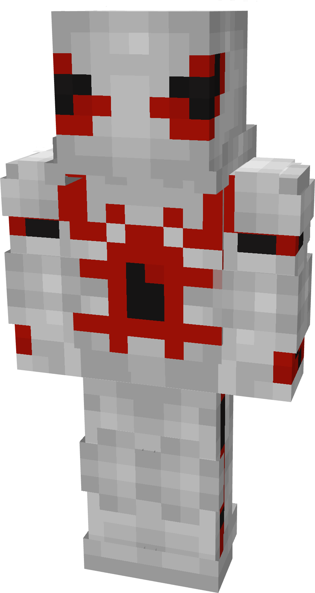
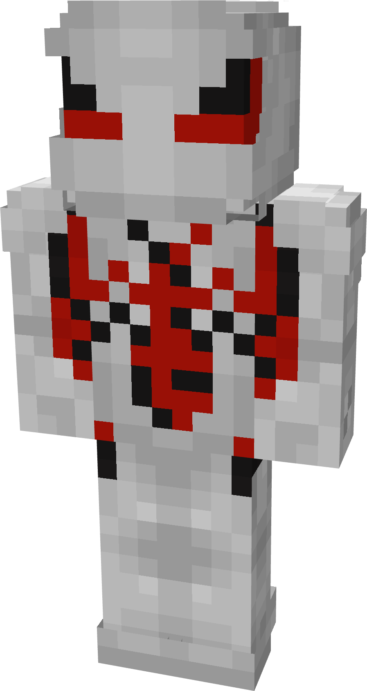

# Xenocive

| { width="117" height="219" loading=lazy } | { width="117" height="219" loading=lazy } | { width="117" height="220" loading=lazy } | { width="117" height="219" loading=lazy } |
|--------------------------------------------------------------------------------------------|--------------------------------------------------------------------------------------------|--------------------------------------------------------------------------------------------|--------------------------------------------------------------------------------------------|
| Base | Agent | Spider | Special |
| { width="115" height="215" loading=lazy } | { width="116" height="218" loading=lazy } | { width="116" height="217" loading=lazy } | N/A |

The “_Xenocive_” Symbiote is one of the random Symbiotes that can be obtained as a secondary power.

_Arm Weapon Image_

Xenocive’s Name’s arm weapon.

This Symbiote has the unique ability:

- (Non-Crouch) **Withering Aura**: Grants the Wither effect to all entities around the user in a 3x3x3 radius for 3 seconds. This ability can be held for up to 10 seconds.

Related Information:

- N/A
