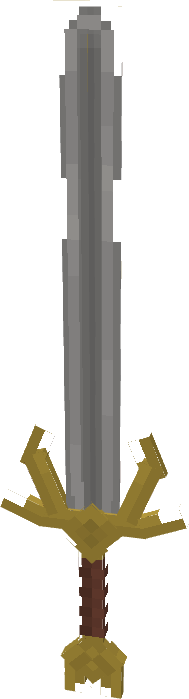
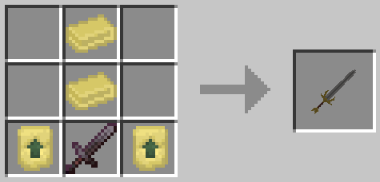

# Hofund

{ width=76 height=281 loading=lazy }

**"Hofund"** is obtained via crafting the sword with x1 Netherite Sword, x2 Uru Templates, and x2 Uru Ingots as shown below:

{ width=357 height=171 loading=lazy }

**Stats**:

* Maximum Health: n/a
* Maximum Healing / Second: n/a
* Armor Rating: n/a
* Armor Toughness: n/a
* Base Attack Damage: +7
* Jump Height: n/a
* Sprint Speed: n/a
* Flight Speed: n/a

**Main Abilities**:

* **Slot 1 (Non-Crouch): "Block Incoming Damage"** - Block incoming damage for a short time by positioning your sword.
* **Slot 2 (Non-Crouch): "Spinning Strike"** - Spin in a circle while holding the blade of your sword out, dealing damage that scales with your current damage output with a Strength 1 modifier to all entities the sword hits.
* **Slot 3 (Non-Crouch): "Asgardian Strike"** - Wind back your Sword, then strike the target directly in front of you dealing damage that scales with your current damage output with a Strength 2 modifier to your target.
* **Slot 4 (Non-Crouch): "Bifrost Beam"** - Fire off Bifrost energy from the tip of your sword at your target, dealing 6 damage per hit.

**Related Information**:

* This tertiary power uses Uru templates to unlock new abilities.
* While weilding this sword, you can passively gain minor All-Sight, allowing entities within a 10x10x10 radius to become highlighted
