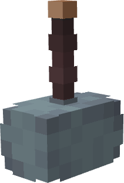

# Mjolnir - Comics

{ width=98 height=143 loading=lazy }

**"Mjolnir - Comics"** is obtained via rarer chance when finding an [Mjolnir Crashsite](../../../structures/mjolnir-crashsite.md).

**Stats:**

* Maximum Health: n/a
* Maximum Healing / Second: n/a
* Armor Rating: n/a
* Armor Toughness: n/a
* Base Attack Damage: +8
* Sprint Speed: n/a
* Flight Speed: 1.0

**Main Abilities:**

* **Slot 1 (Non-Crouch): "Channel Godly Lightning"** - Summon Lightning at your location to charge up your God of Lightning energy bar.
* **Slot 2 (Non-Crouch): "Release Stored Lightning"** - Using the energy stored within your Hammer, fire off a beam of lightning at your target. Scroll while this ability is active to change the output of the Lightning.
* **Slot 3 (Non-Crouch): "Godly Guise Transformation"** - Store any set of armor + "Curios:fsang_cape" and "Curios:fsang_outerwear" slots then strike yourself with lightning to transform back into it at will.
* **Slot 4 (Non-Crouch): "Godly Lightning Smash"** - Slam your hammer down with the full force of the God of Lightning, summoning an explosion of lightning and shaking the area at your feet. This ability will not destroy the area around you.

**Related Information:**

* To fly with Mjolnir, you need to sprint, then fly, and cannot stop sprinting when flying.
* This tertiary power uses Uru templates to unlock new abilities.
* Requires a karma level of 1,000 or higher to wield.
* Crouching then right clicking will allow you to throw your hammer, holding right click while the hammer is thrown will allow you to control the direction.
* If there is armor stored in the hammer crouching while using the Channel Lightning ability will allow the armor to be repaired.
* This hammer also has the ability to toggle on/off the Godly Form Eyes.
