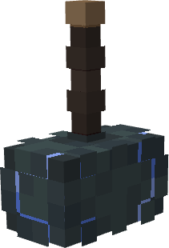

# Mjolnir - Rivals

{ width=111 height=163 loading=lazy }

**"Mjolnir - Rivals"** is obtained via rarer chance when finding an [Mjolnir Crashsite](../../../structures/mjolnir-crashsite.md).

**Stats:**

* Maximum Health: n/a
* Maximum Healing / Second: n/a
* Armor Rating: n/a
* Armor Toughness: n/a
* Base Attack Damage: +6
* Sprint Speed: n/a
* Flight Speed: 1.0

**Main Abilities:**

* **Slot 1 (Non-Crouch): "Channel Godly Lightning"** - Summon Lightning at your location to charge up your God of Lightning energy bar.
* **Slot 2 (Non-Crouch): "Release Stored Lightning"** - Using the energy stored within your Hammer, fire off a beam of lightning at your target. Scroll while this ability is active to change the output of the Lightning. When at "Output 0" use Right-Click to send out a blast of lightning through a larger area.
* **Slot 3 (Non-Crouch): "Unrivaled Storm Guard**" - Spin your hammer in your hand, blocking incoming damage. Hit Right-Click while spinning to leap in the direction you're looking.
* **Slot 4 (Non-Crouch): "Unrivaled Lightning Realm"** - Fire a bolt of lightning at an area which will create a Lightning Zone for 15 seconds then puts your hammer on cooldown for 30 seconds. Any entity caught in this zone will be granted Shock Effect for 3 seconds. Any Mjolnir user inside this zone will instead have their energy passively charged.
* **Slot 5 (Non-Crouch): "Unrivaled God of Thunder"** - Send yourself up into the air, hovering in place for a bit before crashing into the direction you are looking. You will summon a barrage of lightning bolts and damage entities within 6 blocks of where you land based on their proximity to you.

Related Information:

* To fly with Mjolnir, you need to sprint, then fly, and cannot stop sprinting when flying.
* This tertiary power uses Uru templates to unlock new abilities.
* Requires a karma level of 1,000 or higher to wield
* Crouching then right clicking will allow you to throw your hammer, holding right click while the hammer is thrown will allow you to control the direction.
* When you have 80% or more energy stored within your Hammer, gain an additional +6 to your Max Health and +6 to your Armor.
