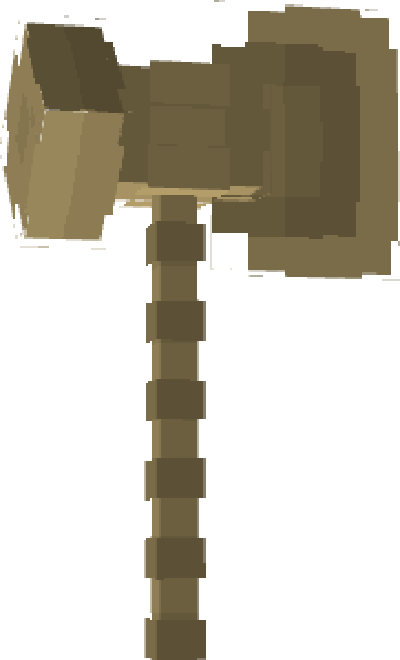

# Stormbreaker

{ width="137" height="226" loading=lazy }

**"Stormbreaker"** is obtained via rare chance when finding an [Mjolnir Crashsite](../../structures/mjolnir-crashsite.md).

**Stats**:

* Maximum Health: n/a
* Maximum Healing / Second: n/a
* Armor Rating: n/a
* Armor Toughness: n/a
* Base Attack Damage: +9
* Jump Height: n/a
* Sprint Speed: n/a
* Flight Speed: 0.5

**Main Abilities**:

* **Slot 1 (Non-Crouch): "Channel Energy"** - Summon lightning on your location to charge your lightning meter. Holding an RF-based item in your mainhand can use this energy to charge said device.
* **Slot 2 (Non-Crouch): "Shoot Lightning"** - Using your Lightning energy, fire off electricity at your target. Changing the output can change the damage dealt at the cost of more energy being used, and setting the output to 0 will deal no damage, but instead can charge any / all RF devices worn or in the main/offhand of the target.
* **Slot 2 (Crouch): "Change Lightning Output"** - Change the output of lightning to fire off
* **Slot 3 (Non-Crouch): "Lightning Smash"** - Wind back your hammer, then smash it on the ground summoning lightning all around you and causing a large explosion.

**Related Information**:

* This tertiary power uses Uru templates to unlock new abilities.
* You do not need to be fast-flying to maintain flight with this hammer.
* Requires a karma level of 600 to weild
* Crouching then right clicking will allow you to throw your hammer, but as of version 11.6.1 there is no recall feature
