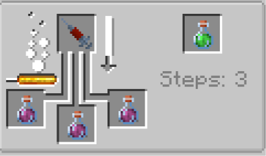

# Skill Point System

{ width="117" height="117" loading=lazy }

Skill Points System are how you upgrade your powers in the power menu. You gain Skill Points via;

* Gain SP Xp on kills, gaining xp on kills are target's Max Health/10 EXP
* Buying 1 Skill Point with 60 Minecraft Level
* Get 1 Skill Point by using Skill Catalyst
* Gain 2 SP Xp by using your abilities, 10 uses for each ability after 5 minute cooldown per ability
* Gain 1 SP Xp every 2 minute passively

Related Information

* The Skill Points and Levels are not transferred between power. Every power starts with Level 1 and 1 Skill Point
* **Max Level** for a power is 50. You can't gain more Skill Points via Level System once you reached max level except for buying them with vanilla levels or via catalyst.
* Buying Skill Points with **Vanilla Levels** does not change your Level.
* Getting Skill Points with **Skill Catalyst** does not change your Level.
* **Skill Catalysts** are a potion that can be crafted used any filled **power** syringe. You brew them with 1 **Filled Power Syringe** and Regeneration inside of Brewing Stand .You must have the effect for at least 1 full minute to gain the Free Skill Point. After using this, there will be a 5 minute cooldown before you can use another one. Current ways to get Skill Catalyst effects are;
  * Potion of Skill Catalyst
  * Splash Potion of Skill Catalyst
  * Lingering Potion of Skill Catalyst
  * Arrow of Skill Catalyst

    > { width="290" height="170" loading=lazy }
* Filled Power Syringes are obtained with right clicking a empty syringe while having any [Main Power](powers/main-powers/index.md). You are sacrificing a Power for Skill Points.
