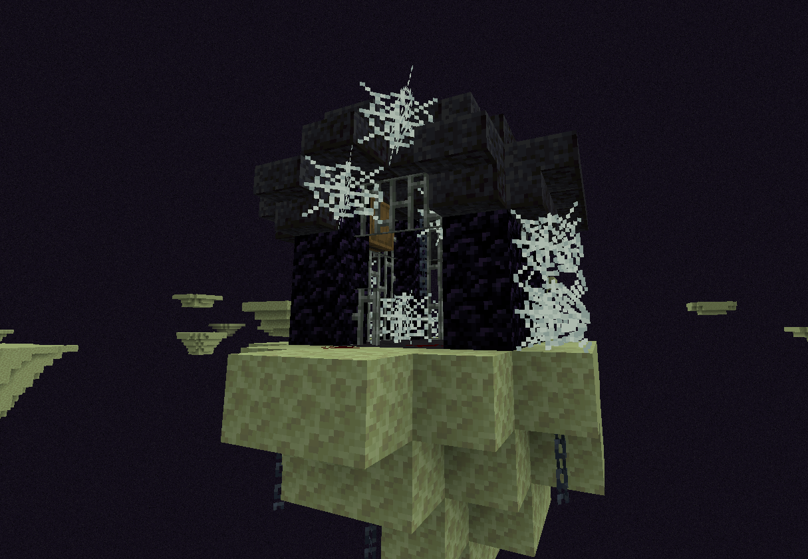

# Abandoned Prison

{ width="486" height="335" loading=lazy }

The **"Abandoned Prison"** structure can be found in the following biomes:

* minecraft:small_end_islands
* minecraft:end_midlands

Purpose:

* This structure contains a barrel, with loot that contains:
  * [ ] [Czarnian Fossil](../items/artifacts/fossils/czarnian.md)
  * [ ] Genetic Inhibitor Cuff
  * [ ] Netherite Scrap
  * [ ] Diamonds
  * [ ] Redstone Flux Crystal

Additional Information:

* With cheats enabled, you can use the "/locate structure fsang:abandoned_prison" command to find the nearest location to you.
* This Structure contains a floor made up of raw titanium blocks
