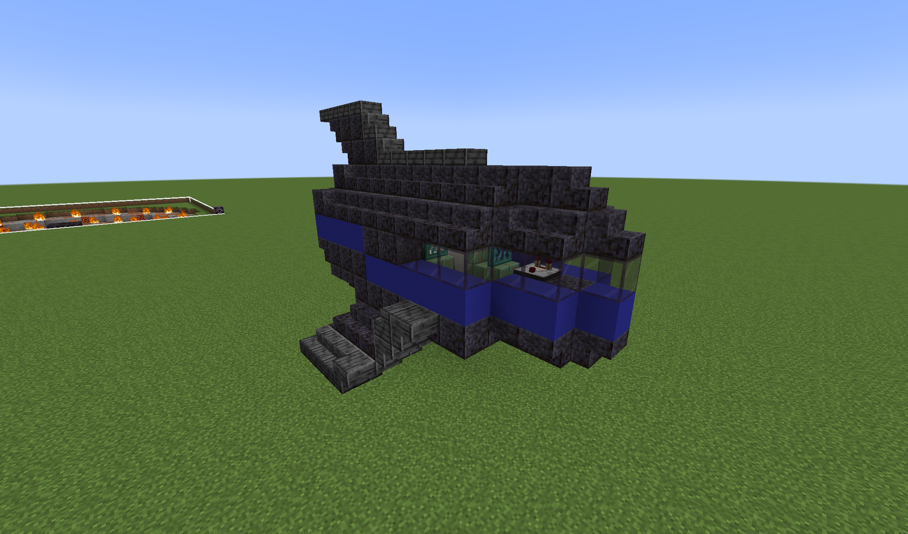
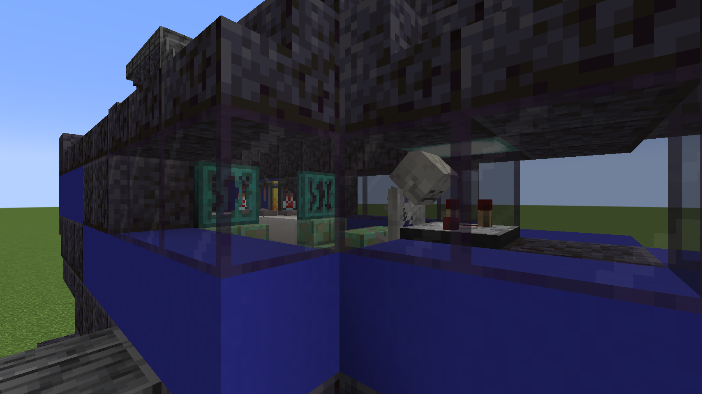

# Fallen Kree Ship

{ width="338" height="198" loading=lazy } { width="355" height="198" loading=lazy }

The "Fallen Kree Ship" structure can be found in the following biomes:

* minecraft:small_end_islands
* minecraft:end_midlands

Purpose:

* This ship contains a Skeleton (Kree) which, when broken, has the following chances to drop the following loot:

  | Loot Name | Percentage |
  |-----------|------------|
  | x1 [Kree Fossil](../items/artifacts/fossils/kree-fossil.md) | 40% |
  | x1 Bone | 90% |
  | x5 Bone | 40% |
  | x1 Bone Meal | 80% |
  | x3 Bone Meal | 50% |
  | x1 Gunpowder | 30% |
  | x3 Bone | 99% |

* This structure contains a chest with loot that contains:
  * Iron nugget
  * [Vibranium](../blocks/ores/vibranium.md) Nugget
  * Damaged Captain Marvel Suit
  * Rotten Flesh
  * [Iron Circuit](../items/technology/circuits/iron-circuit.md)

Additional Information:

* With cheats enabled, you can use the "/locate structure fsang:kree_ship" command to find the nearest location to you.
