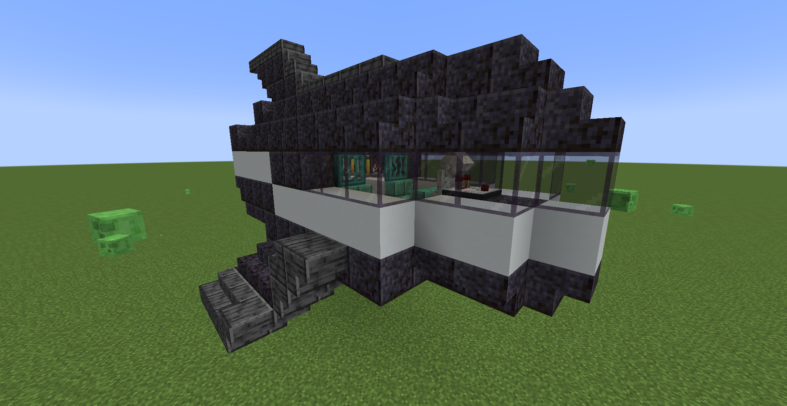

# Fallen Viltrumite Ship

{ width=410 height=211 loading=lazy }

The "Fallen Viltrumite Ship" structure can be found in the following biomes:

* minecraft:small_end_islands
* minecraft:end_midlands

Purpose:

* This ship contains a Skeleton (Viltrumite) which, when broken, has the following chances to drop the following loot:

  | Loot Name | Percentage |
  |-----------|------------|
  | x1 [Viltrumite Fossil](../items/artifacts/fossils/viltrumite-fossil.md) | 40% |
  | x1 Bone | 90% |
  | x5 Bone | 40% |
  | x1 Bone Meal | 80% |
  | x3 Bone Meal | 50% |
  | x1 Gunpowder | 30% |
  | x3 Bone | 99% |

* This structure contains a chest with loot that contains:
  * Iron nugget
  * Block of [Raw Titanium](../blocks/ores/titanium.md)
  * Damaged Viltrumite (Soldier) Suit
  * Rotten Flesh
  * [Iron Circuit](../items/technology/circuits/iron-circuit.md)

Additional Information:

* With cheats enabled, you can use the "/locate structure fsang:viltrumite_ship" command to find the nearest location to you.
